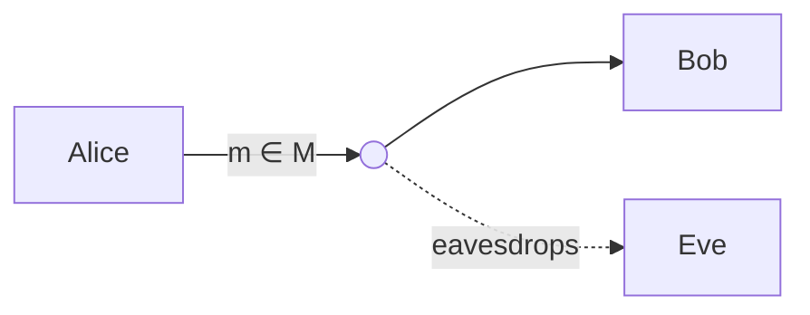
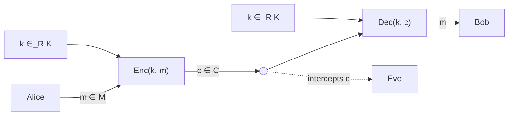

> **Note**: $\text{u.r.} \equiv \text{u.a.r.} \equiv \text{uniformly at random}$ #gemini

**provable security**: is the modern ($\geq 1950$) approach to cryptography (vs. $< 1950$: trial & error). We need to define what *secure* means and what is a *security proof*.
* **goal**: define secure communication.

**Prop 1: confidentiality**
* $A$ sends $m \in \mathcal{M}$ to $B$
* if $E$ intercepts the communication ($c$), she cannot read $m$

**Prop 2: integrity**
* $A$ sends $m \in \mathcal{M}$ to $B$
* $E$ *intercepts* $m$ and sends $m' \neq m$ to $B$
* $B$ detects tampering (does not accept $m'$ as $m$)

**Goal**: create systems consistent with prop. 1 and prop. 2.

**private-key**/shared-key/secret-key: two parties sharing a key, used to communicate secretly.
* **book**: says to assume that key was shared in a secure way. #gemini

## SKE (Secret Key Encryption)
**unconditional security**: prove security without assumptions
* treatment due to Claude Shannon

**cryptographic primitive**: encryption, is the primitive that allows **confidentiality**

> **dictionary**, *confidentiality*: state, practice, or principle of keeping private some kind of information to restrict access to authorized individuals. #gemini

* $k \in \mathcal{K}$: shared between $A$ and $B$, must be *unpredictable*.
* $m \in \mathcal{M}$ and $c \in \mathcal{C}$
* $\Pi = (\text{Enc}, \text{Dec})$.

**assumption**: $k$ uniformly random, unknown to $E$.

> **book**: $\text{Gen}$ is the *probabilistic* key generation algorithm. Outputs $k$ according to some distribution, almost always a *uniform distribution*. #gemini

**assumption**: everyone knows $\Pi$, but no one (except $A, B$) should know $k$.

> **book**, Kerckhoffs's Principle: *The cipher method must not be required to be secret, and it must be able to fall into the hands of the enemy without inconvenience.* #gemini

**note**: a key is easier to keep secret than a complex algorithm $\Pi$. If key is broken, then $A,B$ can choose another one. #gemini

**def**:
* $\text{Enc}: \mathcal{K} \times \mathcal{M} \to \mathcal{C}$
* $\text{Dec}: \mathcal{K} \times \mathcal{C} \to \mathcal{M}$

**correctness**: $\forall k \in \mathcal{K}, \forall m \in \mathcal{M}: \text{Dec}(k, \text{Enc}(k,m)) = m$.
* ex: identity function ($\text{Enc}(k,m)=m$) is correct, but not secure.

**def. secure encryption for symmetric encryption**: ciphertext $c$ leaks no additional information about plaintext $m$, even against an unbounded adversary.
* **Shannon**: gives an information-theoretic definition independent from any adversary $\mathcal{A}$ (and its computational resources): observing $c$ does not change the a priori probability of $m$.

> **book**: regardless of any information an attacker already has, a ciphertext should leak no additional information about the plaintext. #gemini

> **book**, interesting notes about proving security: a proof of security is always relative to the definition and assumptions considered. So a sec. proof might not imply real world security. #gemini

**def. perfect secrecy assumptions**:
* Let $M$ be a distribution on $\mathcal{M}$ (independent of $K$). Definition holds for any distribution
* Let $K$ be the uniform distribution on $\mathcal{K}$
* Then $C = \text{Enc}(K,M)$ is a distribution on $\mathcal{C}$.
	* here $\text{Enc}$ is deterministic (randomness of $C$ comes from $K, M$)

**def. perfect secrecy claim**:
* $\Pi$ is perfectly secret if
	* for every distribution $M$
	* for every $m \in \mathcal{M}$
	* for every $c \in \mathcal{C}$ with $\Pr[C = c] > 0$
* with $\Pr[M=m]$, **a priori probability**: probability that the message sent by Alice is $m$, even before Alice **wakes up**
* $\Pr[M=m] = \Pr[M = m \mid C=c]$.
* with $\Pr[M=m \mid C=c]$, **a posteriori probability**: probability that the plaintext is $m$ given $c$.
	* ciphertext tells us nothing about the plaintext

**does there exist an algorithm that satisfies perfect secrecy**? yes, but at a high price.

**thm**: the following statements are equivalent:
1. perfect secrecy
2. $M, C$ independent distributions, $I(M; C)=0$
	1. $\forall m \in \mathcal{M}, \forall c \in \mathcal{C}: \Pr[M=m \land C=c] = \Pr[M=m]\cdot\Pr[C=c]$, so knowing $C$ gives zero mutual information on $M$ (no statistical relation between $M$ and $C$). #gemini
3. $\forall m,m' \in \mathcal{M}, \forall c \in \mathcal{C}$ then $\Pr[\text{Enc}(K,m)=c] = \Pr[\text{Enc}(K,m')=c]$
	1. every $m \in \mathcal{M}$ has the same probability of **producing** the ciphertext $c$.
	2. prob. taken over $K$ u.r. (random over $\mathcal{K}$)

> [!warning] Exam trap: $\Pr[\text{Enc}(K,m)=c]$ vs. $\Pr[M=m \mid C=c]$ #gemini
> Property 3 means every $m$ is equally likely to **encrypt to $c$** under uniform $K$. It does **not** mean every $m$ has the same probability of *being* the original plaintext given $c$: $\Pr[M=m \mid C=c] = \Pr[M=m]$ still depends on the prior distribution $M$ (uniform only if $M$ itself is uniform).

![[lez1_perfect_secrecy_mapping.png]] #gemini

> [!note] exercise
> read again and again the definitions. understand!

**application of thm**: OTP (One-Time Pad) achieves perfect secrecy.
* $\oplus \equiv \text{XOR}$
* $\mathcal{K}, \mathcal{M}, \mathcal{C} = \{ 0,1 \}^\ell$
* $\text{Enc}(k,m)= k \oplus m$
* $\text{Dec}(k,c) = k \oplus c$
* **correctness proof**: $\text{Dec}(k, \text{Enc}(k,m)) = k \oplus (k \oplus m) = (k \oplus k) \oplus m = m$

**corollary**: OTP is perfectly secret
* for any $m \in \mathcal{M}$ and $c \in \mathcal{C}$, both fixed.
* $\Pr[\text{Enc}(K,m)=c] = \Pr[K \oplus m = c] = \Pr[K = c \oplus m] = 2^{-\ell}$ where $c \oplus m$ is just a fixed string
	* note that $K$ is u.r. over $\mathcal{K}$
* **and so**, similarly, for any $m'$ fixed: $\Pr[\text{Enc}(K,m')=c]=2^{-\ell}$. $\square$

**the limitations**:
1. length of $k$ same as $m$ ($|k| = |m| = \ell$), because you have to do bitwise XOR.
2. **key can only be used once**:
	1. $c_{1} = k \oplus m_{1}$
	2. $c_{2} = k \oplus m_{2}$
	3. $c_{1} \oplus c_{2} = m_{1} \oplus m_{2} \oplus k \oplus k = m_{1} \oplus m_{2}$ (since $k \oplus k = 0^\ell$)
	4. **note**: perfect secrecy does not mean that $k \in \mathcal{K}$ can be reused. #gemini

![[lez1_otp_two_time_pad.png]] #gemini

**problem**: perfect secrecy is too strong. It does not bound the computational power of the adversary (allows unbounded $\mathcal{A}$).
* perfect secrecy implies the two limitations seen above.

**proof thm**:
* $1 (\text{perfect secrecy}) \implies 2 (I(M; C)=0)$:
	* **by perfect secrecy** (for $\Pr[C=c] > 0$): $\Pr[M=m] = \Pr[M=m \mid C=c]$
	* **by def. of cond. prob.**: $\Pr[M=m \mid C=c] = \frac{\Pr[M=m \land C=c]}{\Pr[C=c]}$
	* $\implies \Pr[M=m \land C=c] = \Pr[M=m]\cdot\Pr[C=c]$ (also holds trivially as $0=0$ if $\Pr[C=c]=0$)
	* So $M$ and $C$ are **independent** by def. of independence. $\square$
	* **Note**: $I(M; C)=0 \equiv M, C \text{ have independent distributions}$ #gemini
* $2 (I(M; C)=0) \implies 3 (\Pr[\text{Enc}(K,m)=c] = \Pr[\text{Enc}(K,m')=c])$:
	* $(\text{2.1}) \; \Pr[\text{Enc}(K,m)=c] = \Pr[\text{Enc}(K,M) = c \mid M = m]$ (since $K$ and $M$ are independent)
	* $\text{Enc}(K,M) = C$. $C$ is a distribution over $K,M$ obtained applying $\text{Enc}$ deterministic.
	* $(\text{2.1}) = \Pr[C=c \mid M=m]$
	* $= \Pr[C=c]$ (since $M$ and $C$ are independent by hp. 2)
	* **by the same steps**, choosing $m'$: $\Pr[\text{Enc}(K,m')=c] = \Pr[C=c]$
	* **we conclude that**: $\Pr[\text{Enc}(K,m')=c] = \Pr[\text{Enc}(K,m)=c]$
	* $\square$

> [!warning] Exam trap: $K \perp M$ vs. $M \perp C$ #gemini
> Step $(\text{2.1})$ uses **$K$ independent of $M$** (key generated independently of the message—always true in SKE), whereas $\Pr[C=c \mid M=m] = \Pr[C=c]$ uses **$M$ independent of $C$** (hypothesis 2).

* $3 (\Pr[\text{Enc}(K,m)=c] = \Pr[\text{Enc}(K,m')=c]) \implies 1 (\text{perfect secrecy})$:

$3 \implies 1$, we first show that $\Pr[C=c \mid M=m] = \Pr[C=c]$:
* $\Pr[C=c] = \sum_{m'} \Pr[C=c \land M = m'] = \sum_{m'} \Pr[C=c \mid M=m'] \cdot \Pr[M=m']$
* $= \sum_{m'} \Pr[\text{Enc}(K,M)=c \mid M=m'] \cdot \Pr[M=m']$
	* switch $C$ with $\text{Enc}(K,M)$
* $= \sum_{m'} \Pr[\text{Enc}(K,m')=c] \cdot \Pr[M=m']$.
	* since $K \perp M$, instead of $M$ we have a fixed $m'$.
	* I can switch $m'$ with fixed $m$ because $\forall m,m': \Pr[\text{Enc}(K,m')=c] = \Pr[\text{Enc}(K,m)=c]$ (**by property 3**)
* $= \sum_{m'} \Pr[\text{Enc}(K,m)=c] \cdot \Pr[M=m']$ (obtained **by property 3**)
* $= \Pr[\text{Enc}(K,m)=c] \underbrace{\sum_{m'}\Pr[M=m']}_{=1}$
* $= \Pr[\text{Enc}(K,m)=c] = \Pr[\text{Enc}(K,M)=c \mid M=m] = \Pr[C=c \mid M=m]$
* so $\Pr[C=c] = \Pr[C=c \mid M=m]$

> [!warning] Exam trap: probabilities vs. deterministic outputs #gemini
> Property 3 states $\Pr[\text{Enc}(K,m')=c] = \Pr[\text{Enc}(K,m)=c]$ (over random $K$), **not** $\text{Enc}(k,m') = \text{Enc}(k,m)$ for a fixed $k$ (which would break decryption correctness when $m \neq m'$).

$3 \implies 1$ we can continue (for $\Pr[C=c] > 0$):
* **by Bayes**: $\Pr[M=m \mid C=c]\cdot \Pr[C=c]$
	* we can rewrite $\Pr[M=m \land C=c]$ using $\Pr[C \mid M]$
* $= \Pr[M=m \land C=c] = \Pr[C=c \mid M=m] \cdot \Pr[M=m]$
* $\Pr[M=m] = \frac{\Pr[M=m \mid C=c] \cancel{\Pr[C=c]}}{\cancel{\Pr[C=c \mid M=m]}} = \Pr[M=m \mid C=c]$
* $\square$
