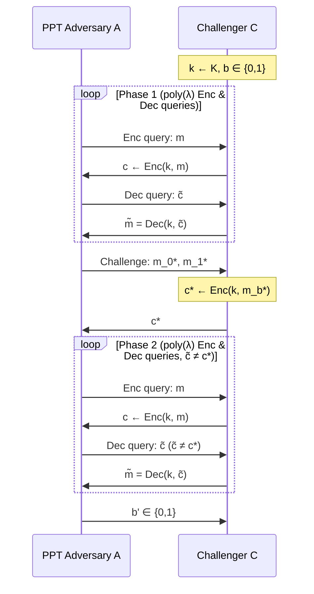
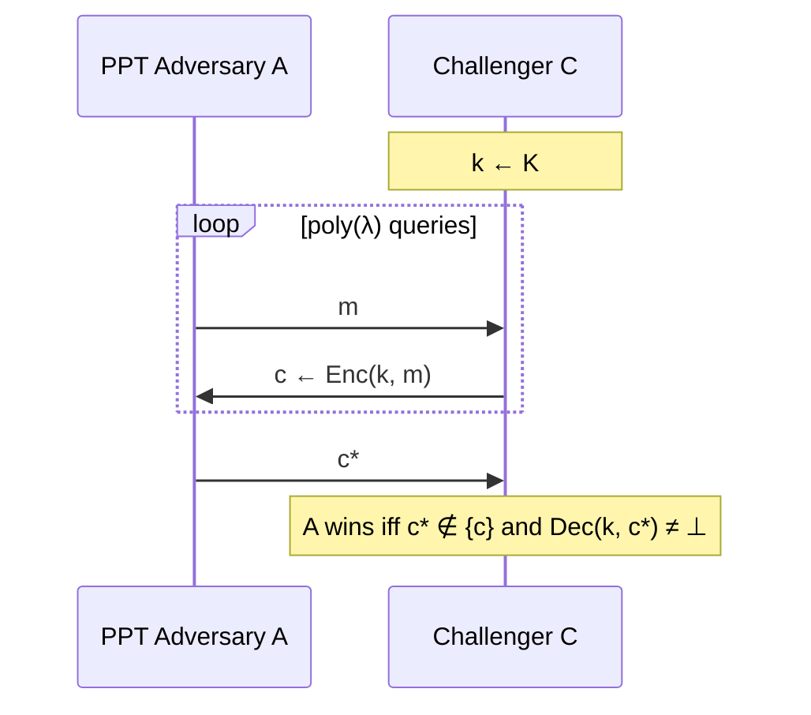
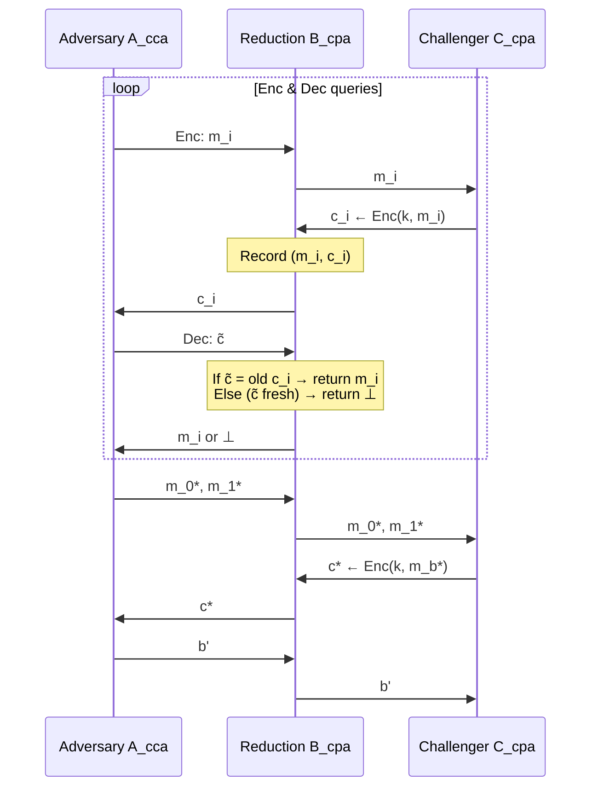

> [!info] References #gemini
> * **Course Slides**: Daniele Venturi, [Lecture 12 — Authenticated Encryption & CCA Security](https://dventuri83.github.io/assets/pdf/crypto_lecture12_2627.pdf) #gemini
> * **Reference Notes**: Simone Bianco, [Cryptography](https://github.com/Exyss/university-notes/raw/main/Master/Cryptography/Cryptography.pdf), Sec. 4.5 (pp. 50–55) #gemini

# Authenticated Encryption
**goals**: build a system that ensures **secrecy** and **authenticity** at the same time.
* **note**: until today we treated message secrecy and authenticity as separate goals.
* Doing both builds a **secure channel** (used widely, e.g., TLS 1.3 or VPNs). #gemini

**def (informal)**: #gemini
* **goal**: hide the message **and** ensure that nobody **tampers** with it.
* All what we studied so far fails! E.g., for $c=(c_{1},c_{2}) = (r, F_{k}(r) \oplus m)$: #gemini

**malleability**: $\tilde c_{2} = c_{2} \oplus 0^{n-1}1 = F_{k}(r) \oplus (m \oplus 0^{n-1}1)$
* flip the last bit: changing a bit in the ciphertext changes the corresponding bit of the plaintext.

**malleability attack**: by changing ciphertext $c$ we obtain an encryption $\tilde{c}$ of a message $\tilde m$ related to $m$ in a non-trivial way. Many real-world applications:
* **Digital auctions** (bidding slightly higher than an encrypted bid without decrypting it). #gemini
* **Bleichenbacher attack against TLS** (malleability of RSA, seen in a later lecture). #gemini

**non-malleable encryption**: above attacks are impossible in a *general sense* (= impossible to create an attack for any non-trivial relation).

---

## CCA Security (Slides 4–6; Bianco Def. 4.13) #gemini

**def**: **CCA-secure encryption** (implies non-malleability): same as CPA security ($\text{Game}_{\Pi, \mathcal{A}}^{\text{cca}}(\lambda, 0) \approx_c \text{Game}_{\Pi, \mathcal{A}}^{\text{cca}}(\lambda, 1)$), but $\mathcal{A}$ also gets a **decryption oracle** $\text{Dec}(k, \cdot)$ (except on the challenge $c^*$). #gemini

* **What $\mathcal{A}$ can do & Phases of $\text{Game}_{\Pi,\mathcal A}^{\text{cca}}(\lambda, b)$**: #gemini
	1. **Setup**: $\mathcal{C}$ samples $k \gets \mathcal{K}$ and fixes $b \in \{0,1\}$. #gemini
	2. **Phase 1 (Queries)**: $\mathcal{A}$ adaptively makes $\text{poly}(\lambda)$ **encryption queries** ($m \to c \gets \text{Enc}(k, m)$) and **decryption queries** ($\tilde{c} \to \tilde{m} = \text{Dec}(k, \tilde{c})$). #gemini
	3. **Challenge**: $\mathcal{A}$ submits $m_0^*, m_1^*$ ($|m_0^*| = |m_1^*|$); $\mathcal{C}$ returns $c^* \gets \text{Enc}(k, m_b^*)$. #gemini
	4. **Phase 2 (Queries)**: $\mathcal{A}$ makes further encryption queries and decryption queries on any **$\tilde{c} \neq c^*$**. #gemini
	5. **Output**: $\mathcal{A}$ outputs a guess $b' \in \{0,1\}$. #gemini

**(Slide 6) Exercise**: the PRF-based SKE $c = (c_{1}=r,\; c_{2}=F_{k}(r) \oplus m)$ is **not** CCA-secure.
* **Solution (Slide 6)**: upon receiving challenge $c^* = (c_1^*, c_2^*)$, $\mathcal{A}$ queries the Phase 2 decryption oracle on $\tilde{c} = (c_1^*,\; c_2^* \oplus 0^{n-1}1) \neq c^*$, receives $\tilde{m} = m_b^* \oplus 0^{n-1}1$, and recovers $m_b^* = \tilde{m} \oplus 0^{n-1}1$ with probability $1$. #gemini

**non-malleability of CCA**: is implied — if $\mathcal{A}$ can flip bits and observe relations via $\text{Dec}(k, \cdot)$, $\mathcal{A}$ easily breaks the CCA game.

---

## Ciphertext Integrity / Authenticity & $\text{CPA} + \text{AUTH} \implies \text{CCA}$ #gemini

**construction**: based on 2 properties (Slides 7–8; Bianco Def. 4.14):
1. **CPA security**
2. **Authenticity (Ciphertext Integrity)**

> **note**: $\text{CPA security} + \text{Authenticity} \implies \text{CCA security}$ #gemini

Let $\text{Dec}: \mathcal K \times \mathcal C \to \mathcal M \cup \{ \bot \}$, where $\bot$ means **"decryption error"**. #gemini
* We define $\text{Game}_{\Pi,\mathcal A}^\text{auth}(\lambda)$ (Slide 8; called $\text{Game}_{\Pi,\mathcal{A}}^{\text{INT}}(\lambda)$ in Bianco p. 51): #gemini
	* $\mathcal A$ makes $q = \text{poly}(\lambda)$ encryption queries $m_i$ and $\mathcal C$ replies with $c_i \gets \text{Enc}(k, m_i)$. #gemini
	* $\mathcal A$ outputs a candidate ciphertext $c^*$ and **wins** iff: #gemini
		1. $c^* \notin \{c_1, \dots, c_q\}$ ($c^*$ is **fresh**), and #gemini
		2. $\text{Dec}(k, c^*) \neq \bot$ ($c^*$ is **valid**). #gemini
* $\Pi$ has **authenticity / integrity** if $\forall \text{ PPT } \mathcal{A}: \Pr[\text{Game}_{\Pi,\mathcal{A}}^{\text{auth}}(\lambda) = 1] \le \text{negl}(\lambda)$. #gemini

**thm (Slides 9–11; Bianco Thm. 4.6)**: $\text{CPA} + \text{AUTH} \implies \text{CCA}$
* **intuition**: since $\text{AUTH}$ holds, any fresh ciphertext $\tilde{c}$ queried to $\text{Dec}(k, \cdot)$ decrypts to $\bot$ (except with negligible probability), so decryption queries are **useless**! Thus CCA reduces to CPA. #gemini

**Reduction sketch (Slides 9–11)**: entities $\mathcal A_{\text{cca}}$, $\mathcal B_{\text{cpa}}$, $\mathcal C_{\text{cpa}}$:
* **Encryption queries**: $\mathcal A_{\text{cca}}$ sends $m_i \to \mathcal B_{\text{cpa}}$ forwards $m_i \to \mathcal C_{\text{cpa}}$ returns $c_i \to \mathcal B_{\text{cpa}}$ records $(m_i, c_i)$ and returns $c_i$ to $\mathcal A_{\text{cca}}$. #gemini
* **Decryption queries (48:00 — how $\mathcal{B}_{\text{cpa}}$ simulates $\text{Dec}$ without $k$)**: when $\mathcal A_{\text{cca}}$ queries $\tilde{c}$: #gemini
	* If $\tilde{c} = c_i$ is an **"old" ciphertext** from a previous encryption query $(m_i, c_i)$, $\mathcal B_{\text{cpa}}$ already knows $m_i$ and replies with $m_i$. #gemini
	* Otherwise ($\tilde{c} \notin \{c_i\}$ is **fresh**), $\mathcal B_{\text{cpa}}$ replies with $\bot$ (guessing it is invalid by AUTH!). #gemini
* **Challenge & Phase 2**: $\mathcal A_{\text{cca}}$ sends $m_{0}^*, m_{1}^* \to \mathcal B_{\text{cpa}}$ forwards to $\mathcal C_{\text{cpa}} \to$ returns $c^*$; Phase 2 queries are answered the same way, and $\mathcal B_{\text{cpa}}$ outputs $\mathcal A_{\text{cca}}$'s guess $b'$. #gemini

Let $\text{BAD}$ be the event (Slide 11):
* $\exists \tilde{c}_{i}$ queried by $\mathcal{A}_{\text{cca}}$ s.t. $\tilde{c}_{i}$ is **FRESH** ($\tilde{c}_i \notin \{c\}$) **and VALID** ($\text{Dec}(k, \tilde{c}_i) \neq \bot$) — i.e., the only case where $\mathcal{B}_{\text{cpa}}$'s simulated answer $\bot$ differs from the real $\text{Dec}(k, \tilde{c}_i)$! #gemini

$$
\text{Pr}[\mathcal A \text{ wins}] \leq \underbrace{\text{Pr}[\mathcal A \text{ wins} \land \text{BAD}]}_{\le \varepsilon_{\text{auth}}} + \underbrace{\text{Pr}[\mathcal A \text{ wins} \land \overline{\text{BAD}}]}_{\le \varepsilon_{\text{cpa}}} \leq \varepsilon_{\text{auth}} + \varepsilon_{\text{cpa}}
$$

> [!warning] Complex Topic — Study on Your Own: Full Two-Claim Proof of $\text{CPA} + \text{AUTH} \implies \text{CCA}$ #gemini
> * **What to study**: How Bianco's formal proof splits this into a hybrid game $H(\lambda, b)$ (where $\text{Dec}$ returns $m_i$ on old $c_i$ and $\bot$ on fresh $\tilde{c}$), proving Claim 1 ($H(\lambda,0) \approx_c H(\lambda,1)$ via CPA) and Claim 2 ($\text{Game}^{\text{cca}}(\lambda,b) \approx_c H(\lambda,b)$ via a reduction $\mathcal{B}'$ to AUTH that guesses which of the $q$ decryption queries $\tilde{c}_j$ is the first valid forgery with probability $1/q$). #gemini
> * **References**: Venturi [Lecture 12 Slides](https://dventuri83.github.io/assets/pdf/crypto_lecture12_2627.pdf), pp. 9–11; Bianco [Cryptography](https://github.com/Exyss/university-notes/raw/main/Master/Cryptography/Cryptography.pdf), Theorem 4.6 (pp. 51–53). #gemini

---

## Combining SKE with MAC: How to Get (1) + (2) (Slides 12–14; Bianco pp. 53–54) #gemini

1. **A) Encrypt-and-Authenticate (E&M)**: $c \gets \text{Enc}(k_{1},m)$, $\tau \gets \text{Tag}(k_{2},m)$, output $c'=(c,\tau)$.
	* **CCA-secure?** **Not always!** A secure MAC only guarantees unforgeability, **not secrecy** of $m$. #gemini
	* **Counterexample (Slide 12–13)**: if $\text{Tag}(k_2, m) = m[0] \,\|\, \tau'$ where $\tau'$ is a secure tag on $m$, it is still UF-CMA secure, but $\tau$ reveals the first bit $m[0]$ of $m$ in the clear (breaking even CPA!). #gemini
2. **B) Authenticate-then-Encrypt / MAC-then-Encrypt (MtE)**: $\tau \gets \text{Tag}(k_{2},m)$, $c\gets \text{Enc}(k_{1},m \,\|\, \tau)$.
	* Used in TLS 1.2, but **not generally CCA-secure** (Slide 13). #gemini
	* > [!warning] Exercise — Break MAC-then-Encrypt (Slide 13) #gemini
	  > * **What to study**: Construct a CPA-secure $\text{Enc}$ + UF-CMA $\text{Tag}$ where MtE fails CCA security (hint: use a malleable/bit-flipping or padding-oracle attack via the decryption oracle $\text{Dec}'$, which must decrypt $c$ *before* checking $\tau$). #gemini
3. **C) Encrypt-then-MAC (EtM — the correct way, Slide 14)**:
	1. $c \gets \text{Enc}(k_{1},m)$
	2. $\tau \gets \text{Tag}(k_{2}, c)$
	3. $c'=(c,\tau)$ *(proven CCA-secure in Lez. 13 Part 1)*. #gemini
