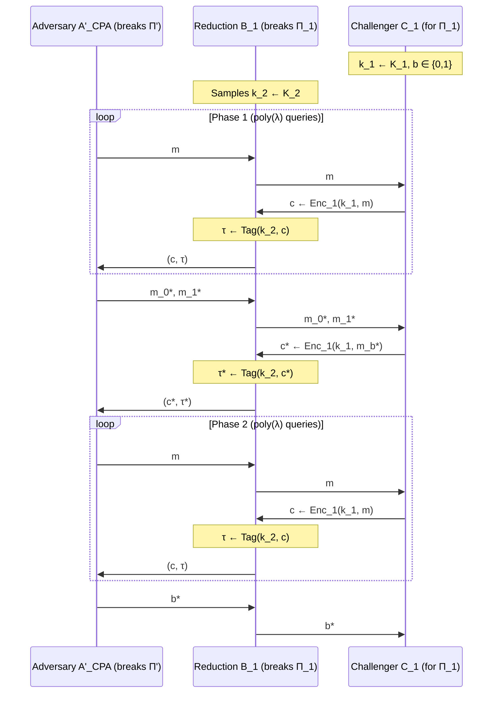
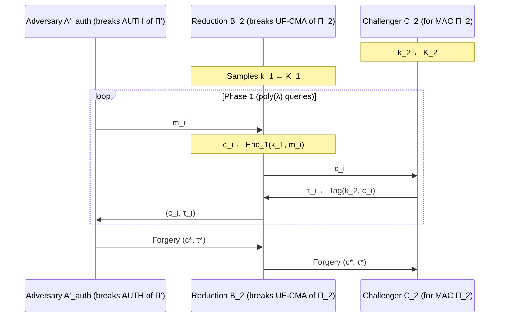

> [!info] References #gemini
> * **Course Slides**: Daniele Venturi, Lecture 13 *(slides not uploaded yet)* #gemini
> * **Reference Notes**: Simone Bianco, [Cryptography](https://github.com/Exyss/university-notes/raw/main/Master/Cryptography/Cryptography.pdf), Sec. 4.5, Theorem 4.7 & Corollary 4.1 (pp. 54–56) #gemini

**Construction $(C)$ — Encrypt-then-MAC (EtM)**: #gemini
1. $c \gets \text{Enc}_{1}(k_{1},m)$
2. $\tau \gets \text{Tag}(k_{2}, c)$
3. $c'=(c,\tau)$

**thm (Bianco Thm. 4.7 & Cor. 4.1)**: construction $(C)$ (prev. lecture) yields a **CCA-secure** SKE assuming: #gemini
* $\Pi_{1} = (\text{Enc}_{1}, \text{Dec}_{1})$ is **CPA-secure**
* $\Pi_{2} = \text{Tag}$ is **UF-CMA** (with **unique tags**, or **strong UF-CMA**) #gemini

**proof**: by the previous theorem ($\text{CPA} + \text{AUTH} \implies \text{CCA}$), it suffices to show $\Pi'=(\text{Enc}',\text{Dec}')$ satisfies both **CPA-security** (Claim 1) and **Ciphertext Integrity / AUTH** (Claim 2), where $k'=(k_{1},k_{2})$: #gemini
* $\text{Enc}'((k_{1},k_{2}),m) = (c, \tau)$ with $c \gets \text{Enc}_1(k_1, m)$ and $\tau \gets \text{Tag}(k_2, c)$ #gemini
* $\text{Dec}'(k',c')$: parse $c' = (c, \tau)$; if $\text{Tag}(k_{2},c)\neq \tau$ output $\bot$, else output $m=\text{Dec}_1(k_1,c)$ #gemini

---

## Claim 1: $\Pi'$ is CPA-secure (Reduction to $\Pi_{1}$) #gemini
* $\mathcal A'_{\text{CPA}}$ wants to attack CPA of $\Pi'$.
* $\mathcal A'_{\text{CPA}}$ plays against $\mathcal B_{1}$ (who simulates $\Pi'$). #gemini
* $\mathcal B_{1}$ plays against $\mathcal C_{1}$ (the CPA challenger for $\Pi_1$). #gemini
* $\mathcal B_{1}$ wants to break CPA of $\Pi_{1}$. #gemini

> [!note] Answers — Entities, Goals & What Reduction 1 Proves #gemini
> * **What this reduction proves**: $\Pi'$ is CPA-secure (if $\mathcal{A}'_{\text{CPA}}$ broke $\Pi'$, $\mathcal{B}_1$ would break $\Pi_1$, contradicting that $\Pi_1$ is CPA-secure). #gemini
> * **$\mathcal{C}_1$ (CPA Challenger for $\Pi_1$)**: holds $k_1 \gets \mathcal{K}_1$ and $b \in \{0,1\}$; answers $\text{Enc}_1(k_1, \cdot)$ queries from $\mathcal{B}_1$. #gemini
> * **$\mathcal{A}'_{\text{CPA}}$ (Adversary against $\Pi'$)**: expects EtM ciphertexts $(c, \tau)$ and tries to guess $b$. #gemini
> * **$\mathcal{B}_1$ (Reduction)**: doesn't know $k_1$, so it forwards $m$ to $\mathcal{C}_1$ to get $c$, **samples its own $k_2 \gets \mathcal{K}_2$** to compute $\tau \gets \text{Tag}(k_2, c)$, and sends $(c, \tau)$ to $\mathcal{A}'_{\text{CPA}}$. Finally, $\mathcal{B}_1$ outputs $\mathcal{A}'_{\text{CPA}}$'s guess $b^*$ to $\mathcal{C}_1$. #gemini

**game alg phase 1**:
* $\mathcal A'_{\text{CPA}}$ sends $m$ queries as many as he wants
* $\mathcal B_{1}$ chooses $k_{2}$ and forwards message $m$ to $\mathcal C_1$
* $\mathcal C_1$ sends $c \gets \text{Enc}_1(k_1, m)$ to $\mathcal B_{1}$
* $\mathcal B_{1}$ computes $\tau \gets \text{Tag}(k_2, c)$ and sends $(c,\tau)$ to $\mathcal A'_{\text{CPA}}$ #gemini

**game alg phase 2**:
* $\mathcal A'_{\text{CPA}}$ sends $m_{0}^*,m_{1}^*$, $\mathcal B_1$ forwards to $\mathcal C_1$
* $\mathcal C_1$ sends $c^*$ and $\mathcal B_1$ computes $\tau^* \gets \text{Tag}(k_2, c^*)$ and forwards $(c^*,\tau^*)$ #gemini

**game alg phase 3**:
* $\mathcal A'_{\text{CPA}}$ does other queries and outputs $b^*$, which $\mathcal B_1$ forwards to $\mathcal C_1$.

---

## Claim 2: $\Pi'$ has Ciphertext Integrity / AUTH (Reduction to $\Pi_2$) #gemini
* $\mathcal A'_{\text{auth}}$ makes encryption queries $m_i$ and receives $(c_i, \tau_i)$
	* **goal**: forge a valid fresh ciphertext $(c^*, \tau^*) \notin \{(c_1, \tau_1), \dots, (c_q, \tau_q)\}$ such that $\text{Dec}'(k', (c^*, \tau^*)) \neq \bot$ (i.e., $\text{Tag}(k_2, c^*) = \tau^*$). #gemini

**game alg phase 1**:
* $\mathcal A'_{\text{auth}}$ sends $m_i$ poly queries; $\mathcal B_2$ samples $k_1 \gets \mathcal{K}_1$, computes $c_i \gets \text{Enc}_1(k_{1},m_i)$, and forwards $c_i$ to $\mathcal C_2$ #gemini
* $\mathcal C_2$ sends $\tau_i \gets \text{Tag}(k_2, c_i)$, $\mathcal B_2$ sends $(c_i,\tau_i)$ to $\mathcal A'_{\text{auth}}$ #gemini

**game alg phase 2**:
* $\mathcal A'_{\text{auth}}$ sends $(c^*,\tau^*)$ #gemini
* $\mathcal A'_{\text{auth}}$ wins AUTH if $(c^*,\tau^*)$ is valid and **fresh as a pair**: $(c^*, \tau^*) \notin \{(c_i, \tau_i)\}$. #gemini
* $\mathcal B_{2}$ wins standard UF-CMA only so long as **$c^*$ itself is fresh**: $c^* \notin \{ c_i \}$. #gemini
* So the reduction could fail if $c^* = c_i$ for some old query $i$, but with a **new valid tag** $\tau^* \neq \tau_i$! #gemini

> [!warning] Why Reduction 2 Could Fail & How the 2 Fixes Work #gemini
> * **What fails**: $\mathcal{A}'_{\text{auth}}$ only needs the **pair** $(c^*, \tau^*) \notin \{(c_i, \tau_i)\}$ to be new. If $\text{Tag}$ allows multiple valid tags for the same $c_i$, $\mathcal{A}'_{\text{auth}}$ can output $(c_i, \tau^*)$ with $\tau^* \neq \tau_i$: $\mathcal{A}'_{\text{auth}}$ **wins AUTH**, but since $c^* = c_i$ was already queried to $\mathcal{C}_2$, $\mathcal{B}_2$ **loses standard UF-CMA**! #gemini
> * **Fix 1 — Strong UF-CMA (sUF-CMA)**: A stronger MAC definition where the adversary wins even by finding a **new valid tag $\tau^* \neq \tau_i$ on an old message $c_i$** (freshness is $(c^*, \tau^*) \notin \{(c_i, \tau_i)\}$, matching AUTH). #gemini
> * **Fix 2 — Unique tags** (Bianco p. 54): For every $(k_2, c)$, there is a **unique** valid $\tau$ (deterministic $\text{Tag}$). Then $c^* = c_i \implies \tau^* = \tau_i \implies (c^*, \tau^*) = (c_i, \tau_i)$ (impossible), so $c^* \notin \{c_i\}$ is guaranteed! (Note: UF-CMA + unique tags $\implies$ sUF-CMA.) $\square$ #gemini

---

## Summary & How to Build Attack Games / Reductions Intuitively #gemini

> [!summary] Big Picture — What We Did & Why We Need Attack Games #gemini
> 1. **Goal**: Build **Authenticated Encryption (CCA-secure SKE)** $\Pi'$ that guarantees both **secrecy** and **integrity/non-malleability**. #gemini
> 2. **Strategy**: From Lez. 12, $\text{CPA} + \text{AUTH} \implies \text{CCA}$. Here we showed **Encrypt-then-MAC (EtM)** achieves both **CPA** (from $\Pi_1$) and **AUTH** (from $\Pi_2$). #gemini
> 3. **Why attack games?**: Security cannot be defined by "no attacker can recover $k$"; games formalize **exact adversary power** (queries/oracles) and **winning condition** (distinguishing $b \in \{0,1\}$ or forging $(c^*, \tau^*)$), turning security into a mathematical statement $\Pr[\mathcal{A} \text{ wins}] \le \text{negl}(\lambda)$. #gemini

> [!tip] Recipe for Building Any Reduction ($\mathcal{A} \leftrightarrow \mathcal{B} \leftrightarrow \mathcal{C}$) #gemini
> Whenever you want to prove **"$X$ is secure assuming $Y$ is secure"**: #gemini
> 1. **Assume by contradiction** there is a PPT adversary $\mathcal{A}$ that breaks $X$ (sits on the **left**, plays the $X$-game). #gemini
> 2. **Place the Challenger $\mathcal{C}$ for $Y$** on the **right** (holds the secret key of $Y$ that you want to break, plays the $Y$-game). #gemini
> 3. **Put Reduction $\mathcal{B}$ in the middle**: $\mathcal{B}$ acts as the **challenger of $X$** toward $\mathcal{A}$, and as the **adversary of $Y$** toward $\mathcal{C}$: #gemini
>    * **Which keys does $\mathcal{B}$ know?** $\mathcal{B}$ **never** knows $\mathcal{C}$'s secret key (for $Y$), so whenever $\mathcal{B}$ needs $Y$ evaluated, it **queries $\mathcal{C}$**. Any *other* keys in $X$ (e.g., $k_2$ in Claim 1, or $k_1$ in Claim 2) are **sampled by $\mathcal{B}$ itself**! #gemini
>    * **Check the winning condition**: verify that whenever $\mathcal{A}$ wins the $X$-game, $\mathcal{B}$'s forwarded output also satisfies $\mathcal{C}$'s winning condition in the $Y$-game (if there is a mismatch, like $(c^*, \tau^*)$ vs $c^*$ in Claim 2, strengthen the assumption!). #gemini
