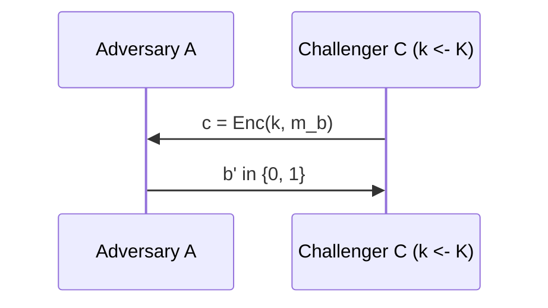
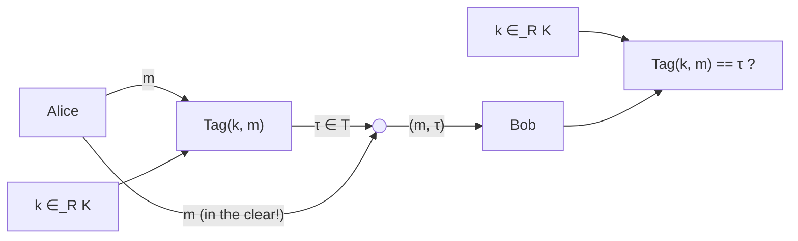
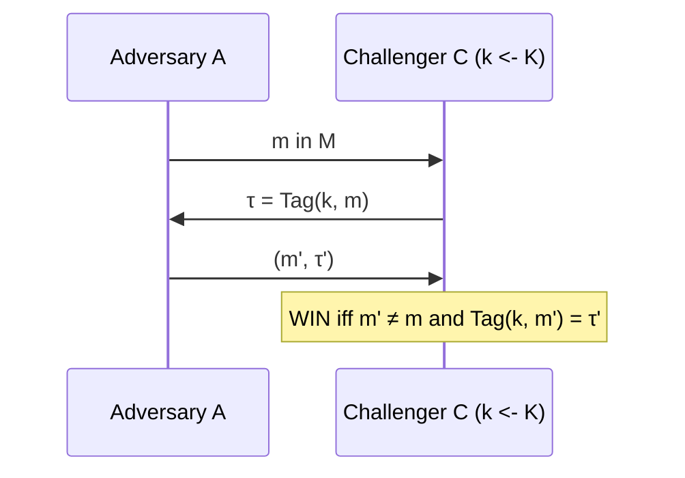

# shannon
**shannon**: every perfectly secret SKE must have the above limitations (from lez. 1: $|k| \geq |m|$ and one-time key). #gemini

**thm**: for any SKE with perfect secrecy #gemini
$$
|\mathcal{K}| \geq |\mathcal{M}|
$$
**proof assumptions**:
* Let $\Pi$ be any perfectly secret SKE.
* Fix the uniform distribution $M$ over $\mathcal{M}$.
* Take any $c \in \mathcal{C}$ s.t. $\Pr[C=c]>0$
* assume $|\mathcal{K}| < |\mathcal{M}|$

**proof**:
* consider $\mathcal{M}' = \{ \text{Dec}(k,c): k \in \mathcal{K} \}$
* since $|\mathcal{M}'| \leq |\mathcal{K}| < |\mathcal{M}|$
* then $|\mathcal{M}'| < |\mathcal{M}|$
* $\exists m \in \mathcal{M} \setminus \mathcal{M}'$
* $\Pr[M=m \mid C=c]=0 \neq \frac{1}{|\mathcal{M}|} = \Pr[M=m]$
	* so we invalidate perfect secrecy right here.
* $\square$

![[lez2_shannon_impossibility.png]] #gemini

**Our goal**: we want to design a system that enables $A,B$ to share a key of length independent of the length of $m \in \mathcal{M}$. #gemini

**Adversary**: with $k \gets \mathcal{K}$ u.r. (unknown to $\mathcal{A}$), $\text{Game}(b,m_{0},m_{1});\; b\in \{ 0,1 \},\; m_{0},m_{1}\in \mathcal{M}$
* $\mathcal{A} \gets c = \text{Enc}(k,m_{b}) \gets \mathcal{C}$
* $\mathcal{A} \to b' \in \{ 0,1 \} \to \mathcal{C}$

**perfect secrecy (game-based)**: $\Pi$ is perfectly secret if #gemini
* $\forall \mathcal{A}$ (unbounded), $\forall m_{0},m_{1} \in \mathcal{M}$
* $\text{Game}_{\mathcal{A}}(b) = \text{Game}_{\mathcal{A}}(b, m_{0}, m_{1})$
$$
|\Pr[b'=1: \text{Game}_{\mathcal{A}}(1)] - \Pr[b'=1 : \text{Game}_{\mathcal{A}}(0)]| = 0
$$
or:
$$
\text{Game}_{\mathcal{A}}(0) \equiv \text{Game}_{\mathcal{A}}(1)
$$

**meaning**: we want for every $\mathcal{A}$ to be *impossible* to distinguish if we are in game (or world) $b=1$ or game (or world) $b=0$. #gemini

# MAC (Message Authentication Code)
**mac**: symmetric primitive that ensures **integrity** (authentication, not confidentiality).
* Alice and Bob share the same $k \in \mathcal{K}$
* Alice sends $m$ unencrypted (**in the clear**), with a tag.
* Alice sends $\tau \in \mathcal{T}$ where $\tau = \text{Tag}(k,m)$
* Bob gets $m$ and $\tau$ and calculates $\text{Tag}(k,m)$ using $k$
* Bob asks himself: is the tag he computed the same Alice sent ($\tau$)?

**tag**: $\text{Tag}: \mathcal{K} \times \mathcal{M} \to \mathcal{T}$, deterministic.

**what's the definition of security here**? adversary should **not** be able to write down $(m', \tau')$ to fool Bob.
* goal for Eve: produce some $m', \tau'$ without knowing $k$ so that $\tau'=\text{Tag}(k,m')$
* **forgery definition**: given a valid pair $(m,\tau)$, can Eve forge another valid pair $(m',\tau')$ with $m' \neq m$?

**def. $\mathcal E$-statistically secure**: 
* let $\text{Tag}$ be a MAC over $(\mathcal{K}, \mathcal{M}, \mathcal{T})$. 
It is **(one-time) $\varepsilon$-statistically** secure if for 
* every $m,m' \in \mathcal{M}$ and $\tau, \tau' \in \mathcal{T}$ with $m \neq m'$ 
* and $\Pr[\tau = \text{Tag}(K,m)] > 0$
we have:

$$\Pr[\tau' = \text{Tag}(K,m') \mid \tau = \text{Tag}(K,m)] \leq \varepsilon$$
* **one-time definition**: applies only in case given $k$, Alice tags **one** message $(m, \tau)$. If Alice tags more messages the definition does not apply.
* where $\varepsilon$ is $2^{-80}$ or $2^{-128}$ for example...
* where the adversary computes $\tau'$ and $m'$ valid
* we don't care how (unbounded $\mathcal{A}$), we want that it's almost impossible

> [!warning] Exam trap: what "one-time" means in MACs #gemini
> "One-time" limits how many valid pairs $(m,\tau)$ **Alice authenticates** under the same key $k$ (at most 1), **not** how many guesses Eve evaluates offline. Also note the spaces are $(\mathcal{K}, \mathcal{M}, \mathcal{T})$ (message space $\mathcal{M}$, not $\mathcal{A}$) and probability is over uniform $K \in_R \mathcal{K}$.

**exercise 1**: $\varepsilon$-security is impossible for $\varepsilon=0$
* Eve can guess $\tau' \in \mathcal{T}$ u.r. and hit the right tag with prob. $\geq \frac{1}{|\mathcal{T}|} > 0$. #gemini

**exercise 2**: OTP for MAC ($\text{Tag}(k,m) = m \oplus k$) is insecure
* from one valid pair $(m, \tau)$, Eve recovers $k = m \oplus \tau$ and forges $\tau' = m' \oplus k$ for any $m' \neq m$ with prob. $1$. #gemini

**exercise 3**: consider this game, $k \gets \mathcal{K}$ u.r. unknown to $\mathcal{A}$
* $\mathcal{A} \to m \in \mathcal{M} \to \mathcal{C}$
* $\mathcal{A} \gets \tau = \text{Tag}(k,m) \gets \mathcal{C}$
* $\mathcal{A} \to m', \tau' \to \mathcal{C}$
* $\mathcal{A} wins (\text{WIN}) if $m' \neq m$ and $\text{Tag}(k,m')=\tau'$

**for a MAC we want**: $\forall \mathcal{A}: \Pr[\text{WIN}] \leq \varepsilon$ (i.e. $\Pr[m' \neq m \land \text{Tag}(K,m') = \tau'] \leq \varepsilon$, equivalent to one-time $\varepsilon$-statistical security). #gemini

> [!warning] Exam trap: $\tau'$ vs. $\tau$ in the MAC game #gemini
> The winning condition checks $\text{Tag}(k,m') = \tau'$ (the **forged** tag $\tau'$, not the old $\tau$) together with $m' \neq m$ (replaying $(m,\tau)$ does not count as a forgery).

**definition**: a family $\mathcal{H} = \{ h_{k}: \mathcal{M} \to \mathcal{T} \}_{k\in \mathcal{K}}$ is **pairwise independent** if for every $m \neq m'$ then $(h(K,m), h(K,m'))$ is uniform over $\mathcal{T}^2$.
* $\mathcal{T}^2 = \mathcal{T} \times \mathcal{T}$ (so $\forall \tau, \tau' \in \mathcal{T}: \Pr[h_K(m)=\tau \land h_K(m')=\tau'] = \frac{1}{|\mathcal{T}|^2}$).
* with $K$ uniform over $\mathcal{K}$, each $h_K(m)$ is also individually uniform over $\mathcal{T}$.
* (source, gemini) if not uniform over $\mathcal{T}^2$, either single outputs $h_K(m)$ are biased or $h_K(m')$ depends on $h_K(m)$, letting Eve predict some $\tau'$ from $(m,\tau)$ with prob. $> \frac{1}{|\mathcal{T}|}$ (not simply $h_{k} = h_{k'}$). #gemini

**so we want**: $\text{Tag}(k,m)=h(k,m)=h_{k}(m)$ (gives a one-time $\frac{1}{|\mathcal{T}|}$-statistically secure MAC).

**example**: $h_{a,b}(m)=a \cdot m + b \bmod p$ with $p$ a large prime ($\lambda$ bits)
* $(a,b) \in \mathbb{Z}_{p}^2 = \mathcal{K}$
* $m \in \mathbb{Z}_{p} = \mathcal{M} = \mathcal{T}$ (achieves $\varepsilon = \frac{1}{p} \approx 2^{-\lambda}$)

![[lez2_mac_pairwise_independence.png]] #gemini
