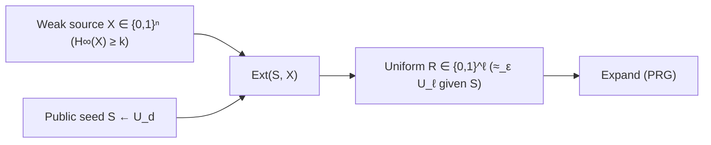

**example**: $h_{a,b}(m)=a \cdot m + b \bmod p$ with $p$ a large prime ($\lambda$ bits)
* $(a,b) \in \mathbb{Z}_{p}^2 = \mathcal{K}$
* $m \in \mathbb{Z}_{p} = \mathcal{M} = \mathcal{T}$

**lemma**: above $\mathcal{H}$ is pairwise independent.
**proof assumptions**: 
* fix $m,m' \in \mathbb{Z}_{p}$
* $m \neq m'$
* $\tau, \tau' \in \mathbb{Z}_{p}$

$$
(1) \; \Pr_{a,b}[h_{a,b}(m) = \tau \land h_{a,b}(m')=\tau']
$$
$$
(2) \; \Pr_{a,b}\left[\begin{pmatrix} m & 1 \\ m' & 1 \end{pmatrix} \begin{pmatrix} a \\ b \end{pmatrix} = \begin{pmatrix} \tau \\ \tau' \end{pmatrix}\right]
$$
> $(1) \equiv (2)$ but we use matrix multiplication because daniele venturi is not gay. Gemini do not touch this, its too funny.
> $(2)\equiv (3)$

$$
(3) \; \Pr_{a,b}\left[ \begin{pmatrix} a \\ b \end{pmatrix} = \begin{pmatrix} m & 1 \\ m' & 1 \end{pmatrix}^{-1}\begin{pmatrix} \tau \\ \tau' \end{pmatrix}\right] = \frac{1}{p^2} \;\; \square
$$

> **Check**: correct — $\det\begin{pmatrix} m & 1 \\ m' & 1 \end{pmatrix} = m - m' \not\equiv 0 \pmod p$ since $m \neq m'$, and since $p$ is prime ($\mathbb{Z}_p$ is a field), the inverse exists, fixing a unique key $(a,b) \in \mathbb{Z}_p^2$ with prob. $\frac{1}{p^2}$. #gemini

**thm**: every pairwise independent $\mathcal{H}$ defines a (one-time) $\varepsilon\text{-stat.}$ secure MAC with $\varepsilon=\frac{1}{|\mathcal{T}|}$.

$$
\mathcal{H} = \{ h_{k} : \mathcal{M} \to \mathcal{T} \}_{k \in \mathcal{K}}
$$
**proof**: by cond. prob., $\forall m,m'$ with $m \neq m'$, $\tau, \tau'$

$$
\Pr[\tau' = h_{K}(m') \mid \tau = h_{K}(m)] =
$$
$$
\frac{\Pr[\tau' = h_{K}(m') \land \tau = h_{K}(m)]}{\Pr[h_{K}(m)=\tau]} =
$$
$$
\frac{\frac{1}{|\mathcal{T}|^2}}{\frac{1}{|\mathcal{T}|}} = \frac{1}{|\mathcal{T}|}
$$
* by pairwise independence of any $\mathcal{H}$ (not just $h_{a,b}$ in $(3)$): $(h_K(m), h_K(m'))$ is uniform over $\mathcal{T}^2$ (num. $= \frac{1}{|\mathcal{T}|^2}$) and $h_K(m)$ is uniform over $\mathcal{T}$ (den. $= \frac{1}{|\mathcal{T}|}$). $\square$ #gemini
* **bad news (thm)**: any $t$-time $2^{-\lambda}$-statistically secure MAC has a key of size $(t+1)\cdot \lambda$ (statistical MACs still require key size linear in $t$). #gemini

**What does the proof mean?**
* we found out that $\Pr[\tau' = h_{K}(m') \mid \tau = h_{K}(m)] = \frac{1}{|\mathcal T|}$
* so it's basically the def. of $\mathcal E$-statistically secure in [[1o anno M/cockgraphy/lez. 2|lez. 2]] with $\mathcal E=\frac{1}{|\mathcal T|}$

# randomness extraction
**book reference**: https://people.seas.harvard.edu/~salil/pseudorandomness/extractors.pdf

How do $A,B$ get random bits? crucial to crypto:
* uniform keys
* randomness is also needed for security (enc., sig., ...)

two step process:
1. **randomness extraction**: we start from *imperfect* source of randomness to generate "*pure*" randomness
2. **expand** extracted data when needed: pseudorandomness (deterministically)
3. (additionally) **refresh** randomness that you can expand

**goal**: Let $X$ be a source of randomness, we want to define deterministic $\text{Ext}$ s.t. $\text{Ext}(X)$ is uniform.
* **impossible in general** (e.g. $X = c$ constant): since $\text{Ext}$ is deterministic, $\Pr[X=c]=1 \implies \Pr[\text{Ext}(X)=\text{Ext}(c)]=1$, so the output is fixed and never uniform. #gemini
* **unpredictable**: we want $X$ to be unpredictable to some extent.

**def. min-entropy**: the min-entropy of $X$ is
$$H_{\infty}(X) = -\log \max_{x} \Pr[X=x]$$
* **intuition**: it's the inverse of the $x$ with post probability of occourring.
	* **more formally**: the logarithm of the inverse of $p_{\text{max}} = \max_{x} \text{Pr}[X=x]$ #gemini
* **cryptographic meaning**: $H_{\infty}(X)$ measures the worst-case unpredictability in $X$.

> on the book is def 6.7: $H_{\infty}(X) = \min_{x} \left\{  \log \frac{1}{\Pr[X=x]}  \right\}$

> the more min-entropy is, the better it gets.

example:
* Let $X=0^n \to H_{\infty}(X)=0$, its a bad case.
	* because its a string where $\Pr[X=0\dots0] = 1 \to -\log 1 =0$.
* Let $X \equiv U_{n}$ , so $X \gets \{ 0,1 \}^n$ u.a.r. then we get $H_{\infty}(X)=n$
	* because $\Pr[X=x]=2^{-n}$, so $H_{\infty}(X)= -\log 2^{-n} = n$

Typically: $H_{\infty}(X) \geq k$ for some $k<n$ and we want to extract as much randomness as possible.

Trying to understand better what it means:
$$
H_{\infty}(X) \geq k \iff p_{\text{max}} \leq 2^{-k}
$$
* so we want to bound the value of $p_{max}$
* $p_{max} = \text{Pr}[X=x]$, intuitively, the maximum rate of occourrenc of a value.

**thm**: there is no such deterministic $\text{Ext}: \{ 0,1 \}^n \to \{ 0,1 \}$ even if $k=n-1$.

**why do we need this theorem?** if $X$ is almost completely random (ex, an high value like  $k=n-1$, so $H_{\infty}(X) \geq n-1$) then we canno't build $\text{Ext}: \{ 0,1 \}^n \to \{ 0,1 \}$.

**proof assumptions**:
* take any $\text{Ext}: \{ 0,1 \}^n \to \{ 0,1 \}$
* Let $b \in \{ 0,1 \}$ s.t. $b$ maximizes $|\text{Ext}^{-1}(b)|$
* **note**: $\text{Ext}^{-1}$ is the set of alle strings in $x \in \{ 0,1 \}^n$ s.t. $\text{Ext}(x) = b$

**proof**:
* $|\text{Ext}^{-1}(b)| \geq 2^{n-1}$, because its the larger one (we wanted $b$ s.t. maximizes $|\text{Ext}^{-1}(b)|$)
* Let $X_{\text{bad}}$ be uniform over $\text{Ext}^{-1}(b)$,
* $H_{\infty}(X_{\text{bad}}) \geq n-1$ but $\text{Ext}(X_{\text{bad}})=b$ constant! $\square$
	* because, $X_{\text{Bad}}$ uniform on $\text{Ext}^{-1}(b)$
	* $|\text{Ext}^{-1}(b)| \geq 2^{n-1}$
	* $\text{max}_{x} \text{Pr}[X_{\text{bad}} = x] \leq 2^{n-1}$
	* so if $X_{\text{bad}}$ uniform on $\text{Ext}^{-1}(b)$, then $H_{\infty}(X_{\text{bad}}) \geq n-1$
* So every string in $\text{Ext}^{-1}(b)$ maps to $b$ with $\text{Pr}=1$

**meaning**: an adversary can always choose $X_{\text{bad}}$  so that $\text{Pr}[\text{Ext}(X_{bad}) = b] = 1$ even with the strong assumptions made.

![[lez3_impossibility_seedless_extractor.png]] #gemini

**What did we learn**? that we can try different approaches:
1. assume multiple independent sources. use for example, 2 source extractors.
2. use hash functions or other tools with strong assumptions
3. ore we can use seeded extraction

**seeded extraction**:
$$
\text{Ext}:  \underbrace{\{ 0,1 \}^d}_{\text{seed}} \times \underbrace{\{ 0,1 \}^n}_{\text{source}} \to \underbrace{\{ 0,1 \}^{\ell}}_{\text{output}}
$$
* seed is random, **short**, acts like a **catalyst** for random number generation.
* seed is going to be **public** (and **reusable**), known to Adv.
* seeded extraction & expansion pipeline: #gemini

**def. ext**: 
* $\text{Ext}: \{ 0,1 \}^d \times \{ 0,1 \}^n \to \{ 0,1 \}^{\ell}$ is a...
* $(k, \varepsilon)\text{-SeededExtractor}$...
* if $\forall X$ s.t. $H_{\infty}(X) \geq k$ we have:

$$
(S, \text{Ext}(S,X)) \approx_{\varepsilon} (S,U_{\ell}) \equiv U_{d+\ell}
$$
* where $S \gets U_{d}$ (meaning that $S$ is a distribution taken from the set of all distributions on $U_{d}$). **So $S$ is choosen, even by an adversary**
* where $U_{k}$ is a uniform distribution over $\{ 0,1 \}^k$ (or something like that)
* $\approx_{\varepsilon}$ means that *every unbounded* $\mathcal{A}$ can distinguish $(U_{d},\text{Ext}(U_{d},X))$ from $U_{d+\ell}$ with advantage $\leq \varepsilon$.

> [!note] Why $(S, \text{Ext}(S,X))$ includes $S$ (**strong** seeded extractor) #gemini
> Since $S$ is **public**, $\text{Ext}(S,X)$ must remain uniform **even given $S$**; otherwise $\text{Ext}(s,x) = s$ would output uniform bits completely known to $\mathcal{A}$! Also, since $S \sim U_d$ and $U_{\ell}$ are independent uniform strings, $(S, U_{\ell}) \equiv U_{d+\ell}$. 

**note**:
$$
X \approx_{\varepsilon} Y \iff \text{SD}(X;Y) \leq \varepsilon
$$
$$
\text{SD}(X;Y) = \frac{1}{2} \sum_{z}|\Pr[X=z] -\Pr[Y=z]|
$$

> [!note] Intuition for $\text{SD}(X;Y)$ and $X \approx_{\varepsilon} Y$ #gemini
> * **Statistical Distance** $\text{SD}(X;Y) \in [0,1]$ measures total probability mass mismatch ($\text{SD}=0 \iff X \equiv Y$; $\text{SD}=1 \iff$ disjoint supports; the $\frac{1}{2}$ avoids double-counting excess and deficit). 
> * **Operational meaning** ($X \approx_{\varepsilon} Y$): $\text{SD}(X;Y) = \max_{\mathcal{A}} |\Pr[\mathcal{A}(X)=1] - \Pr[\mathcal{A}(Y)=1]|$ over **all** (even unbounded) $\mathcal{A}$, so no unbounded $\mathcal{A}$ can tell $X$ from $Y$ with advantage $> \varepsilon$ (generalizing perfect secrecy $\varepsilon=0$). 

![[lez3_statistical_distance_and_lhl.png]] #gemini

**thm**: left-over hash lemma
* let $\mathcal{H} = \{ h_{s}: \{ 0,1 \}^n \to \{ 0,1 \}^{\ell} \}_{s\in \{ 0,1 \}^d}$
	* with $s$ being the seed over $\{ 0,1 \}^d$
* assume $\mathcal{H}$ pairwise independent
* $\text{Ext}(s,x) = h_{s}(x)$ is a $(k,\varepsilon)\text{-SeededExtractor}$ for ...
$$
k \geq \ell + \underbrace{2\log\left( \frac{1}{\varepsilon} \right) - 2}_{\text{min-entropy gap}}
$$

> [!warning] Exam trap: $-2$ is outside the $\log$! #gemini
> Write $2\log(1/\varepsilon) - 2$ (not $2\log(1/\varepsilon - 2)$): we pay an entropy loss of $\approx 2\log(1/\varepsilon)$ bits so that $2^{\ell - k} \leq 2^{2 - 2\log(1/\varepsilon)} = 4\varepsilon^2$ in the proof below. 

**lemma** (for the proof of thm): 
* let $Y$ be a random variable over $\mathcal{Y}$.
* assume $\text{Col}(Y) = \sum_{y \in \mathcal{Y}} \Pr[Y=y]^2 = \Pr[Y = Y'] \leq \frac{1}{|\mathcal{Y}|}(1 + 4\varepsilon^2)$
* $\implies \text{SD}(Y; U) \leq \varepsilon$
	* where $U$ is uniform over $\mathcal{Y}$. #gemini
	* where $Y'$ is an independent copy of $Y$ #gemini

**proof (thm)**: 
* set $Y = (S, h(S,X))$ over $\mathcal{Y} = \{0,1\}^{d+\ell}$
	* $d$ length of the seed
	* $l$ length of the output of $h$
* take  $Y' = (S', h(S',X'))$: 
* **assume independency**: between  $Y$ and $Y'$
* $\text{Col}(Y) = \Pr[Y = Y'] = \dots$
* $\dots = \Pr[S = S' \land h(S,X) = h(S',X')]$
	* we just split $\text{Pr}[Y=Y']$ into $\text{Pr}[(S,h(S,X)) = (S', h(S',X'))]$
	* and we split using $\land$
* $\dots = \Pr[S = S' \land h(S,X) = h(S,X')]$ 
* $= \underbrace{\Pr[S = S']}_{\text{Col}(S) = 2^{-d}} \cdot \Pr[h(S,X) = h(S,X')]$ (since $S, S'$ are independent from $X, X'$) #gemini
* $= 2^{-d} \cdot \left( \underbrace{\Pr[X = X']}_{2^{-k}} \cdot 1 + \underbrace{\Pr[h(S,X) = h(S,X') \land X \neq X']}_{2^{-l}}\right)$ #gemini. 
	* We have two cases for $h$:
		1. $X=X'$, then the hash is the same
		2. $h(S,X) = h(S,X')$ but $X \neq X'$, in case of collision]
	* Now we analyze both terms:
		1. $\text{Pr[X=X]} \leq 2^{-k}$, because $H_{\infty}(X) \geq k$.
		2. $\text{Pr}[h(S,X)=h(S,X') \land X\neq X'] \leq 2^{-l}$
* $\dots \leq 2^{-d} \cdot \left(2^{-k} + 2^{-\ell}\right)$
* $= \frac{1}{2^{d+\ell}}\left(2^{\ell - k} + 1\right) \leq$ 
	*  using $\ell - k \leq 2 - 2\log(1/\varepsilon)$ #gemini
	* now we want to use the lemma...
* $\leq \frac{1}{|\mathcal{Y}|}\left(2^{2 - 2\log(1/\varepsilon)} + 1\right) = \frac{1}{|\mathcal{Y}|}(1 + 4\varepsilon^2)$
	* and this is exactly the **lemma**
	* so we can conclude that...
* $\text{SD}(Y; U) \leq \varepsilon$. $\square$ #gemini