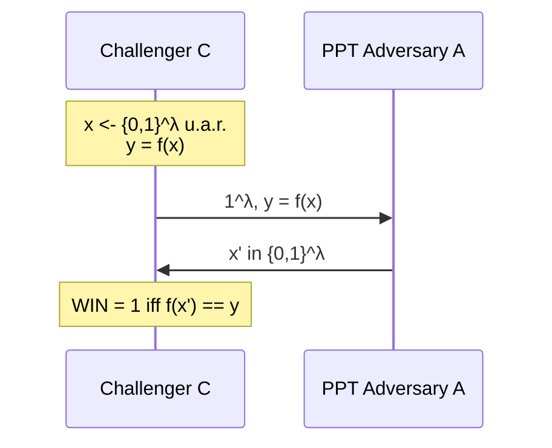

**lemma** (for the proof of thm in [[1o anno M/cockgraphy/lez. 3|lez. 3]]): 
* let $Y$ be a random variable over $\mathcal{Y}$.
* assume $\text{Col}(Y) = \sum_{y \in \mathcal{Y}} \Pr[Y=y]^2 = \Pr[Y = Y'] \leq \frac{1}{|\mathcal{Y}|}(1 + 4\varepsilon^2)$
* $\implies \text{SD}(Y; U) \leq \varepsilon$
	* where $U$ is uniform over $\mathcal{Y}$. #gemini
	* where $Y'$ is an independent copy of $Y$ #gemini

**assumptions and definitions for the proof**:
* Ass: $\text{Col}(Y) \leq \frac{1}{|\mathcal Y|}(1+4 \varepsilon^2)$
* **def. Statistical Distance**: $\text{SD}(Y,U) = \frac{1}{2} \sum_{y\in \mathcal Y} |\text{Pr}[Y=y]-\frac{1}{|\mathcal Y|}|$
* let $q_{y} = \text{Pr}[Y=y]-\frac{1}{|\mathcal Y|}$
* also let 
$$
s_{y} = \begin{cases}
+1 \text{ if } q_{y} \geq 0 \\
-1 \text{ otherwise}
\end{cases}
$$

* $\vec{q} = (q_{y})_{y \in \mathcal Y}$
* $\vec{s} = (s_{y})_{y\in \mathcal Y}$

**proof**:
* From the **def** of Statistical Distance: $\text{SD}(Y,U) = \frac{1}{2} \sum_{y\in\mathcal Y} q_{y}s_{y}$ (since $|q_y| = q_y s_y$) #gemini
* $\text{SD}(Y,U) = \frac{1}{2}\langle\vec{q}, \vec{s}\rangle$
* **by cauchy schwarz**: 
$$\text{SD}(Y,U) \leq \frac{1}{2}\sqrt{ \langle\vec{q}, \vec{q}\rangle\underbrace{\langle\vec{s}, \vec{s}\rangle}_{\sum_{y\in \mathcal Y} s_{y}^2 = |\mathcal Y|} }$$

$$
 = \frac{1}{2} \sqrt{ \sum_{y\in \mathcal Y} q^2_{y} |\mathcal Y|}
$$

> [!note] cauchy schwarz, wikipedia
> $$|\langle u,v\rangle|^2 \leq \langle u,u\rangle \cdot \langle v,v\rangle$$

Let's focus on $\sum_{y \in \mathcal Y} q_{y}^2$:
* $\sum_{y \in \mathcal Y} q_{y}^2 = \sum_{y \in \mathcal Y}\left( \text{Pr}[Y=y] - \frac{1}{|\mathcal Y|} \right)^2 =$
	* we square $q_{y} = \text{Pr}[Y=y]-\frac{1}{|\mathcal Y|}$
* $\sum_{y\in \mathcal Y}\left( \text{Pr}[Y=y]^2 + \frac{1}{|\mathcal Y|^2}-2 \frac{\text{Pr}[Y=y]}{|\mathcal Y|} \right) =$
	* $\sum_{y \in \mathcal Y} \frac{1}{|\mathcal Y|^2} = |\mathcal Y| \cdot \frac{1}{|\mathcal Y|^2} = \frac{1}{|\mathcal Y|}$ #gemini
	* $\sum_{y \in \mathcal Y} 2 \frac{\text{Pr}[Y=y]}{|\mathcal Y|}=\frac{2}{|\mathcal Y|}$ because $\sum_{y\in \mathcal Y} \text{Pr}[Y=y] =1$
* $\text{Col}(Y) + \frac{1}{|\mathcal Y|} - \frac{2}{|\mathcal Y|} =$
	* we assumed $\text{Col}(Y) \leq \frac{1}{|\mathcal Y|}(1+4 \varepsilon^2)$
* $\leq \frac{1+4 \varepsilon^2}{|\mathcal Y|} - \frac{1}{|\mathcal Y|} = \frac{4 \varepsilon^2}{|\mathcal Y|}$
* $\to \text{SD}(Y;U) \leq \frac{1}{2}\sqrt{\frac{4 \varepsilon^2}{|\mathcal Y|} |\mathcal Y|} = \varepsilon \;\; \square$

## Computational Security
We need to find a way to deploy a provably secure and at the same time efficient crypto system.

assumptions:
1. $\text{Adv}$ is an "efficient" machine
2. There are "hard" problems that an "efficient" machine cannot solve

**assumption 1**:
* $\text{Adv} \equiv \text{Turing Machine}$, an "efficient" **TM**
	* "efficient" = limited running time = *polynomial time*.
* We measure $\#$ of steps using the notation $O(n^c)$ (or $\text{poly}(\lambda)$ in the security parameter $\lambda$) #gemini
* Additionally: $\text{Adv}$ can generate arbitrary (*polynomial*) amount of randomness.

> [!note] What "arbitrary (polynomial) amount of randomness" means #gemini
> $\text{Adv}$ has an extra **random tape** of independent uniform bits (or can flip a fair coin at each step). Since its running time is bounded by $O(n^c)$, it can read at most $\text{poly}(n)$ random bits. #gemini

**take away**:
$$
\text{Adv} \equiv \text{Probabilistic Poly. Time Turing Machine (PPT TM)}
$$
$$
\text{PTT} \equiv \text{Probabilistic Poly. Time}
$$

**assumption 2**:
* assume $P \neq NP$
	* $P \equiv$ problems **solvable** by a deterministic $\text{Poly. Time T.M.}$ 
	* $NP \equiv$ all problems that can be **verified** by a deterministic $\text{Poly. Time T.M.}$ (given a polynomial-size witness, or **solvable** by a *Non-Deterministic* Poly. Time T.M.) #gemini

**thm** (ideal goal): if $P \neq NP$ then $\Pi$ is "secure" #gemini

**consequences**: we have only two options
* either $\Pi$ is **secure**, OR #gemini
* $\Pi$ is **not secure** $\implies P=NP$ (by contrapositive: breaking $\Pi$ proves $P=NP$) #gemini

> [!note] Meaning of the "two options" (Proof by Reduction / Contrapositive) #gemini
> Proving $\text{Hardness} \implies \Pi \text{ secure}$ is equivalent to the contrapositive $\Pi \text{ insecure} \implies \neg\text{Hardness}$. Thus either (1) $\Pi$ is indeed secure, or (2) a PPT $\mathcal{A}$ breaks $\Pi$, which lets us build a PPT reduction $\mathcal{B}$ using $\mathcal{A}$ as a subroutine to solve the hard problem in poly-time (proving $P=NP$ or $\text{Factoring} \in P$). #gemini
> * **Why $P \neq NP$ is necessary but NOT sufficient**: $\text{OWFs exist} \implies P \neq NP$, **but** $P \neq NP \not\implies \text{OWFs exist}$ because $P \neq NP$ only guarantees **worst-case** hardness, whereas cryptography requires **average-case** hardness (random instances must be hard with high probability). #gemini

**thm**: if factoring is hard, then $\Pi$ secure.
* if $\Pi$ not secure then factoring not hard
* implies: $\exists \text{Poly. Time T.M.}$ that solves factoring.

**owf**: One Way Functions, are a strong requirement to do crypto (necessary and sufficient for symmetric crypto). #gemini

**def**. a deterministic function $f: \mathcal X \to \mathcal Y$ is a owf iff:
1. $f$ is **efficiently computable** in deterministic $\text{poly}(\lambda)$-time, and #gemini
2. $f$ is **hard to invert on average**: $\forall \text{PPT } \mathcal A$ #gemini
$$
\text{Pr}[\text{Game}_{\mathcal A, f}^\text{owf}(\lambda)=1] \text{ is "small"}
$$
in other words:
$$
\text{Pr}[\text{WIN}] = \Pr_{x \gets \mathcal{X}}\big[f(x') = y \;:\; y = f(x),\; x' \gets \mathcal{A}(1^\lambda, y)\big] \leq \text{negl}(\lambda)
$$

**attack game** ($\text{Game}_{\mathcal{A}, f}^{\text{owf}}(\lambda)$): 
* Challenger $\mathcal C$ samples $x \gets \mathcal X$ u.a.r., computes $y = f(x)$, and sends $(1^\lambda, y \in \mathcal Y)$ to $\mathcal A$ #gemini
* $\mathcal A$ outputs $x' \in \mathcal X$
* $\mathcal A$ wins ($\text{Game}_{\mathcal{A}, f}^{\text{owf}}(\lambda)=1$) if it outputs $x': f(x')=y$ (any pre-image $x' \in f^{-1}(y)$ suffices, not necessarily $x' = x$!) #gemini
* **assume**: $f: \{ 0,1 \}^\lambda \to \{  0,1 \}^\lambda$ (or $\{0,1\}^m$) #gemini

* **candidate OWFs**: Multiplication/Factoring $f_{\text{mult}}(p,q) = p \cdot q$; Subset-Sum $f(\vec{a}, b) = (\vec{a}, \sum b_i a_i \bmod 2^\lambda)$; Modular Exponentiation / Discrete Log $f_{p,g}(x) = g^x \bmod p$. #gemini

**def. negligible**: $\varepsilon(\lambda)$ is negligible ($\varepsilon \in \text{negl}(\lambda)$) iff:
* $\varepsilon(\lambda) = O\left( \frac{1}{p(\lambda)} \right)$ 
* for every positive polynomial $p(\lambda) = \text{poly}(\lambda)$ (i.e. $\forall c \in \mathbb{N},\; \exists \lambda_0 \in \mathbb{N} : \forall \lambda > \lambda_0,\; \varepsilon(\lambda) < \lambda^{-c}$) #gemini

**examples & closure of $\text{negl}(\lambda)$:**
* $2^{-\lambda} = \text{negl}(\lambda)$ (also $2^{-\sqrt{\lambda}}, \lambda^{-\log \lambda} \in \text{negl}(\lambda)$, whereas $\lambda^{-c} \notin \text{negl}(\lambda)$) #gemini
* $\text{negl}(\lambda) + \text{negl}(\lambda) = \text{negl}(\lambda)$ and $\text{poly}(\lambda) \cdot \text{negl}(\lambda) = \text{negl}(\lambda)$ #gemini

![[lez4_owf_and_negligible.png]] #gemini

to conclude, there are 5 different computational worlds (**Impagliazzo's Five Worlds**): #gemini
1. **Algorithmica** ($P = NP$): all $NP$ problems are easy $\implies$ no OWFs, no crypto. #gemini
2. **Heuristica** ($P \neq NP$, easy on average): worst-case hard problems exist, but easy on average $\implies$ no OWFs. #gemini
3. **Pessiland** (hard on average, no OWFs): average-case hard problems exist, but no OWFs (*worst world*: hardness without crypto). #gemini
4. **Minicrypt**: **owf** $\iff$ ske, macs, prgs, prfs, digital signatures (symmetric crypto, no public-key crypto). #gemini
5. **Cryptomania**: trapdoor owfs $\implies$ pke, key exchange (public-key cryptography). #gemini

![[lez4_reduction_and_impagliazzo.png]] #gemini
