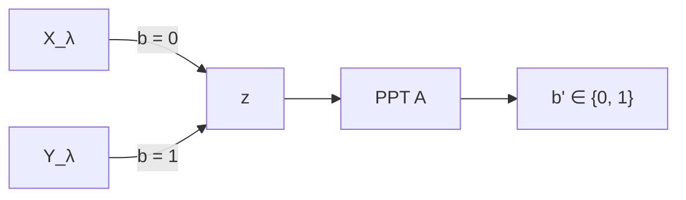

> [!info] References #gemini
> * **Course Slides**: Daniele Venturi, [Lecture 5 — Pseudorandom Generators](https://dventuri83.github.io/assets/pdf/crypto_lecture05_2627.pdf) #gemini
> * **Reference Notes**: Simone Bianco, [Lecture Notes for the Cryptography Course](https://github.com/Exyss/university-notes/raw/main/Master/Cryptography/Cryptography.pdf), Chapter 3 (Sections 3.2–3.3, pp. 21–26) #gemini
> * **Book Note**: [[lez. 5 hybrids book|Katz & Lindell — Section 7.4.2 (Theorem 7.20)]] #gemini

**D1**: When are two probability ensembles $X = \{X_\lambda\}_{\lambda \in \mathbb{N}}$ and $Y = \{Y_\lambda\}_{\lambda \in \mathbb{N}}$ computationally indistinguishable ($X \approx_C Y$)? #gemini
* **R1**: [INSERT HERE] #gemini
**D2**: State the formal definition of a secure Pseudorandom Generator (PRG) $G: \{0,1\}^\lambda \to \{0,1\}^{\lambda+l}$. Why can no PRG be secure against an unbounded adversary (even for $l=1$)? #gemini
* **R2**: [INSERT HERE] #gemini
**D3**: How does the sequential composition $G^l$ amplify a $1$-bit stretch PRG $G$ to a $\text{poly}(\lambda)$-bit stretch PRG? #gemini
* **R3**: [INSERT HERE] #gemini
**D4**: Why does a direct one-step reduction from $G^l(U_\lambda) \approx_C U_{\lambda+l}$ to $G(U_\lambda) \approx_C U_{\lambda+1}$ fail, and how does the Hybrid Argument resolve this? #gemini
* **R4**: [INSERT HERE] #gemini
**D5**: Define a hard-core predicate $h$ for a function $f$ (both via guessing probability and via $\approx_C$) and show how an OWP + hard-core bit yields a $1$-bit stretch PRG. #gemini
* **R5**: [INSERT HERE] #gemini
**D6**: Can a single universal predicate $h$ be hard-core for every OWF $f$? State the counterexample $f_{\text{BAD}}$. #gemini
* **R6**: [INSERT HERE] #gemini

---

# 1. Computational Indistinguishability ($\approx_C$) #gemini

* **Probability Ensembles**: Let $X = \{ X_{\lambda} \}_{\lambda \in \mathbb N}$ and $Y = \{ Y_{\lambda} \}_{\lambda \in \mathbb N}$ be infinite sequences of probability distributions indexed by the security parameter $\lambda$ (where $X_\lambda, Y_\lambda$ are distributions over $\{0,1\}^{\text{poly}(\lambda)}$). #gemini

**Def. 3.2 (Computational Indistinguishability — Bianco p. 21, Slide 1)**: $X$ and $Y$ are computationally indistinguishable ($X \approx_C Y$) if $\forall \text{ PPT distinguisher } \mathcal{A}$, $\exists \text{negl}(\lambda)$ such that $\forall \lambda \in \mathbb{N}$: #gemini
$$
\left| \Pr[\mathcal{A}(z) = 1 : z \gets X_\lambda] - \Pr[\mathcal{A}(z) = 1 : z \gets Y_\lambda] \right| \leq \text{negl}(\lambda)
$$

**Indistinguishability Game $\text{GAME}(\lambda, b)$ (Slide 2)**: #gemini

$$
X \approx_C Y \iff \{ \text{GAME}(\lambda, 0) \}_{\lambda} \approx_C \{ \text{GAME}(\lambda, 1) \}_{\lambda}
$$

* **Intuition (what $\approx_C$ means in practice vs statistical $\varepsilon$-closeness)**: * [INSERT HERE] #gemini
* **Key Properties of $\approx_C$ (Bianco p. 21)**: #gemini
	* **Transitivity (Triangle Inequality)**: If $X \approx_C Y$ and $Y \approx_C Z$, then $X \approx_C Z$ (holds across $l(\lambda) = \text{poly}(\lambda)$ steps). #gemini
	* **Closure under PPT reductions**: For any PPT-computable function $f$, if $X \approx_C Y \implies f(X) \approx_C f(Y)$. #gemini

---

# 2. Pseudorandom Generators (PRGs) #gemini

**Def. 3.3 (Pseudorandom Generator — Bianco p. 21, Slide 2)**: A deterministic function $G: \{0,1\}^\lambda \to \{0,1\}^{\lambda+l}$ with **expansion factor (stretch)** $l(\lambda) \geq 1$ is a secure PRG if: #gemini
1. **Efficiency**: $G$ is computable in deterministic $\text{poly}(\lambda)$-time. #gemini
2. **Pseudorandomness**: $\{ G(U_\lambda) \}_{\lambda \in \mathbb{N}} \approx_C \{ U_{\lambda+l} \}_{\lambda \in \mathbb{N}}$. #gemini

* **Role of PRGs (amplifying a short uniform seed $s \gets U_\lambda$)**: * [INSERT HERE] #gemini

### Exercise: Insecurity Against Unbounded Attackers (Slide 3) #gemini
No PRG is secure against an **unbounded** adversary $\mathcal{A}$, even for $1$-bit stretch $G: \{0,1\}^\lambda \to \{0,1\}^{\lambda+1}$. #gemini
* **Unbounded Distinguisher $\mathcal{A}(z)$**: On input $z \in \{0,1\}^{\lambda+1}$, brute-force all $s \in \{0,1\}^\lambda$. Output $1$ if $\exists s : G(s) = z$, else output $0$. #gemini
$$
\begin{aligned}
\Pr[\mathcal{A}(z) = 1 : z = G(s); \; s \gets U_\lambda] &= 1 \\
\Pr[\mathcal{A}(z) = 1 : z \gets U_{\lambda+1}] &= \frac{|\text{Im}(G)|}{2^{\lambda+1}} \leq \frac{2^\lambda}{2^{\lambda+1}} = \frac{1}{2}
\end{aligned}
$$
* **Why $|\text{Im}(G)| \leq 2^\lambda$ implies $\mathcal{A}$ wins with non-negligible advantage $\geq \frac{1}{2}$**: * [INSERT HERE] #gemini

---

# 3. Stretch Amplification & The Hybrid Argument #gemini

**Fundamental Theorem (Slide 4, Bianco Sec. 3.3)**: #gemini
$$
\text{OWFs exist} \iff \text{PRGs exist with stretch } l(\lambda) = \text{poly}(\lambda)
$$
* **Two main ingredients of the proof**: #gemini
	1. **Stretch Amplification (Thm. 3.1)**: From $l(\lambda) = 1$ to $l(\lambda) = \text{poly}(\lambda)$ via sequential composition. #gemini
	2. **Hard-Core Predicates (Sec. 4)**: Constructing a $1$-bit stretch PRG from any OWF. #gemini

### Theorem 3.1: PRG Stretch Amplification (Bianco p. 22, Slides 5–6) #gemini
> **Statement**: If $G: \{0,1\}^\lambda \to \{0,1\}^{\lambda+1}$ is a secure PRG, then $\forall l(\lambda) = \text{poly}(\lambda)$, there exists a secure PRG $G^l: \{0,1\}^\lambda \to \{0,1\}^{\lambda+l}$. #gemini

![[lez. 5 thmconstruction.excalidraw]]

**Construction of $G^l(s_0)$**: #gemini
* **Input**: Seed $s_0 \gets U_\lambda$. #gemini
* **Iteration**: For $i \in [l] = \{1, \dots, l\}$, compute $(s_i, b_i) = G(s_{i-1})$ where $s_i \in \{0,1\}^\lambda$ and $b_i \in \{0,1\}$. #gemini
* **Output**: $(b_1, \dots, b_l, s_l) \in \{0,1\}^{\lambda+l}$. #gemini

---

### Proof of Theorem 3.1 via the Hybrid Argument (Bianco pp. 22–23, Slides 7–11) #gemini

![[lez. 5 2026-10-27 17.54.26.excalidraw]]

> [!warning] Complex Topic — Study on Your Own: Direct Reduction Failure & Hybrid Reduction #gemini
> * **What to study**: Understand (1) why a direct 1-step reduction $\mathcal{B}$ from $G^l(U_\lambda) \approx_C U_{\lambda+l}$ to $G(U_\lambda) \approx_C U_{\lambda+1}$ gets stuck, and (2) how defining intermediate hybrid distributions $H_0, \dots, H_l$ allows $\mathcal{B}$ to embed a single $(\lambda+1)$-bit challenge $z = (b_1, s_1)$ so that $z \gets G(U_\lambda)$ produces $H_0$ and $z \gets U_{\lambda+1}$ produces $H_1$. #gemini
> * **References**: #gemini
>   1. **Simone Bianco Notes**: Section 3.2, *Theorem 3.1 & Figure 3.1* (pp. 22–23). #gemini
>   2. **Venturi Lecture 5 Slides**: Pages 7–11. #gemini
>   3. **Textbook**: Katz & Lindell, Section 7.4.2 (see [[lez. 5 hybrids book]]). #gemini

* **Why a direct reduction without hybrids fails**: * [INSERT HERE] #gemini

**1. General Hybrid Argument Template**: To prove $X \approx_C Y$, define $l+1$ hybrids $H_0, H_1, \dots, H_l$ such that: #gemini
1. **Extreme match**: $H_0 \equiv X$ and $H_l \equiv Y$. #gemini
2. **Neighbor indistinguishability**: $\forall i \in \{0, \dots, l-1\}, \; H_i \approx_C H_{i+1}$. #gemini
3. **Polynomial count**: $l(\lambda) = \text{poly}(\lambda) \implies$ by triangle inequality, $\text{Adv}_{H_0, H_l}(\mathcal{A}) \leq \sum_{i=0}^{l-1} \text{Adv}_{H_i, H_{i+1}}(\mathcal{A}) \leq l(\lambda) \cdot \text{negl}(\lambda) = \text{negl}(\lambda)$. #gemini

**2. Definition of Hybrids $H_0, \dots, H_l$ (Slide 8, Bianco p. 22)**: #gemini
| Hybrid | First $i$ bits ($b_1, \dots, b_i$) | Seed $s_i$ | Remaining $l-i$ steps ($b_{i+1}, \dots, b_l, s_l$) | Equivalent Distribution |
| :--- | :--- | :--- | :--- | :--- |
| $H_0$ | — | $s_0 \gets U_\lambda$ | $(b_1, \dots, b_l, s_l) = G^l(s_0)$ | $G^l(U_\lambda)$ |
| $H_1$ | $b_1 \gets \{0,1\}$ | $s_1 \gets U_\lambda$ | $(b_2, \dots, b_l, s_l) = G^{l-1}(s_1)$ | $1$ random step, $l-1$ via $G$ |
| $H_i$ | $b_1, \dots, b_i \gets \{0,1\}$ | $s_i \gets U_\lambda$ | $(b_{i+1}, \dots, b_l, s_l) = G^{l-i}(s_i)$ | $i$ random steps, $l-i$ via $G$ |
| $H_l$ | $b_1, \dots, b_l \gets \{0,1\}$ | $s_l \gets U_\lambda$ | — | $U_{\lambda+l}$ |

![[lez. 5 2026-11-07 16.30.35.excalidraw]]

**3. Reduction Proof for $H_0 \approx_C H_1$ (Slides 9–11)**: #gemini
* **Contradiction Hypothesis**: Assume $\exists \text{ PPT } \mathcal{A}$ distinguishing $H_0$ from $H_1$: #gemini
$$
\left| \Pr[\mathcal{A}(z') = 1 : z' \gets H_0] - \Pr[\mathcal{A}(z') = 1 : z' \gets H_1] \right| \geq \frac{1}{p(\lambda)}
$$
* **Construction of Reduction $\mathcal{B}(z)$ attacking $G$ against Challenger $\mathcal{C}$**: #gemini
	1. Receive $z \in \{0,1\}^{\lambda+1}$ from $\mathcal{C}$ (where either $z \gets G(U_\lambda)$ or $z \gets U_{\lambda+1}$). #gemini
	2. Parse $z = (b_1, s_1)$ with $b_1 \in \{0,1\}$ and $s_1 \in \{0,1\}^\lambda$. #gemini
	3. Compute $(b_2, \dots, b_l, s_l) = G^{l-1}(s_1)$. #gemini
	4. Output $b' \gets \mathcal{A}(b_1, b_2, \dots, b_l, s_l)$. #gemini
* **Why $z \gets G(U_\lambda) \implies z' \sim H_0$ and $z \gets U_{\lambda+1} \implies z' \sim H_1$**: * [INSERT HERE] #gemini
* **Advantage Equivalence (Slide 11)**: #gemini
$$
\begin{aligned}
\Pr[\mathcal{B}(z) = 1 : z \gets G(U_\lambda)] &= \Pr[\mathcal{A}(b_1, \dots, b_l, s_l) = 1 : (b_1, \dots, b_l, s_l) \gets H_0] \\
\Pr[\mathcal{B}(z) = 1 : z \gets U_{\lambda+1}] &= \Pr[\mathcal{A}(b_1, \dots, b_l, s_l) = 1 : (b_1, \dots, b_l, s_l) \gets H_1]
\end{aligned}
$$
* **Conclusion (Contradiction & Generalization to $H_i \approx_C H_{i+1}$, Bianco p. 23)**: * [INSERT HERE] #gemini

---

# 4. Hard-Core Predicates & PRGs from OWFs #gemini

**Def. 3.4 (Hard-Core Predicate — Bianco p. 25, Slides 12–13)**: Let $f: \{0,1\}^n \to \{0,1\}^m$ be PPT-computable. A poly-time computable predicate $h: \{0,1\}^n \to \{0,1\}$ is **hard-core** for $f$ if $\forall \text{ PPT } \mathcal{A}$: #gemini
$$
\Pr_{x \gets U_n}\left[ \mathcal{A}(1^n, f(x)) = h(x) \right] \leq \frac{1}{2} + \text{negl}(n)
$$
* **Equivalent Indistinguishability Formulation (Slide 13, Bianco p. 25)**: #gemini
$$
\{ (f(x), h(x)) \}_{x \gets U_n} \approx_C \{ (f(x), u) \}_{x \gets U_n, \; u \gets U_1}
$$

### Proposition 3.1: From OWP + Hard-Core Bit to 1-Bit Stretch PRG (Slide 13, Bianco p. 26) #gemini
Let $f: \{0,1\}^n \to \{0,1\}^n$ be a **One-Way Permutation (OWP)** with hard-core predicate $h: \{0,1\}^n \to \{0,1\}$. Then $G(s) = f(s) \| h(s)$ is a secure PRG with stretch $l = 1$: #gemini
$$
\begin{aligned}
G(s) &= f(s) \| h(s) && (s \gets U_n) \\
&\approx_C f(s) \| b && (b \gets U_1, \text{ since } h \text{ is hard-core for } f) \\
&\equiv U_{n+1} && (\text{since } f \text{ is a permutation, } f(U_n) \equiv U_n)
\end{aligned}
$$
* **Why $f$ being a bijection (permutation) is needed for the last step $\equiv U_{n+1}$**: * [INSERT HERE] #gemini

---

### Three Fundamental Questions on Hard-Core Predicates (Bianco pp. 25–26, Slide 14) #gemini

> [!warning] Complex Topic — Study on Your Own: Properties & Goldreich-Levin Theorem #gemini
> * **What to study**: Review the three theoretical questions regarding hard-core predicates in **Simone Bianco Notes (Section 3.3, pp. 25–26)** and **Venturi Lecture 5 Slide 14** (continued in Lecture 6): #gemini
>   1. Why no universal hard-core predicate $h^*$ can exist for *every* OWF (and the reduction showing $f_{\text{BAD}}(x) = f(x) \| h^*(x)$ remains a OWF). #gemini
>   2. Why having a hard-core predicate does *not* by itself make $f$ a OWF. #gemini
>   3. How the **Goldreich-Levin Theorem** modifies any OWF $f$ into $g(x, r) = f(x) \| r$ with hard-core bit $h(x, r) = \bigoplus_{i=1}^n x_i r_i$. #gemini

| Question | Answer | Construction / Counterexample | Proof / Intuition |
| :--- | :--- | :--- | :--- |
| **1. Universal $h$ for every OWF $f$?** | **No** | Given any $h$ and OWF $f$, define $f_{\text{BAD}}(x) = f(x) \| h(x)$. | * [INSERT HERE: why is $h$ not hard-core for $f_{\text{BAD}}$, and why is $f_{\text{BAD}}$ still a OWF?] |
| **2. Does $h$ hard-core $\implies f$ is OWF?** | **No** | $f(x_1 \dots x_n) = x_1 \dots x_{n-1}$, $h(x_1 \dots x_n) = x_n$. | * [INSERT HERE: why is $h$ hard-core, yet $f$ easily invertible w.p. $1/2$?] |
| **3. Does every OWF admit a hard-core bit?** | **Yes** *(Goldreich-Levin)* | $g(x, r) = f(x) \| r$ ($|x|=|r|=n$), $h(x, r) = \langle x, r \rangle \bmod 2 = \bigoplus_{i=1}^n x_i r_i$. | * [INSERT HERE] |
