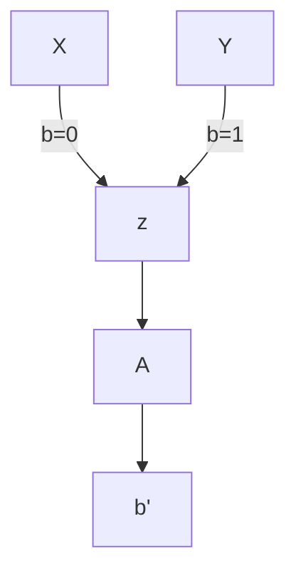

**02:10 public cryptography**.

**4:20 pesudorandomness**: a **deterministic** function can create pseudorandomness. Takes an uniform string and outputs many bits  that "*look-random*", but cannot be random.

*look-random*, pseudorandomness means no PPT $\mathcal A$ can distinguish it from a random except with negligible probability. So it's a property about the distributions.

**def**. let $X = \{ X_{\lambda} \}_{\lambda \in \mathbb N}$, $T = \{ Y_{\lambda} \}_{\lambda \in \mathbb N}$ two sets of distributions. We say that $X$ is computationally indistinguishable from $Y$, $X \approx_{C} Y$ if $\forall$ **PPT** $\mathcal A$.
* goal of $A$ is to decide if $x$ belongs to $X$ or to $Y$
* if $\mathcal A$ can win "often" (pr is not negligible in function of lambda), then $X$ and $Y$ are not computationally indistinguishable
* if $\mathcal A$ cannot win "often" (pr is not negligible in function of lambda), then $X$ and $Y$ are computationally indistinguishable
* **note**: we did not point out already how $X$ and $Y$ look like.
* formally:
$$
(1) \;\; |\text{Pr}[A(X)=1]-\text{Pr}[A(Y)=1]| \leq \text{negl}(\lambda)
$$
$$
\equiv |\text{Pr}[A(X_{\lambda})=1]-\text{Pr}[A(Y_{\lambda})=1]| \leq \text{negl}(\lambda)
$$
**example**:
* $\mathcal A$ receives $z$ that either comes from $X$, or from $Y$
	* if $b=0$, then $z \in X$
	* if $b=1$, then $z \in Y$
* $\mathcal A$ outputs $b'=\{ 0,1 \}$ and wins if $b'=b$.

in therms of game $(1)$ becomes:
$$
\{ \text{GAME}(\lambda, 0) \}) \approx_{C} \{ \text{GAME}(\lambda, 1) \})
$$

**(25:00) pseudorandom generators**: pesudorandom generators extract and amplify recorded random sources. So a PRG (secure) is a function $G: \{ 0,1 \}^\lambda \to \{ 0,1 \}^{\lambda+l}$ with $l>0$ such that:
1. $\{G(U_{\lambda})\} = \{ X_{\lambda} \}$ where $X_{\lambda}$ is the distribution $G$ of $U_{\lambda}$ with $U$ uniform.
	1. so i sample uniformly random strings and put in $G$
	2. i get a distribution $X_{\lambda}$
2. $\{G(U_{\lambda})\} \approx_{C} U_{l+\lambda}$
	1. i want $X_{\lambda}$ computationally indistinguishable from $U_{l+\lambda}$.

**Excercise**: no PRG is secure against unbounded attackers. Not even if $G: \{ 0,1 \}^\lambda \to \{ 0,1 \}^{\lambda+1}$.
* Adversary can brute force combinations. and find the primitive for $z$.
* **DOMANDA**: $X$ e $Y$ sono gli insiemi di partenza (???) oppure due PRG differenti?
	* **RISPOSTA**: $X$ e' $U$ mentre $Y$ e' $G(U)$
* so given $z\in \{ 0,1 \}^{\lambda+1}$, $\mathcal A$ can finde $s \in \{ 0,1 \}^\lambda$ s.t. $z=G(s)$.

How to construct $G$? its not easy. 
**thm 41:00**: if any **owf** (one way function) exists, so do PRGs with stretch $l(\lambda)=\text{poly}(\lambda)$ (can stretch of a polinomial factor in $\lambda$). The result of the theorem is not something practical, it cannot be easily implemented with code.

> **Note**: often in **crypto** there is difference between theory and practice. something feasible in theory might not be practical

**proof for thm is hard** and so am i. but we will discuss main ideas:
1. **thm 1: from $l(\lambda)=1$ to $l(\lambda)=\text{poly}(\lambda)$:** we can design a function that stretchs of 1 bit and produce a function that stratches $\text{poly}(\lambda)$ bits.
	1. ass
 2. **51:50 thm 2: Hard-core bits**.

**thm 1**: assume  $G: \{ 0,1 \}^{\lambda} \to \{ 0,1 \}^{\lambda+1}$ is a PRG, then there is a $\text{PRG}$: $G^l: \{ 0,1 \}^{\lambda} \to \{ 0,1 \}^{\lambda+l}$ for every $l(\lambda)=\text{poly}(l)$
* let $s_{0} \in \{ 0,1 \}^\lambda$ an initial seed for $G$
* $G$ outputs $s_{1} \in \{ 0,1 \}^\lambda$ and $b_{1} \in \{ 0,1 \}$, we output in totale $\lambda+1$ bits.
* then we give again $s_{1}$ in input to $G$ as a seed
* $G$ outputs $s_{2} \in \{ 0,1 \}^\lambda$ and $b_{2} \in \{ 0,1 \}$
* ...
* if we repeat $l$ times we produced bits $b_{1}, \dots, b_{l}$, so $l$ bits. 

> look at the fancy diagram in the notes

**more formarly**:
* let $s_{0} \in U_{\lambda}$
* for $i \in [1,\dots, l]$$(s_{i}, b_{i}) = G(s_{i-1})$
* $s_{i} \in \{ 0,1 \}^\lambda$
* $b_{i} \in \{ 0,1 \}$
* we have gained $l$ bits $(b_{1},\dots,b_{l})$.
* **output**: $(b_{1},\dots,b_{l}) \text{ concatenated to } s_{l}$
* **note**: since $s_{0}$ is uniform, then we can assume $G(s_{0})$ also is uniform and so on...

**1:00:0 How to prove thm1?** by reduction. Assume not true. Then there is $PPT$ $\mathcal A$ that breaks $G^l$, then we build a PPT $\mathcal B$ that breaks $G$.
* $\mathcal A$ expects from $\mathcal B$, a value $z' \in \{ 0,1 \}^{\lambda+l}$
* $\mathcal B$ gets $z$ from the **Challenger**.
* ma fare la riduzione da $\mathcal A$ ad $\mathcal B$ e' impossibile ora.

> look at the diagrams

we introduce a new technique: **the hybrid argument (1:12:00)**: if we need to show $X \approx_{C} Y$ we can do so by finding hybrids $H_{0}, H_{1}, \dots, H_{l}$ such that:
1. $H_{0}\equiv X$ and $H_{l}\equiv Y$.
2. $H_{0} \approx_{C} H_{1}$, ..., $H_{l-1} \approx_{C} H_{l}$
3. by triangle inequality, $H_{0} \approx_{C} H_{l}$ so long as $l(\lambda)=\text{poly}(\lambda)$

How do we find $H_{i}$? idea, lets pretend $s_{1}$ uniform and $b_{1}$ uniform at the first stage in the main idea.
* $H_{1}$: $s_{1},b_{1}$ will be uniform.
* $H_{2}$: $s_{2},b_{2}$ will be uniform. and $s_{1}$ is uniform.
* ...
* $H_{l}: s_{l}, b_{l}$ will be uniform, and $s_{1},\dots,s_{l-1}$ is uniform. 

**formalization** (**critto 5 parte 2 0:00**):
* $H_{0} \equiv G^l(U_{\lambda})$; $H_{l} \equiv U_{l+\lambda}$
* NON CI HO CAPITO NIENTE
* $H_{i}$: $b_{1},\dots,b_{i} \gets \{ 0,1 \}$, $s_{i} \gets U_{\lambda}$, $b_{i+1}, \dots, b_{l}, s_{l} = G^{l-i}(s_{i})$
* $H_{1}$: i pick $b_{1}$ uniformly, $s_{1}$ uniformly and $b_{2},\dots,b_{l}, s_{l} = G^{l-1}(s_{1})$ with $s_{1} \gets U_{\lambda}$.

**now, finally we can do the reduction**: we'll show $H_0 \approx_{C} H_{1}$.
* assume $G$ is secure and $\exists$ PPT $\mathcal A$ that distinguishes $H_{0}$ from $H_{1}$
	* before we wanted to distniguish $H_{0}$ from $H_{l}$, that's why we could not do the reduction.
* we want to find $\mathcal B$ that breaks $G$

* $\mathcal B$ gets $z$ from $\mathcal C$. $\mathcal C$ choses one of the two
	* $z \in G(U_{\lambda})$
	* $z \in U_{\lambda+1}$
* $\mathcal A$ gets from $\mathcal B$ something that does not look like $H_{0}$ and neither like $H_{1}$. The goal is to generating a string containg someway $z$.
	* $z=b_{1} s_{1}$ (concatenation), in $H_{1}$ $s_{1},b_{1}$ are uniform, with $s_{1} \in \{ 0,1 \}^\lambda$ and $b \in \{ 0,1 \}$
	* $(b_{2}, \dots, b_{l}, s_{l})=G^{l-1}(s_{1})$.
	* $\mathcal A$ gets $b_{1},b_{2},\dots,b_{l},s_{l}$

**Observe** if $z \in G(U_{\lambda})$, then $b_{1},\dots,b_{l},s_{l}$ computed by $\mathcal B$ are distribute like $H_{0}$. Else, if $z \gets U_{\lambda+1}$, then it is distrubited like in $H_{1}$.

But by assumption $\mathcal A$, distinguishes $H_{0}$ from $H_{1}$:
$$\text{Pr}[\mathcal A(b_{1},\dots,b_{l},s_{l}): (b_{1},\dots,b_{l}, s_{l}) \gets G^l(U_{\lambda})]- \text{Pr}[\mathcal A(b_{1},\dots,b_{l}, s_{l}): (b_{1}, \dots, b_{l}, s_{l}) \gets H_{1}]  \geq \frac{1}{p(\lambda)}$$
 
* note $G^l(U_{\lambda}) \equiv H_{0}$

And we have shown: 
$$
\text{Pr}[\mathcal B(z)=1: z \gets H_{0}]= \text{Pr}[\mathcal A(b_{1},\dots,b_{l},s_{l})=1:b_{1},\dots, b_{l}, s_{l} \gets H_{0}]
$$
$$
= 
$$

so $\mathcal B$ distinguishes w.p $\geq \frac{1}{p(\lambda)}$, and by **very similar proof**: $H_{i} \approx_{C} H_{i+1}$.

**How do we get (24:00) $G: \{ 0,1 \}^\lambda \to \{ 0,1 \}^{\lambda+1}$ in the first place?** In theory i can do it starting with any ofw, but not very efficiently. Using number theory and other things we can make it more efficient. 

**hard-core bit**: let $f: \{ 0,1 \}^n \to \{ 0,1 \}^n$ be owf. Can we say that a particolar bit of $x$ is hard to compute? Maybe in a owf i can compute some bits of the preimage?

**hard core definition**: $h: \{ 0,1 \}^n \to \{ 0,1 \}$ is hard core if $h(x)$ is hard to compute given $f(x)$.
* alternatively: $(f(x),h(x)) \approx_{C} (f(x),u)$ with $u \in \{ 0,1 \}$.
* given $f(x)$, can i guess $h(x) \in \{ 0,1 \}$
* we want $h(x)$ to be hard to guess. (CHECK THIS)

**Assume** $f: \{ 0,1 \}^n \to \{ 0,1 \}^n$ is a **one-way-permutation**, then look: $G(s) \approx f(s) || h(s)$, with $s \gets U_{n}$. But since $h(s)$ is hardcore, then $b \in \{ 0,1 \}$ is uniform.
$$
f(s) || h(s) \approx_{C} f(s)||b \equiv U_{n+1}
$$

the assumption above works even with $f$ **owf** (and not **owp**). moreover, every $f$ admits hard-core bit $h$.

**Question**: can there be $h: \{ 0,1 \}^n \to \{ 0,1 \}$ for every $f: \{ 0,1 \}^n \to \{ 0,1 \}^n$.