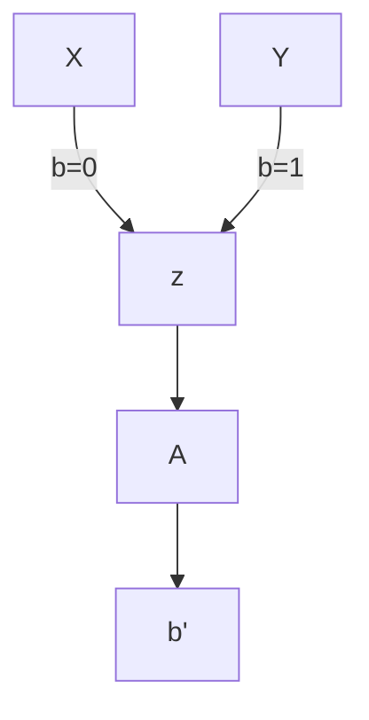

[4:20] **pseudorandomness**: a deterministic function can create **pseudorandomness**
* from a uniform string 
* we can output bits that look-random

**def. pseudorandomness**: $f$ is pseudorandom iff no $\text{PPT } \mathcal A$ can distinguish it from a random string
	* except for a negligible probability
	* so pseudo.rand. is a property that applies to distributions

**assumptions for def. computationally indistinguishable**
* let $X = \{ X_{\lambda} \}_{\lambda \in \mathbb N}$
* let $Y = \{ Y_{\lambda} \}_{\lambda \in \mathbb N}$ 
* we have two sets of distributions. 

**def. computationally indistinguishable**: We say that $X$ is computationally indistinguishable from $Y$
$$X \approx_{C} Y$$
if $\forall \text{ PPT } \mathcal A$:
$$
(1) \;\; |\text{Pr}[A(X)=1]-\text{Pr}[A(Y)=1]| \leq \text{negl}(\lambda)
$$
$$
\equiv |\text{Pr}[A(X_{\lambda})=1]-\text{Pr}[A(Y_{\lambda})=1]| \leq \text{negl}(\lambda)
$$

**what the definition says in practice?**
* goal of $A$ is to decide if a "given" $x$ belongs to $X$ or to $Y$
*  we ask if: *pr is not negligible in function of lambda ($\lambda$)*?
	* **note**: $\lambda$ decides how long input and output are
* if $\mathcal A$ can win "often" then $X$ and $Y$ are not computationally indistinguishable
* **note**: we did not point out already how $X$ and $Y$ look like.

**example**:
* $\mathcal A$ receives $z$ that either comes from $X$, or from $Y$
	* if $b=0$, then $z \gets X_{\lambda}$
	* if $b=1$, then $z \gets Y_{\lambda}$
* $\mathcal A$ outputs $b'\in \{ 0,1 \}$ and wins if $b'=b$.

In terms of game $(1)$ becomes:
$$
\{ \text{GAME}(\lambda, 0) \} \approx_{C} \{ \text{GAME}(\lambda, 1) \}
$$
**Pseudorandom Generators**: P.G. extract and **amplify** "recorded random sources". So a **secure** PRG  is a deterministic poly-time function $G: \{ 0,1 \}^\lambda \to \{ 0,1 \}^{\lambda+l}$ with $l>0$ such that:
1. $\{G(U_{\lambda})\} = \{ X_{\lambda} \}$ 
	- $X_{\lambda}$ is the distribution $G(U_{\lambda})$
	- $U$ stands for Uniform.
	- So i *sample uniformly random strings* and put in $G$
	- The result is $X_{\lambda}$ 
2. $\{G(U_{\lambda})\}_{\lambda} \approx_{C} \{U_{\lambda+l}\}_{\lambda}$
	1. Means that i  want $\{X_{\lambda}\}$  to be *computationally indistinguishable* from $U_{\lambda+l}$.

**Exercise**: no PRG is secure against **unbounded** attackers. Not even if $G: \{ 0,1 \}^\lambda \to \{ 0,1 \}^{\lambda+1}$.
* Adversary can brute force combinations, and find the pre-image for $z$: output $1$ if $\exists s \in \{0,1\}^\lambda$ s.t. $G(s)=z$, else $0$. #gemini
* **Note**: $X$ is $G(U_\lambda)$ while $Y$ is $U_{\lambda+1}$
* so given $z\in \{ 0,1 \}^{\lambda+1}$, $\mathcal A$ can find $s \in \{ 0,1 \}^\lambda$ s.t. $z=G(s)$ just by looking at all the combinations, since is unbounded.

**gemini**: what does it mean 
* $\text{Pr}[\mathcal A(z) = 1 : z=G(s); s \gets U_{\lambda}]=1$: when $z$ is generated by $G(s)$, a valid seed $s$ always exists, so $\mathcal{A}$ always finds one and outputs $1$. #gemini
* $\text{Pr}[\mathcal A(z) = 1 : z \gets U_{\lambda+1}] \leq \frac{1}{2}$: since $|\text{Im}(G)| \leq 2^\lambda$ and $|\{0,1\}^{\lambda+1}| = 2^{\lambda+1}$, at most $\frac{2^\lambda}{2^{\lambda+1}} = \frac{1}{2}$ of all $(\lambda+1)$-bit strings are in the image of $G$. Thus $\mathcal{A}$ distinguishes with advantage $|1 - \text{Pr}[\mathcal{A}(U_{\lambda+1})=1]| \geq \frac{1}{2}$ (non-negligible). #gemini

How to construct $G$? its not easy. 

**thm 41:00**: 
* if any **owf** (one way function) exists
* so do PRGs with stretch $l(\lambda)=\text{poly}(\lambda)$ 
	* means that: can stretch of a polynomial factor in $\lambda$.
	* note a polynomial in $\lambda$ is: $a_{n}\lambda^n + \dots a_{1} \lambda + a_{0}$
* The result of the theorem is not something practical, it cannot be easily implemented with code.

> **Note**: often in **crypto** there is difference between theory and practice. something feasible in theory might not be practical

**proof for thm is hard** and so am i. We will discuss main ideas:
1. **thm 1: from $l(\lambda)=1$ to $l(\lambda)=\text{poly}(\lambda)$ (stretch amplification):** we can design a function that stretches of 1 bit and produce a function that stretches $\text{poly}(\lambda)$ bits.
2. **51:50 thm 2: Hard-core bits**.

**thm 1**: 
* assume  $G: \{ 0,1 \}^{\lambda} \to \{ 0,1 \}^{\lambda+1}$ is a PRG
* then there is a $\text{PRG}$: $G^l: \{ 0,1 \}^{\lambda} \to \{ 0,1 \}^{\lambda+l}$ 
* for every $l(\lambda)=\text{poly}(\lambda)$

**construction in excalidraw**:
![[lez. 5 thmconstruction.excalidraw]]
$$
(s_{i}, b_{i}) = G(s_{i-1})
$$

**construction explanation & proof for thm1**:
* **initial seed**: let $s_{0} \in \{ 0,1 \}^\lambda$ an initial seed for $G$
* the first $G$ outputs $s_{1} \in \{ 0,1 \}^\lambda$ and $b_{1} \in \{ 0,1 \}$
	* in total $\lambda+1$ bits.
* then we give again $s_{1}$ in input to $G$ as a seed
* $G$ outputs $s_{2} \in \{ 0,1 \}^\lambda$ and $b_{2} \in \{ 0,1 \}$
* ...
* if we repeat $l$ times we produced bits $b_{1}, \dots, b_{l}$.
	* in total $l$ bits.

**more formally**:
* let $s_{0} \gets U_{\lambda}$
* for $i \in [l]$, $(s_{i}, b_{i}) = G(s_{i-1})$
	* $s_{i} \in \{ 0,1 \}^\lambda$
	* $b_{i} \in \{ 0,1 \}$
	* where $[l] = \{ 1,\dots,l \}$
* we have gained $l$ bits $(b_{1},\dots,b_{l})$.
* **output**: $(b_{1},\dots,b_{l},s_{l}) \equiv$  $(b_{1},\dots,b_{l}) \text{ concatenated to } s_{l}$

 > **note**: since $s_{0}$ is uniform, then we can assume $G(s_{0})$ also is uniform and so on...

**1:00:0 How to prove thm1?** by reduction. Assume not true
* Then there is $\text{PPT}$ $\mathcal A$ that breaks $G^l$
* Then we can build a PPT $\mathcal B$ that breaks $G$.
* $\mathcal A$ expects from $\mathcal B$, a value $z' \in \{ 0,1 \}^{\lambda+l}$
* but $\mathcal B$ gets $z\in \{ 0,1 \}^{\lambda+1}$ from the **Challenger**.
* how do we convert a challenge for $\mathcal B$ into a challenge for $\mathcal A$ breaking $G^l$?

Reduction looks like this:
![[lez. 5 2026-10-27 17.54.26.excalidraw]]
gemini explain the idea behind the difficulty with the reduction:
* **Why a direct reduction fails**: $\mathcal{A}$ only distinguishes the two extremes $G^l(U_\lambda)$ ($H_0$) and $U_{\lambda+l}$ ($H_l$). However, $\mathcal{B}$ receives only a single $(\lambda+1)$-bit challenge $z = (b_1, s_1)$ from $\mathcal{C}$ (representing **one** evaluation of $G$ vs $U_{\lambda+1}$). If $\mathcal{B}$ expands $s_1$ via $G^{l-1}(s_1)$, then when $z \gets G(U_\lambda)$ the result is $H_0$, **but** when $z \gets U_{\lambda+1}$ the result is $H_1$ (where bits $b_2, \dots, b_l, s_l$ are still pseudorandom, not truly uniform $U_{\lambda+l}$!). Thus $\mathcal{B}$ cannot simulate both $G^l(U_\lambda)$ and $U_{\lambda+l}$ in a single jump. #gemini

> [!note] what is an hybrid?
> Its just a distribution $\{ H_{n}^i \}_{n=1,\dots}$, that we are building ($H_{n}^i \equiv H_{i}$) by using $G$ and $\hat{G}$ 
> [[lez. 5 hybrids book]]

**Solution: the hybrid argument (1:12:00)**: if we need to show $X \approx_{C} Y$ we can do so by finding hybrids $H_{0}, H_{1}, \dots, H_{l}$ such that:
1. $H_{0}\equiv X$ and $H_{l}\equiv Y$.
	1. $H_{0}$ is a distribution identical to $X$
2. $H_{0} \approx_{C} H_{1}$, ..., $H_{l-1} \approx_{C} H_{l}$
3. by triangle inequality, $H_{0} \approx_{C} H_{l}$ 
4. so long as $l(\lambda)=\text{poly}(\lambda)$ (since $\text{poly}(\lambda) \cdot \text{negl}(\lambda) = \text{negl}(\lambda)$) #gemini

How do we find $H_{i}$? idea:
* lets pretend $s_{1}$ uniform 
* and $b_{1}$ uniform at the first stage in the main idea (as in excalidraw drawing).
* $H_{1}$: $s_{1},b_{1}$ will be uniform.
* $H_{2}$: $b_{1},b_{2}$ and $s_{2}$ will be uniform.
* ...
* $H_{l}: b_{1},\dots,b_{l}, s_{l}$ will all be uniform. 
* its like a chain of distributions where at step $H_i$ the first $i$ calls to $G$ are replaced with truly uniform bits, and the remaining $l-i$ calls still use $G$. #gemini

**formalization** (**critto 5 parte 2 0:00**):
* $H_{0} \equiv G^l(U_{\lambda})$; $H_{l} \equiv U_{l+\lambda}$
	* $H_{0}$ is equivalent to $G^l$ with input $U_{\lambda}$
	* $H_{l}$ is equivalent to $U_{\lambda+\ell}$
* $H_{i}$: 
	* let $b_{1}, \dots, b_{i} \gets \{ 0,1 \}$
	* $s_{i} \gets U_{\lambda}$
	* $(b_{i+1}, \dots, b_{l}, s_{l}) = G^{l-i}(s_{i})$
* $H_{1}$: i pick $b_{1}$ uniformly, $s_{1}$ uniformly
	*  $(b_{2},\dots,b_{l}, s_{l}) = G^{l-1}(s_{1})$ with $s_{1} \gets U_{\lambda}$.

![[lez. 5 2026-11-07 16.30.35.excalidraw]]

**now, finally we can do the reduction**: we'll show $H_0 \approx_{C} H_{1}$.
* assume not. 
* so assume $G$ is secure and $\exists$ PPT $\mathcal A$ that distinguishes $H_{0}$ from $H_{1}$
	* **note**: before we wanted to distinguish $H_{0}$ from $H_{l}$, that's why we could not do the reduction.
	* **now we want to find** $\mathcal B$ that breaks $G$

**example**:
* if $z \gets G(U_{\lambda})$ then $b_{1},\dots,b_{l},s_{l}$ computed by $\mathcal B$ are distributed like $H_{0}$
* if $z \gets U_{\lambda+1}$ then it is distributed like in $H_{1}$

But by assumption $\mathcal A$, distinguishes $H_{0}$ from $H_{1}$:
$$\left|\text{Pr}[\mathcal A(b_{1},\dots,b_{l},s_{l})=1: (b_{1},\dots,b_{l}, s_{l}) \gets H_{0}]- \text{Pr}[\mathcal A(b_{1},\dots,b_{l}, s_{l})=1: (b_{1}, \dots, b_{l}, s_{l}) \gets H_{1}]\right|  \geq \frac{1}{p(\lambda)}$$
 

And we have shown by doing so that: 
$$
\text{Pr}[\mathcal B(z)=1: z \gets G(U_{\lambda})]= \text{Pr}[\mathcal A(b_{1},\dots,b_{l},s_{l})=1:b_{1},\dots, b_{l}, s_{l} \gets H_{0}]
$$
$$
\text{Pr}[\mathcal B(z)=1: z \gets U_{\lambda+1}]= \text{Pr}[\mathcal A(b_{1},\dots,b_{l},s_{l})=1:b_{1},\dots, b_{l}, s_{l} \gets H_{1}]
$$
so $\mathcal B$ distinguishes w.p $\geq \frac{1}{p(\lambda)}$, and by **very similar proof**: $\forall i, \; H_{i} \approx_{C} H_{i+1}$.

**How do we get (24:00) $G: \{ 0,1 \}^\lambda \to \{ 0,1 \}^{\lambda+1}$ in the first place?** In theory i can do it starting with any owf, but not very efficiently. Using number theory, lattices, and other things we can make it more efficient. 

**hard-core bit**: let $f: \{ 0,1 \}^n \to \{ 0,1 \}^n$ be owf. Can we say that a particular bit of $x$ is hard to compute? Maybe in a owf i can compute some bits of the preimage?

**hard core definition**: $h: \{ 0,1 \}^n \to \{ 0,1 \}$ is hard core if $h(x)$ is hard to compute given $f(x)$.
* alternatively: $(f(x),h(x)) \approx_{C} (f(x),u)$ with $x \gets U_n, \; u \gets \{ 0,1 \}$.
* given $f(x)$, can i guess $h(x) \in \{ 0,1 \}$
* we want $h(x)$ to be hard to guess: $\forall \text{ PPT } \mathcal{A}, \; \Pr_{x \gets U_n}[\mathcal{A}(1^n, f(x)) = h(x)] \leq \frac{1}{2} + \text{negl}(n)$. #gemini

**Assume** $f: \{ 0,1 \}^n \to \{ 0,1 \}^n$ is a **one-way-permutation**, then look: $G(s) = f(s) || h(s)$, with $s \gets U_{n}$. Since $f$ is a permutation (bijection), $f(U_n) \equiv U_n$, and since $h(s)$ is hardcore, replacing $h(s)$ with uniform $b \gets \{ 0,1 \}$ yields $U_{n+1}$: #gemini
$$
f(s) || h(s) \approx_{C} f(s)||b \equiv U_{n+1}
$$

the assumption above works even with $f$ **owf** (and not **owp**). moreover, every $f$ admits hard-core bit $h$.

why is this useful?
$$
\begin{aligned}
G(s) &= f(s) || h(s) \;\;\;\; s\gets U_{n} \\
&\approx_{C} f(s) || b \;\;\;\;\;\;\;\; b \gets \{ 0,1 \} \\
&\equiv U_{n+1}
\end{aligned}
$$

**Question**: can there be a single $h: \{ 0,1 \}^n \to \{ 0,1 \}$ for every $f: \{ 0,1 \}^n \to \{ 0,1 \}^n$? **No.** #gemini
* **Idea**: Take any $h$; build $f_{\text{BAD}}(x) = f(x) \| h(x)$ using an auxiliary OWF $f: \{0,1\}^n \to \{0,1\}^n$ so that $f_{\text{BAD}}$ is still a OWF, but $h$ is trivially leaked in the output (hence not hard-core for $f_{\text{BAD}}$). #gemini