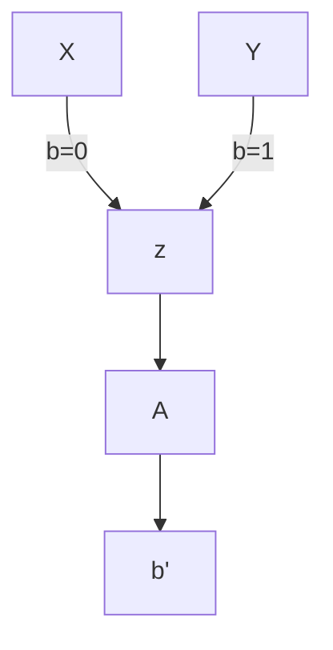

[4:20] **pseudorandomness**: a deterministic function can create **pseudorandomness**
* from a uniform string 
* we can output bits that look-random

**def. pseudorandomness**: $f$ is pseudorandom iff no $\text{PPT } \mathcal A$ can distinguish it from a random string
	* except for a negligible probability
	* so pseudo.rand. is a property that applies to distributions

**assumptions for def. computationally indistinguishable**
* let $X = \{ X_{\lambda} \}_{\lambda \in \mathbb N}$
* let $Y = \{ Y_{\lambda} \}_{\lambda \in \mathbb N}$ 
* we have two sets of distributions. 

**def. computationally indistinguishable**: We say that $X$ is computationally indistinguishable from $Y$ ($X \approx_{C} Y$) if $\forall \text{ PPT } \mathcal A$: #gemini
$$
(1) \;\; |\text{Pr}[A(X_{\lambda})=1]-\text{Pr}[A(Y_{\lambda})=1]| \leq \text{negl}(\lambda)
$$

**what the definition says in practice?**
* goal of $A$ is to decide if a "given" $x$ belongs to $X$ or to $Y$
*  we ask if: *pr is not negligible in function of lambda ($\lambda$)*?
	* **note**: $\lambda$ decides how long input and output are
* if $\mathcal A$ can win "often" then $X$ and $Y$ are not computationally indistinguishable
* **note**: we did not point out already how $X$ and $Y$ look like.

**example**:
* $\mathcal A$ receives $z$ that either comes from $X$, or from $Y$
	* if $b=0$, then $z \gets X_{\lambda}$
	* if $b=1$, then $z \gets Y_{\lambda}$
* $\mathcal A$ outputs $b'\in \{ 0,1 \}$ and wins if $b'=b$.

In terms of game $(1)$ becomes:
$$
\{ \text{GAME}(\lambda, 0) \} \approx_{C} \{ \text{GAME}(\lambda, 1) \}
$$
**Pseudorandom Generators**: P.G. extract and **amplify** "recorded random sources". So a **secure** PRG  is a deterministic poly-time function $G: \{ 0,1 \}^\lambda \to \{ 0,1 \}^{\lambda+l}$ with $l>0$ such that:
1. $\{G(U_{\lambda})\} = \{ X_{\lambda} \}$ 
	- $X_{\lambda}$ is the distribution $G(U_{\lambda})$
	- $U$ stands for Uniform.
	- So i *sample uniformly random strings* and put in $G$
	- The result is $X_{\lambda}$ 
2. $\{G(U_{\lambda})\}_{\lambda} \approx_{C} \{U_{\lambda+l}\}_{\lambda}$
	1. Means that i  want $\{X_{\lambda}\}$  to be *computationally indistinguishable* from $U_{\lambda+l}$.

**Exercise**: no PRG is secure against **unbounded** attackers. Not even if $G: \{ 0,1 \}^\lambda \to \{ 0,1 \}^{\lambda+1}$.
* Adversary brute-forces pre-images: output $1$ if $\exists s \in \{0,1\}^\lambda$ s.t. $G(s)=z$, else $0$. #gemini
* $\text{Pr}[\mathcal A(z) = 1 : z=G(s); s \gets U_{\lambda}]=1$: * [INSERT HERE: why pre-image search always succeeds on G(s)] #gemini
* $\text{Pr}[\mathcal A(z) = 1 : z \gets U_{\lambda+1}] \leq \frac{1}{2}$: * [INSERT HERE: bound via ratio |Im(G)| / 2^{λ+1}] #gemini

How to construct $G$? its not easy. 

**thm 41:00**: 
* if any **owf** (one way function) exists
* so do PRGs with stretch $l(\lambda)=\text{poly}(\lambda)$ 
	* means that: can stretch of a polynomial factor in $\lambda$.
	* note a polynomial in $\lambda$ is: $a_{n}\lambda^n + \dots a_{1} \lambda + a_{0}$
* The result of the theorem is not something practical, it cannot be easily implemented with code.

> **Note**: often in **crypto** there is difference between theory and practice. something feasible in theory might not be practical

**proof for thm is hard** and so am i. We will discuss main ideas:
1. **thm 1: from $l(\lambda)=1$ to $l(\lambda)=\text{poly}(\lambda)$ (stretch amplification):** we can design a function that stretches of 1 bit and produce a function that stretches $\text{poly}(\lambda)$ bits.
2. **51:50 thm 2: Hard-core bits**.

**thm 1**: 
* assume  $G: \{ 0,1 \}^{\lambda} \to \{ 0,1 \}^{\lambda+1}$ is a PRG
* then there is a $\text{PRG}$: $G^l: \{ 0,1 \}^{\lambda} \to \{ 0,1 \}^{\lambda+l}$ 
* for every $l(\lambda)=\text{poly}(\lambda)$

**construction**:
![[lez. 5 thmconstruction.excalidraw]]
* let $s_{0} \gets U_{\lambda}$
* for $i = 1, \dots, l$: $(s_{i}, b_{i}) = G(s_{i-1})$ where $s_{i} \in \{ 0,1 \}^\lambda, \; b_{i} \in \{ 0,1 \}$ #gemini
* **output**: $(b_{1},\dots,b_{l},s_{l}) \in \{0,1\}^{\lambda+l}$ #gemini
* **intuition**: * [INSERT HERE: why each step produces 1 pseudorandom bit and a fresh seed] #gemini

**1:00:0 Proof of thm 1 by reduction**: Assume $\exists \text{ PPT } \mathcal A$ breaking $G^l \implies$ build PPT $\mathcal B$ breaking $G$. #gemini
* $\mathcal B$ receives $z \in \{0,1\}^{\lambda+1}$ from Challenger $\mathcal C$; $\mathcal A$ expects $z' \in \{0,1\}^{\lambda+l}$. #gemini
* **Why direct reduction fails**: * [INSERT HERE: why B cannot simulate both extremes H_0 and H_l in a single jump from challenge z] #gemini

![[lez. 5 2026-10-27 17.54.26.excalidraw]]

> [!note] what is an hybrid?
> Its just a distribution $\{ H_{n}^i \}_{n=1,\dots}$, that we are building ($H_{n}^i \equiv H_{i}$) by using $G$ and $\hat{G}$ 
> [[lez. 5 hybrids book]]

**Solution: the hybrid argument (1:12:00)**: To show $X \approx_{C} Y$, find hybrids $H_{0}, H_{1}, \dots, H_{l}$ such that: #gemini
1. $H_{0}\equiv X$ and $H_{l}\equiv Y$
2. $\forall i \in \{0, \dots, l-1\}: \; H_{i} \approx_{C} H_{i+1}$ #gemini
3. $\implies H_{0} \approx_{C} H_{l}$ by triangle inequality, so long as $l(\lambda)=\text{poly}(\lambda)$
* **Hybrid sequence intuition**: * [INSERT HERE: how intermediate distributions H_i bridge H_0 to H_l] #gemini

**formalization of hybrids for $G^l$**: #gemini
* $H_{0} \equiv G^l(U_{\lambda})$
* $H_{i}$ (for $i \in [l-1]$): $b_{1}, \dots, b_{i} \gets \{ 0,1 \}, \; s_{i} \gets U_{\lambda}$, and $(b_{i+1}, \dots, b_{l}, s_{l}) = G^{l-i}(s_{i})$ #gemini
* $H_{l} \equiv U_{\lambda+l}$ #gemini

![[lez. 5 2026-11-07 16.30.35.excalidraw]]

**reduction ($H_0 \approx_{C} H_1$)**: #gemini
* Assume $\exists \text{ PPT } \mathcal A$ distinguishing $H_{0}$ from $H_{1}$ with advantage $\ge \frac{1}{p(\lambda)}$. Build PPT $\mathcal B$ breaking $G$: #gemini
	1. $\mathcal B$ receives $z \in \{ 0,1 \}^{\lambda+1}$ from Challenger $\mathcal C$ #gemini
	2. $\mathcal B$ parses $z = (b_1, s_1)$ with $b_1 \in \{0,1\}$ and $s_1 \in \{0,1\}^\lambda$ #gemini
	3. $\mathcal B$ computes $(b_2, \dots, b_l, s_l) = G^{l-1}(s_1)$ #gemini
	4. $\mathcal B$ queries $\mathcal A(b_1, \dots, b_l, s_l)$ and forwards decision bit $b'$ to $\mathcal C$ #gemini
* **Distribution mapping**:
	* $z \gets G(U_{\lambda}) \implies (b_{1},\dots,b_{l},s_{l}) \sim H_{0}$ #gemini
	* $z \gets U_{\lambda+1} \implies (b_{1},\dots,b_{l},s_{l}) \sim H_{1}$ #gemini
* **Distinguishing advantage**:
$$
\begin{aligned}
\text{Pr}[\mathcal B(z)=1: z \gets G(U_{\lambda})] &= \text{Pr}[\mathcal A(z')=1: z' \gets H_{0}] \\
\text{Pr}[\mathcal B(z)=1: z \gets U_{\lambda+1}] &= \text{Pr}[\mathcal A(z')=1: z' \gets H_{1}]
\end{aligned}
$$
$$\implies \left|\text{Pr}[\mathcal B(G(U_\lambda))=1] - \text{Pr}[\mathcal B(U_{\lambda+1})=1]\right| \geq \frac{1}{p(\lambda)}$$
* **Proof step / triangle inequality**: * [INSERT HERE: why this contradicts PRG security of G and how to extend to all H_i] #gemini

**How do we get (24:00) $G: \{ 0,1 \}^\lambda \to \{ 0,1 \}^{\lambda+1}$ in the first place?** In theory i can do it starting with any owf, but not very efficiently. Using number theory, lattices, and other things we can make it more efficient. 

**hard-core bit**: let $f: \{ 0,1 \}^n \to \{ 0,1 \}^n$ be owf. Can we say that a particular bit of $x$ is hard to compute? Maybe in a owf i can compute some bits of the preimage?

**hard core definition**: $h: \{ 0,1 \}^n \to \{ 0,1 \}$ is hard core if $h(x)$ is hard to compute given $f(x)$.
* alternatively: $(f(x),h(x)) \approx_{C} (f(x),u)$ with $x \gets U_n, \; u \gets \{ 0,1 \}$.
* given $f(x)$, can i guess $h(x) \in \{ 0,1 \}$
* we want $h(x)$ to be hard to guess: $\forall \text{ PPT } \mathcal{A}, \; \Pr_{x \gets U_n}[\mathcal{A}(1^n, f(x)) = h(x)] \leq \frac{1}{2} + \text{negl}(n)$. #gemini

**PRG from OWP**: If $f: \{ 0,1 \}^n \to \{ 0,1 \}^n$ is a **one-way-permutation** (OWP) and $h$ is a hard-core predicate for $f$, then $G(s) = f(s) \| h(s)$ is a secure PRG stretching $n \to n+1$: #gemini
$$
\begin{aligned}
G(s) &= f(s) \| h(s) \;\;\;\; (s \gets U_{n}) \\
&\approx_{C} f(s) \| b \;\;\;\;\;\;\;\; (b \gets \{ 0,1 \}) \\
&\equiv U_{n+1}
\end{aligned}
$$
* **Proof intuition**: * [INSERT HERE: why f being a bijection ensures f(s) is uniform over {0,1}^n] #gemini
* Note: also works for any general **OWF** (every OWF admits a hard-core bit via Goldreich-Levin). #gemini

**Question**: can there be a single universal $h: \{ 0,1 \}^n \to \{ 0,1 \}$ for every OWF? **No.** #gemini
* **Counterexample**: * [INSERT HERE: build f_BAD(x) = f(x) || h(x) leaking h(x)] #gemini