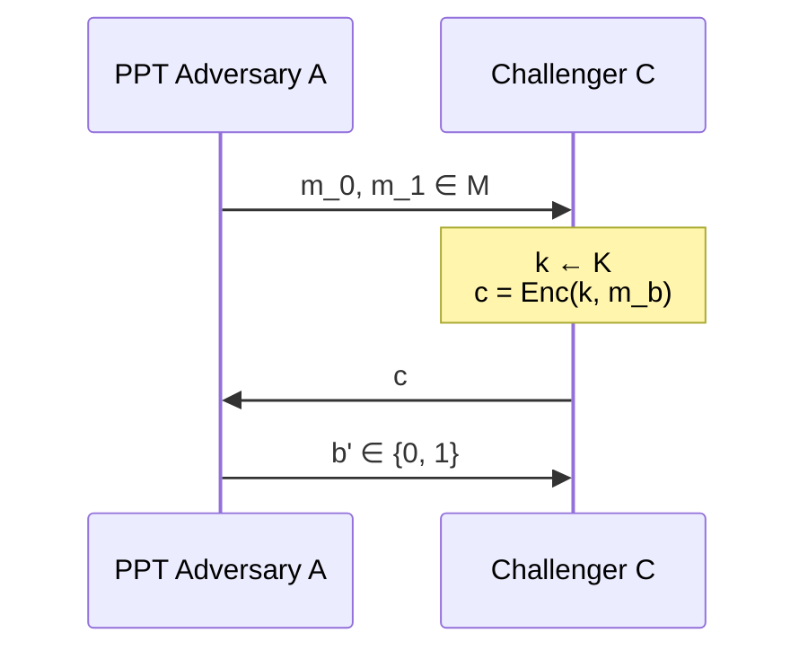
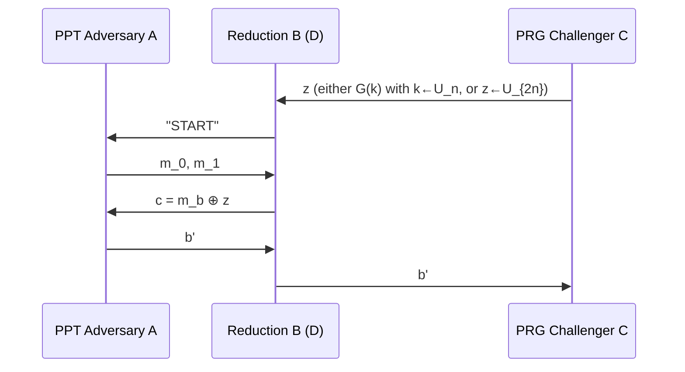

[[lez. 6 owf book]]

> this section is over engineered to understand something of what the teacher explained and so extended with book topics and unnecessary things

what is $h$?
1. its the bit of $x$ that $f(x)$ hides. $f$ takes x and produces an output but **leaking a partial information**.
2. $h$ isolates from the input $\{ 0,1 \}^n$ the bit that $f(x)$ **does not leak**, and so hides.
3. $h$ strictly depends on $f$

why do we need $h$?
* with $f$ and owp or owf
* $h$ permits to do pseudorandom stretch on $f$
* $G(s)= f(s) || h(s) \equiv U_{n+1}$

**Question**: can there be an
* $h: \{ 0,1 \}^n \to \{ 0,1 \}$
* for every $f: \{ 0,1 \}^n \to \{ 0,1 \}^n$?

**R: no**, idea:
* take any $h$
* build $f_{\text{bad}}$ s.t. $h$ not hard-core for $f_{\text{bad}}$
* but $f_{bad}$ is owf
* we can build $f_{bad}$ using another owf

$f_{\text{bad}}(x) = f(x) || h(x)$ built choosing $h$:
* $h(\cdot)$ is not hardcore for $f_{bad}$ by assumption
* bur its still a owf.

why $f_{bad}$ is still a owf?
* suppose not: $\exists \text{PPT} \mathcal A$ that wins $\text{Game}_{f_{\text{bad}}}^\text{owf}(\lambda)$
* with w.p. $\geq \frac{1}{\text{poly}(\lambda)}$ 
* then we consider PPT $\mathcal B$ s.t. $\mathcal B$ breaks $f$.

**attack game** *(Bianco Sec. 3.3, p. 25; Slide 1)*:
* $\mathcal C$ picks $x \gets U_n$ and sends $y=f(x)$ to $\mathcal B$ #gemini
	* **$\mathcal B$'s goal**: find $x'$ s.t. $f(x') = y$
* $\mathcal B$ sends $y||\hat{b}$  with $\hat{b} \gets U_{1}$ to $\mathcal A$
	* $\mathcal A$'s goal: **invert $f_{\text{bad}}$**, i.e., output $x'$ s.t. $f_{\text{bad}}(x') = f(x')||h(x') = y||\hat{b}$ *(not distinguish!)* #gemini
* $\mathcal A$ sends $x'$ to $\mathcal B$ to win $\text{Game}_{f_{\text{bad}}}^{\text{owf}}(\lambda)$
* $\mathcal B$ sends $x'$ to $\mathcal C$ to win $\text{Game}_{f}^{\text{owf}}(\lambda)$

$$
\text{Pr}[\mathcal B_{\text{wins}}] \geq \Pr[\hat{b} = h(x)] \cdot \Pr[\mathcal A_{\text{wins}} \mid \hat{b} = h(x)] = \frac{1}{2} \text{Pr}[\mathcal A_{\text{wins}}] \geq \frac{1}{2} \cdot \frac{1}{\text{poly}(\lambda)} =\frac{1}{\text{poly}(\lambda)}
$$
* $\frac{1}{2}$ because we choose $\hat{b} \gets U_{1}$, so $\Pr[\hat{b} = h(x)] = \frac{1}{2}$ (making $y||\hat{b} = f_{\text{bad}}(x)$ a valid challenge for $\mathcal{A}$) #gemini

> [!note] Second question from Bianco Sec. 3.3 (p. 26) #gemini
> **Does $h$ being hard-core for $f$ imply $f$ is a OWF? No.** Let $f(x_1 \| \dots \| x_n) = x_1 \| \dots \| x_{n-1}$ (drops last bit) and $h(x_1 \| \dots \| x_n) = x_n$. Here $h$ is hard-core for $f$ (since $x_n$ is independent of $x_1 \dots x_{n-1}$), yet $f$ is **not** a OWF (guessing the last bit inverts $f$ with probability $1/2$). #gemini

**thm (Goldreich-Levin — Bianco Thm. 3.3, p. 26; Slide 2)**: 
* let $f: \{ 0,1 \}^n \to \{ 0,1 \}^n$ be an owf
	* **note**: we assume that we have already an owf
	* **goal**: is to build $g$ s.t. exists $h$ hardcore for $g$
* consider $g: \{ 0,1 \}^{2n} \to \{ 0,1 \}^{2n}$ s.t. 
	* $g(x,r)=f(x)||r \quad \forall x, r \in \{0,1\}^n$
	* **note**: so we built $g$, now how $h$ hardcore for $g$ looks?
* **then**:
	* $g$ is owf
	* and $h(x,r) = \langle x,r \rangle = \sum_{i=1}^n x_{i} r_{i} \bmod 2 = \bigoplus_{i=1}^n x_i r_i$ 
		* with $x=(x_{1},\dots,x_{n})$
		* and with $r=(r_{1},\dots,r_{n})$
	* and $h$ is hard-core for $g$
* **meaning**: if $f$ is owf, then it hides the exclusive-or of a random subset of the bits of $x$

**note**: if $r$ uniform, then $h$ outputs a xor of a random subset of $x$

**thm 7.6 book (Bianco Prop. 3.1, p. 26)**: with $f$ one way permutation, and $hc$ hardcore predicate of $f$
* $G(s) = f(s)||hc(s)$ is a pseudorandom generator
* with expansion factor $l(n)=n+1$ (stretch $1$: $G(U_n) \equiv (f(U_n), hc(U_n)) \approx_c (U_n, U_1) \equiv U_{n+1}$) #gemini

**intuition for 7.6**:
* with input uniformly distributed, then the permutation looks random
* $\text{hc}(s)$ is an hardcore predicate for $f$ implies that $\text{hc}(s)$ look random.

**intuition for goldreich-levin (Slide 3)**: assume $\exists$ a *very good* adversary $\mathcal A$ that
* **always** computes $h(x,r)$ given $g(x,r)=(f(x),r) \;\;\forall r$
* assuming $f$ is owf
* then we can use $\mathcal A$ to recover $x$ bit-by-bit and invert $f(x)$, contradicting $f$ being an owf. #gemini
* *(Slide 3 note)*: The general proof is harder because $\mathcal{A}$ wins only w.p. $\frac{1}{2} + \frac{1}{\text{poly}(\lambda)}$ and over a **random** choice of $r \gets U_n$. #gemini

**prop 7.13**: 
* if there exists $\mathcal A$ PPT s.t. $\mathcal A(f(x), r)=h(x,r)$ 
	* **note**: given $f(x)$ and $r$ i can compute the hardcore 
	* for all $n$ and $x,r \in \{ 0,1 \}^n$ 
* then exists $A'$ s.t. $A'(1^n, f(x))=x$ 
	* **note**: given $f(x)$ if i know how to break $h(x,r)$ then i can break $f(x)$
	* for all $n$ and $x\in \{ 0,1 \}^n$

**dim**:
* $\mathcal A'$ computes $x_{i}=\mathcal A(y,e^i)$ for $i=1,\dots,n$
	* $e^i= 00\dots 010\dots 00$ with a 1 in $i\text{-th}$ position

$$
x_{i}=\mathcal A(f(\hat{x}), e^i) = \text{gl}(\hat{x}, e^i) = \bigoplus_{j=1}^n \hat{x}_{j} \cdot e_{j}^i = \hat{x}_{i}
$$
*or more easily*:
* $h(x, e_{1})= \langle x,e_{1}\rangle = \langle x, 10\dots 0\rangle = x_{1}$
* $\dots$
* $h(x, e_n) = \langle x, e_{n}\rangle = \langle x,0\dots 01\rangle =x_{n}$

* $\mathcal A'$ outputs $x=x_{1} \dots x _n$
* and it runs in polynomial time!

# Computational Security of SKE & PRG-OTP *(Bianco Sec. 4.1, pp. 29–31; Slides 3–8)* #gemini
Let's apply PRGs so that we can **beat Shannon** (*PRG-OTP*, Bianco p. 29). Consider this system:
* $\text{Enc}(k,m) = G(k) \oplus m$
* $\text{Dec}(k,c) = G(k) \oplus c$
* $m,c \in \{ 0,1 \}^{2n}$ (or $\{0,1\}^{\lambda+\ell}$ in Bianco) #gemini
* $k \in \{ 0,1 \}^n$ (or $\{0,1\}^\lambda$) #gemini
* $G: \{ 0,1 \}^n \to \{ 0,1 \}^{2n}$

**gemini**: what is $G$?
* $G$ is a deterministic **Pseudorandom Generator (PRG)** that expands the short uniform secret key $k \gets \{0,1\}^n$ into a longer $2n$-bit pseudorandom pad $G(k) \approx_c U_{2n}$ used to mask $m$ just like the One-Time Pad. #gemini

**note (Slide 4)**: the key is shorter than the message ($|k| = n < 2n = |m|$), and this system is **only one-time** secure. Indeed, if the same key $k$ is reused twice: #gemini
$$
c_1 = G(k) \oplus m_1, \quad c_2 = G(k) \oplus m_2 \implies c_1 \oplus c_2 = m_1 \oplus m_2
$$

**perfect secrecy for SKE (Slide 4)**: $\forall m_{0},m_{1}$
* $\text{Enc}(K,m_{0}) \equiv \text{Enc}(K,m_{1})$ (identical distributions over $K \gets \mathcal{K}$) #gemini
* $\implies$ Not even an **unbounded** $\mathcal A$ can tell them apart! (For computational security, we replace $\equiv$ with $\approx_c$ against **PPT** adversaries). #gemini

**def (Def. 4.1 Bianco p. 30; Slide 5)**. a SKE $\Pi=(\text{Enc}, \text{Dec})$ is **one-time computationally secure** if $\forall \text{ PPT } \mathcal{A}$:

$$
\text{Game}_{\Pi,\mathcal A}^{\text{one-time}} (\lambda, 0) \approx_{C} \text{Game}_{\Pi,\mathcal A}^{\text{one-time}} (\lambda, 1)
$$

in this game $\text{Game}_{\Pi, \mathcal{A}}^{\text{one-time}}(\lambda, b)$:
1. $\mathcal A$ sends $m_{0},m_{1} \in \mathcal M$ to $\mathcal C$
2. $\mathcal C$ chooses $k \gets \mathcal K$ and replies with $c=\text{Enc}(k,m_b)$
3. $\mathcal A$ outputs $b' \in \{0,1\}$
	1. $b'=0$ if he thinks $\mathcal C$ sent $m_{0}$ encrypted
	2. $b'=1$ otherwise

**Why we need attack games to define security for SKE? (Sanity Checks from Slides 5–6)**: (used #gemini to understand what slide were trying to explain)
* Above definition implies $\implies$ **hard to compute $k$**. 
	* if $\text{Enc}(k,m)=m$ then $c=m$. 
	* in this case it means that the encryption scheme does not leak $k$ at all.
	*  an adversary seeing $c$ encrypted with this scheme cannot deduce $k$
	* so what's the point with $\text{Enc}(k,m)=m$?
		* $k$ is almost impossible to find
		* but the scheme is not secure, because $c=m$.
	* **concluding**: we cannot state that a system is secure if an attacker cannot find $k$. 
* Also **hard to compute $m$** from $c$. #gemini
	* but we want that the attacker cannot know if $m$ start with a 0, or a 1.
	* or other king of information on $m$
* **The goal**: We need computational games like $\text{Game}(\lambda, b)$ to state that:
	* **no partial information about $m$ must be leaked**

**thm (Prop. 4.1 Bianco p. 30; Slide 6)**: assuming $G$ is a PRG, the above defined SKE (PRG-OTP) is one-time computationally secure.

**proof**: uses **game hopping** technique (Slide 6–8; Bianco pp. 30–31).
* $\text{Game}_{\Pi,\mathcal A}^{\text{one-time}} (\lambda, 0) \equiv G_{0}$
* $\text{Game}_{\Pi,\mathcal A}^{\text{one-time}} (\lambda, 1) \equiv G_{1}$
* we have to show $G_{0} \approx_{c} G_{1}$ 
* introducing two new hybrid games $H_{b}, \; b\in \{ 0,1 \}$ (called $\text{Hyb}(\lambda, b)$ in Bianco p. 30) #gemini

$H_{b}$ works like that (Slide 7):
* $\mathcal C$ replies executing:
	* $z \gets U_{2n}$ (instead of $k \gets \{0,1\}^n$)
	* and then $c_{b} = z \oplus m_{b}$ (instead of $c_{b} = G(k) \oplus  m_{b}$)
* **Note**: $H_{0} \equiv H_{1}$. This follows by **perfect secrecy of OTP** (since $z \gets U_{2n}$ is truly uniform).

So it remains to show $G_b \approx_c H_b$ for any $b \in \{0,1\}$. Then:
$$
G_{0} \approx_{c} H_{0} \equiv H_{1} \approx_{c} G_{1}
$$

> [!warning] Complex Topic — Study on Your Own: Reduction Proving $G_b \approx_c H_b$ #gemini
> * **What to study**: Understand how to prove $G_b \approx_c H_b$ by contradiction: if a PPT adversary $\mathcal{A}$ distinguishes $G_b$ from $H_b$ with probability $\geq 1/\text{poly}(\lambda)$, how to construct a PPT reduction $\mathcal{B}$ (called $D$ in Bianco p. 31) that receives $z \in \{0,1\}^{2n}$ from the PRG challenger $\mathcal{C}$ (where either $z = G(k)$ or $z \gets U_{2n}$), acts as challenger for $\mathcal{A}$ by encrypting $c = m_b \oplus z$, and breaks the PRG $G$ with a **perfect reduction**. #gemini
> * **References**: #gemini
>   1. **Venturi Lecture 6 Slides**: Pages 7–8. #gemini
>   2. **Simone Bianco Notes**: Section 4.1, *Proof of Proposition 4.1 (Claim: $\text{Game}_{\Pi,\mathcal{A}}^{\text{1-time}}(\lambda, b) \approx_c \text{Hyb}(\lambda, b)$)*, pp. 30–31. #gemini

**Reduction structure for $G_b \approx_c H_b$ (Slides 7–8; Bianco p. 31)**: #gemini
* **Assume not**: $\exists \text{ PPT } \mathcal{A}$ telling apart $G_b / H_b$ (for any $b \in \{0,1\}$) w.p. $\geq 1/\text{poly}(\lambda)$. #gemini
* **Reduction $\mathcal{B}$ attacking PRG $G$**: #gemini

* **Why is this a "Perfect Reduction" (Slide 8)?** #gemini
	* When $z = G(k)$ ($k \gets U_n$), what game is $\mathcal{B}$ simulating for $\mathcal{A}$? * [INSERT HERE] #gemini
	* When $z \gets U_{2n}$, what game is $\mathcal{B}$ simulating for $\mathcal{A}$? * [INSERT HERE] #gemini
$$
\begin{aligned}
\Pr[\mathcal{B} \Rightarrow 1 : z = G(k)] &= \Pr[\mathcal{A} \Rightarrow 1 \text{ in } G_b] \\
\Pr[\mathcal{B} \Rightarrow 1 : z \gets U_{2n}] &= \Pr[\mathcal{A} \Rightarrow 1 \text{ in } H_b]
\end{aligned}
$$
* **Conclusion (why this contradicts $G$ being a PRG)**: * [INSERT HERE] #gemini