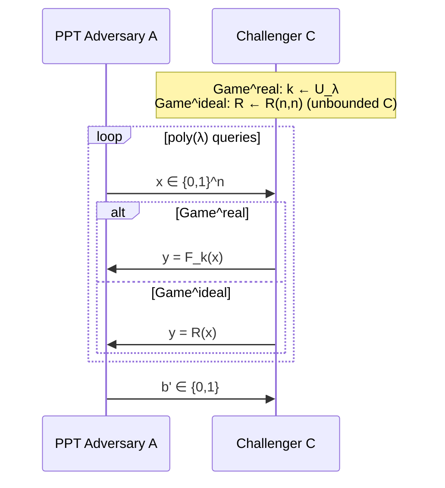
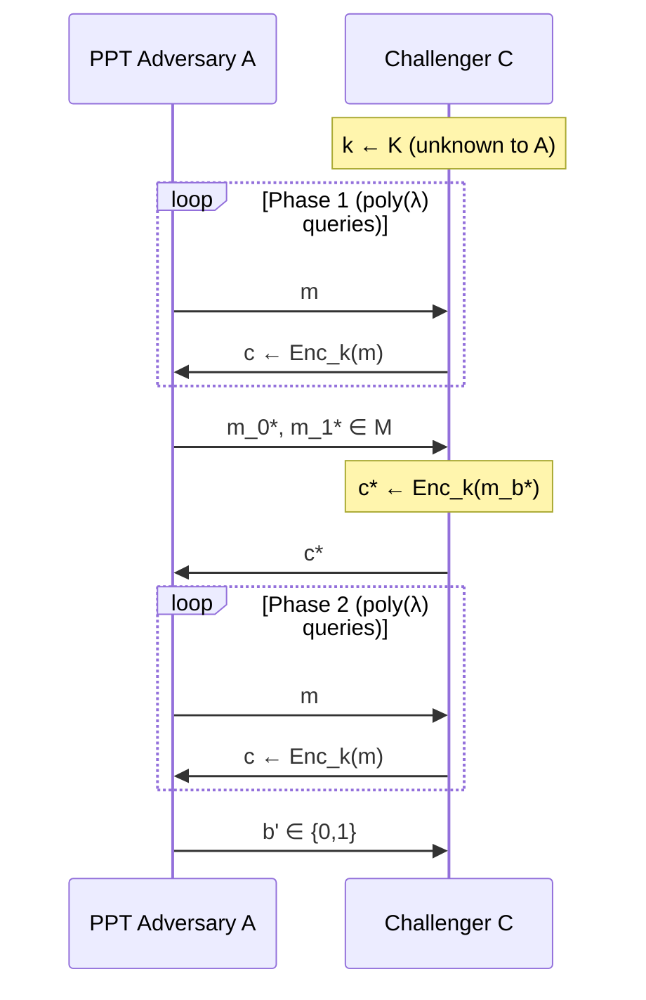
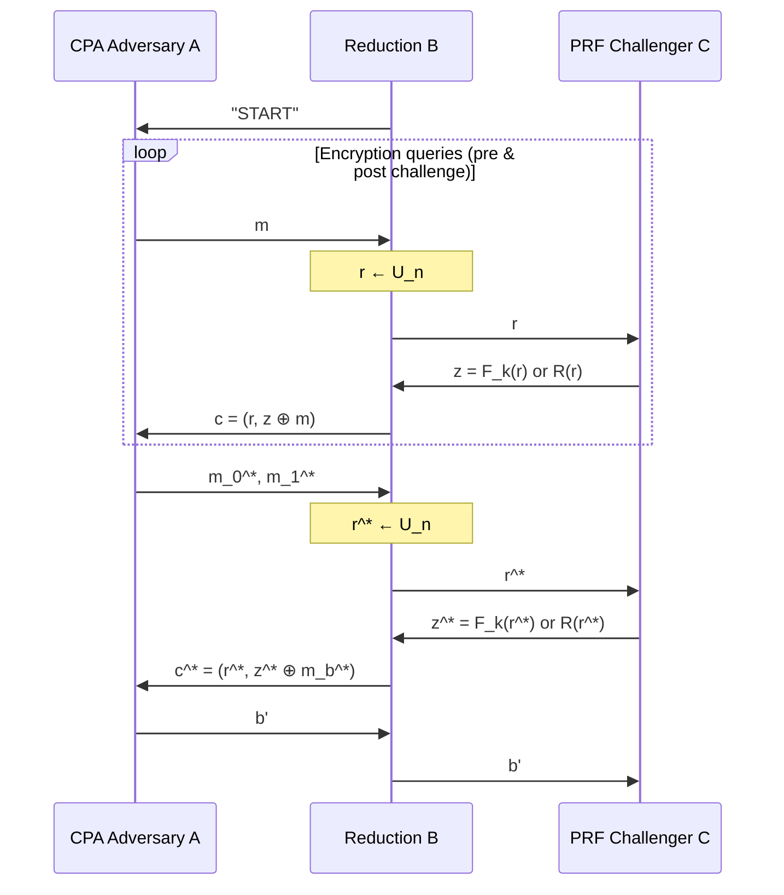
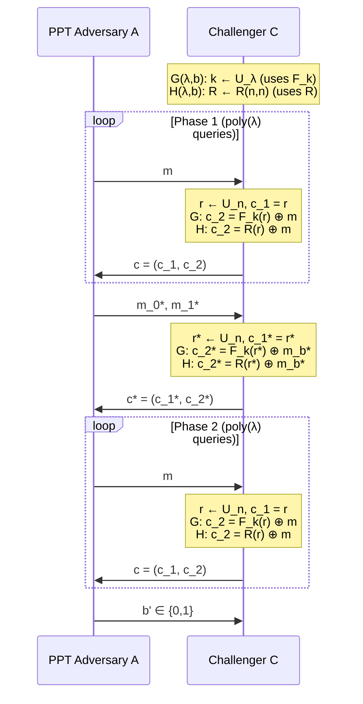
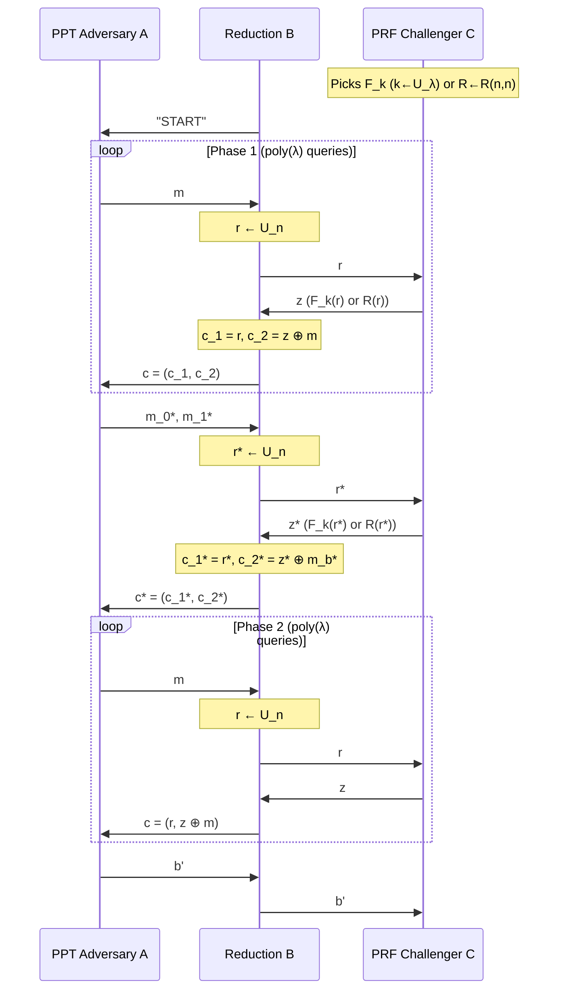

<<<<<<< HEAD
# pseudorandom functions
**note**: we have seen SKE systems that are insecure with multiple messages encrypted
=======
# pseudorandom
**note**: we have seen SKE systems that are unsecure with multiple messages encrypted
>>>>>>> f2f9d6d8c3e587dd169e86b9aeac5f632b44eade

**def. PRF**: 
$$
\mathcal F = \{ F_{k}: \{ 0,1 \}^n \to \{ 0,1 \}^n \}_{k\in \{ 0,1 \}^\lambda}
$$
* for $k \gets U_{\lambda}$
* no efficient $\mathcal A$ can identify if samples are from $F_{k}(\cdot)$ or from a uniformly random function $R: \{ 0,1 \}^n \to \{ 0,1 \}^n$

<<<<<<< HEAD
> **Note**: $R$ is still deterministic, but picked randomly among all possible maps on $\{ 0,1 \}^n \to \{ 0,1 \}^n$
=======
> **Note**: $R$ is still deterministic but picked randomly among all possible maps on $\{ 0,1 \}^n \to \{ 0,1 \}^n$ ($|\mathcal{R}(n,n)| = (2^n)^{2^n}$, so $\text{Game}^{\text{ideal}}$ takes $\exp$ time / unbounded $\mathcal{C}$). #gemini
>>>>>>> f2f9d6d8c3e587dd169e86b9aeac5f632b44eade

**def**. $\mathcal F$ is a PRF family if:

$$
\text{Game}_{\mathcal F, \mathcal A}^{\text{real}}(\lambda) \approx_{c} \text{Game}_{\mathcal F, \mathcal A}^{\text{ideal}} (\lambda)
$$

<<<<<<< HEAD
$\text{Game}^\text{real}$:
1. $\mathcal A$ does a query for $x\in \{ 0,1 \}^n$.
	1. can do as many as he wants (repeat)
2. $\mathcal C$ has chosen $k \gets U_{\lambda}$, replies with $y=F_{k}(x) \in \{0,1\}^n$
3. $\mathcal A$ outputs $b'$

$\text{Game}^\text{ideal}$:
1. $\mathcal A$ does a query for $x\in \{ 0,1 \}^n$.
	1. can do as many as he wants (repeat)
2. $\mathcal C$ has chosen $R \gets \mathcal R(n,n)$ (the set of all maps from $\{0,1\}^n \to \{0,1\}^n$), replies with $y=R(x) \in \{0,1\}^n$ #gemini
3. $\mathcal A$ outputs $b'$

> **REMARK**: The ideal game takes exp time (i.e., $\mathcal C$ is unbounded, since $|\mathcal R(n,n)| = (2^n)^{2^n}$). #gemini

**Exercise**: No $\mathcal F$ is a PRF against unbounded adversaries!
=======

**what does it mean**? we want for $\mathcal A$ to be hard to distinguish between $\text{Game}^{\text{real}}$ and $\text{Game}^{\text{ideal}}$

**Exercise**: No $\mathcal F$ is a PRF against unbounded adversaries.
>>>>>>> f2f9d6d8c3e587dd169e86b9aeac5f632b44eade

How to create a PRF?
* **practice**: use AES, DES or any blockcipher.
	* **note**: nobody knows how to prove AES is a PRF
* **theory**: OWFs (not practical); or use same assumptions as public-key cryptography (factoring, discrete log, lattices) — practical and efficient (still less efficient than AES). #gemini

**build practical SKE using PRFs:** 
<<<<<<< HEAD
* **practical**: one key, short, can use it to encrypt many messages (i.e., CPA-secure SKE).
=======
* **practical**: one key, short, i can use it to encrypt many messages.
>>>>>>> f2f9d6d8c3e587dd169e86b9aeac5f632b44eade

**def**. $\Pi=(\text{Enc, Dec})$ is CPA-secure iff
$$
\text{Game}_{\Pi, \mathcal A}^\text{cpa}(\lambda,0) \approx_{c} \text{Game}_{\Pi, \mathcal A}^\text{cpa}(\lambda,1) 
$$

<<<<<<< HEAD
that is:
$$
\text{Game}_{\Pi, \mathcal A}^\text{cpa}(\lambda,b\in \{ 0,1 \}) 
$$
1. $\mathcal A$ queries as many times he wants $m$
2. $\mathcal C$ replies with $c \gets \text{Enc}_{k}(m)$
3. $\mathcal A$ sends $m_{0}^*,m_{1}^* \in \mathcal M$ to $\mathcal C$
4. **note**: $\mathcal C$ has chosen an unknown key $k \gets \mathcal K$ at the start
5. $\mathcal C$ replies with $c^*\gets \text{Enc}_{k}(m_{b}^*)$
6. $\mathcal A$ queries as many times he wants $m$
7. $\mathcal C$ replies with $c \gets \text{Enc}_{k}(m)$
8. $\mathcal A$ outputs $b'$
=======
that is, for $b \in \{0,1\}$:
>>>>>>> f2f9d6d8c3e587dd169e86b9aeac5f632b44eade

<<<<<<< HEAD
**REMARK**: $\text{Enc}_{k}(\cdot)$ must be randomized, so $c\gets \text{Enc}_{k}(m) \equiv c=\text{Enc}_{k}(m;r)$ with $r \gets \mathcal R$ (a randomness space). Usually $\text{Dec}_k(\cdot)$ is still deterministic. #gemini

Let's build it from **any** PRF:
=======
**goal**: encrypt many messages using the same key.

**REMARK**: $\text{Enc}_{k}$ **must** be randomized (deterministic $\text{Enc}_k$ is never CPA-secure), so $c\gets \text{Enc}_{k}(m) \equiv c=\text{Enc}_{k}(m;r)$ with $r \gets \mathcal R$ (a randomness space) #gemini
* **simply**: at every call of $\text{Enc}_{k}$, $r$ changes and is sampled uniformly from $U$

Usually $\text{Dec}_{k}(\cdot)$ is still deterministic. **Construction of CPA-secure SKE from any PRF** (Slide 6): #gemini
>>>>>>> f2f9d6d8c3e587dd169e86b9aeac5f632b44eade
* $\text{Enc}(k,m)=(c_{1},c_{2})$
	* $c_{2} = F_{k}(r) \oplus m$, $r \gets U_{n}$
	* $c_{1}=r$
* $\text{Dec}(k, (c_{1},c_{2}))=F_{k}(c_{1}) \oplus c_{2}=m$

**thm**: assuming $\mathcal F$ is a PRF family, then $\Pi = (\text{Enc, Dec})$ as above is CPA-secure

**proof**:
* $G(\lambda,b)\equiv \text{Game}_{\Pi, \mathcal A}^{\text{cpa}}(\lambda, b)$
* **goal**: $G(\lambda,0) \approx_{c} G(\lambda,1)$
<<<<<<< HEAD
* consider $H(\lambda,b)$: the same as $G(\lambda,b)$ except we use $R \gets \mathcal R(n,n)$ instead of $F_{k}$

**Game attack** $G(\lambda,b)$:
* **goal**: for $\mathcal A$ to tell apart $b=0$ vs $b=1$ when $\mathcal C$ encrypts with $F_{k}$ (for a fixed $k \gets U_\lambda$) #gemini
1. $\mathcal A$ queries $m$ as many times to $\mathcal C$
2. $\mathcal C$ replies with $c=(c_{1},c_{2})$
	1. $\mathcal C$ chose and fixed $k \gets U_{\lambda}$
	2. $c_{1} = r \gets U_{n}$
	3. $c_{2} = F_{k}(r) \oplus m$
3. $\mathcal A$ queries $m_{0}^*, m_{1}^*$
4. $\mathcal C$ replies with $c^*=(c_{1}^*, c_{2}^*)$
	1. $c_{1}^* = r^* \gets U_{n}$
	2. $c_{2}^* = F_{k}(r^*) \oplus m_{b}^*$
5. $\mathcal A$ queries $m$ as many times to $\mathcal C$
6. $\mathcal C$ replies with $c=(c_{1},c_{2})$
7. $\mathcal A$ outputs $b'$

**Game attack** $H(\lambda, b)$:
* **goal**: for $\mathcal A$ to tell apart $b=0$ vs $b=1$ when $\mathcal C$ encrypts with $R \gets \mathcal R(n,n)$ instead of $F_k$ #gemini
1. $\mathcal A$ can ask $m$ queries as many times he wants.
2. $\mathcal C$ replies with $c=(c_{1},c_{2})$
	1. $\mathcal C$ chose and fixed $R \gets \mathcal R(n,n)$
	2. $c_{1} = r \gets U_{n}$
	3. $c_{2} = R(r) \oplus m$
3. $\mathcal A$ queries $m_{0}^*, m_{1}^*$
4. $\mathcal C$ replies with $c^*=(c_{1}^*, c_{2}^*)$
	1. $c_{1}^* = r^* \gets U_{n}$
	2. $c_{2}^* = R(r^*) \oplus m_{b}^*$
5. $\mathcal A$ queries $m$ as many times to $\mathcal C$
6. $\mathcal C$ replies with $c=(c_{1},c_{2})$
7. $\mathcal A$ outputs $b'$

**lemma**: $G(\lambda, b) \approx_{c} H(\lambda, b), \quad \forall b \in \{ 0,1 \}$

**proof**: by reduction to PRF security.
1. $\mathcal B$ starts the challenge by sending `"START"` to $\mathcal A$ (where $\mathcal B$ attacks the PRF challenger $\mathcal C$, and simulates the CPA challenger for $\mathcal A$ with fixed bit $b$) #gemini
2. Whenever $\mathcal A$ queries $m$ (before or after the challenge), $\mathcal B$ does: #gemini
	1. $\mathcal B$ samples $r \gets U_{n}$ and queries $r$ to $\mathcal C$
	2. $\mathcal C$ replies with $z$ (where either $z = F_{k}(r)$ or $z = R(r)$)
	3. $\mathcal B$ replies to $\mathcal A$ with $c=(c_{1},c_{2})$ where $c_{1}=r$ and $c_{2}= z \oplus m$
3. $\mathcal A$ sends $m_{0}^*,m_{1}^*$ to $\mathcal B$
4. $\mathcal B$ samples $r^* \gets U_n$ and queries $r^*$ to $\mathcal C$
5. $\mathcal C$ replies with $z^*$
6. $\mathcal B$ replies to $\mathcal A$ with $c^* = (c_1^*, c_2^*)$:
	1. $c_{1}^*=r^*$
	2. $c_{2}^*=z^* \oplus m^*_{b}$
7. $\mathcal A$ outputs $b'$, then $\mathcal B$ outputs $b'$ to $\mathcal C$

**gemini**: explain why this is a proof for $G \approx_{c} H$
* **Perfect Reduction (Slide 9–10)**: $\mathcal{B}$ runs in PPT and uses its PRF oracle $\mathcal{C}$ to evaluate the unknown function (either $F_k$ or $R$) on each random $r \gets U_n$: #gemini
	* If $\mathcal{C}$ uses $F_k$ ($\text{Game}_{\mathcal{F},\mathcal{B}}^{\text{real}}$), then $z = F_k(r)$ and $z^* = F_k(r^*)$, so $\mathcal{B}$ perfectly simulates $G(\lambda, b)$ for $\mathcal{A}$: #gemini
	  $$\Pr[\text{Game}_{\mathcal{F},\mathcal{B}}^{\text{real}}(\lambda) = 1] = \Pr[G(\lambda, b) = 1]$$
	* If $\mathcal{C}$ uses $R$ ($\text{Game}_{\mathcal{F},\mathcal{B}}^{\text{ideal}}$), then $z = R(r)$ and $z^* = R(r^*)$, so $\mathcal{B}$ perfectly simulates $H(\lambda, b)$ for $\mathcal{A}$: #gemini
	  $$\Pr[\text{Game}_{\mathcal{F},\mathcal{B}}^{\text{ideal}}(\lambda) = 1] = \Pr[H(\lambda, b) = 1]$$
* Therefore, if $\mathcal{A}$ could distinguish $G(\lambda, b)$ from $H(\lambda, b)$ with non-negligible advantage, $\mathcal{B}$ would distinguish $\text{Game}^{\text{real}}$ from $\text{Game}^{\text{ideal}}$ with the exact same advantage, contradicting $\mathcal{F}$ being a PRF. #gemini
=======
* consider $H(\lambda,b)$ the same as $G(\lambda,b)$ except
	* $R \gets \mathcal R(n,n)$ instead of using  $F_{k}$

**Game hopping** ($G(\lambda,b)$ vs $H(\lambda,b)$): 
* **goal**: distinguish whether $c^*$ encrypts $m_0^*$ or $m_1^*$ (using $F_k$ in $G$, or truly random $R$ in $H$). 

why the proof works?
1. **FACT 1**: no PPT adversary can tell $F_{k}$ apart from $R$
	1. so $G(\lambda, b) \approx_{C} H(\lambda,b)$ with $b \in \{ 0,1 \}$
2. **FACT 2**: $R(r^*) \oplus m$ with $r^*\gets U_{n}$ acts like a one time pad (unless $r^*$ collides with a query), so it is impossible to distinguish between $b=0$ or $b=1$
	1. so $H(\lambda,0) \approx_{s} H(\lambda,1)$

> **note**: we will prove FACT 1 and FACT 2 in this lesson.

**FACT 3**:
$$
G(\lambda,0) \approx_{C} H(\lambda,0) \approx_{S} H(\lambda,1) \approx_{C} G(\lambda,1)
$$

so: $G(\lambda,0) \approx_{C} G(\lambda,1)$ by triangle inequality.

> [!error] $\approx_{C}$ and $\approx_{S}$
> * $\approx_{S}$: two distributions are actually almost identical. It's hard to distinguish them even using infinite computing power.
> 	* $\text{SD}(X;Y) \leq \text{negl}(\lambda)$
> * $\approx_{C}$: two distributions can be different for an unbounded attacker, but look the **same to any PPT (computationally bounded) attacker**. #gemini
> 	* $|\Pr[\mathcal{A}(X)=1] - \Pr[\mathcal{A}(Y)=1]| \leq \text{negl}(\lambda)$ #gemini

**lemma**: $G(\lambda, b) \approx_{c} H(\lambda, b),\; \forall b \in \{ 0,1 \}$

**remember**:
* $G$ is the game that encrypts using $F_{k}$
* $H$ is the game that encrypts using $R$

**proof**: by reduction to PRF security (perfect reduction): 
* suppose PPT $\mathcal A$ can tell $G(\lambda,b)$ apart from $H(\lambda,b)$ with non negligible advantage.
* **goal of $\mathcal B$**: $\mathcal B$ uses $\mathcal A$ as a subroutine to win PRF.
	* **what we are doing**: creating a bridge between the hybrid games ($G$ vs $H$) and PRF. #gemini
		* $\mathcal A$: distinguishes $G(\lambda,b)$ from $H(\lambda,b)$ for a fixed $b \in \{0,1\}$ #gemini
		* PRF: understand if we are in $\text{real}$ or $\text{ideal}$ world
			* **real**: we use $F_{k}$ #gemini
			* **ideal**: we use $R$ #gemini
	* $\mathcal A$ can distinguish $G(\lambda,b)$ vs $H(\lambda,b)$ #gemini
	* $C$ issues PRF challenge.
	* $\mathcal B$ wants to use $\mathcal A$ to win PRF

**two cases**:
* $\mathcal C$ is $\text{Game}^\text{real} \implies z=F_{k}(r)$
	* challenge is $c^*=(r^*, F_{k}(r^*) \oplus m_{b}^*)$
	* so $\mathcal A$ is playing $G(\lambda,b)$ that we already seen
* $\mathcal C$ is $\text{Game}^\text{ideal} \implies z=R(r)$
	* challenge is $c^* = (r^*, R(r^*) \oplus m_{b}^*)$
	* so $\mathcal A$ is playing $H(\lambda,b)$ that we already seen.

**so**: $\mathcal B$ breaks $\text{PRF } \mathcal F$ using the same non-negligible advantage $\varepsilon(\lambda)$

**contradiction**: but $\mathcal F$ is a PRF so such $\mathcal A$ does not exist, thus $G(\lambda, b) \approx_{C} H(\lambda,b) \;\square$

> And $\approx_{C}$ means that $G$ and $H$ are equivalent to a PPT attacker.

**Lemma**:
$$
H(\lambda,0) \approx_{s} H(\lambda,1)
$$
* so long as the (unbounded) attacker makes at most $q(\lambda)=\text{poly}(\lambda)$ queries ($\implies H(\lambda,0) \approx_c H(\lambda,1)$). 

**proof**: suppose that
* $\mathcal A$ makes no enc queries.
* $\mathcal A$ just sends $m_{0}^*$ and $m_{1}^*$
* and **receives** $c^*=(r^*, R(r^*) \oplus m_{b}^*)$ with $r^* \gets U_{n}$
* **OTP**: since $R$ is a truly random table, $c^* = (r^*, z^* \oplus m_b^*)$ with $r^*, z^* \gets U_n$ (uniform and independent), which is literally a One-Time Pad (Slides 10–11). #gemini

**we can say that**: for $q=0$, $H(\lambda,0) \equiv H(\lambda,1)$, but for $q>0$? does enc queries leak information?
* suppose that we are **very lucky**, and that the challenger samples the same randomness
* e.g., $\mathcal{A}$ queries $m = 0^n$ and $\mathcal{C}$ picks $r_{i}=r^* \implies c = (r^*, R(r^*) \oplus 0^n)$ (Slide 11) #gemini
* and by that, using XOR, can recover $m^*_{b}$
* and guess with $\Pr=1$.

**note**: $\mathcal A$ cannot force $r_{i}=r^*$, since they are sampled u.a.r.

let $\text{BAD}$ be the **collision event** that $r^*$ collides with any of the $r$'s in encryption queries (Slide 12).
* **Conditioned on $\overline{\text{BAD}}$**: $H(\lambda,0) \equiv H(\lambda,1)$ because we can replace $R(r^*)$ with uniform $z^* \gets U_n$ independent of everything (Slide 12). #gemini
* **Bounding $\Pr[\text{BAD}]$**:
	* $\Pr[\text{BAD}] \leq \Pr_{r_i, r_j}[\exists i,j: r_{i}=r_{j}]$ #gemini
	* $\leq \sum_{\substack{i,j=1 \\ i \neq j}}^q \Pr[r_{i}=r_{j}]$
	* $= \sum_{i,j} \text{Col}(U_{n})$
	* $\leq \underbrace{\binom {q}{2}}_{\text{all the pairs}} \cdot \underbrace{2^{-n}}_{\Pr[r_{i}=r_{j}]}$
	* with $n=n(\lambda)=\text{poly}(\lambda)$
	* so $= \text{poly}(\lambda) \cdot \text{negl}(\lambda) = \text{negl}(\lambda)$

One can show that the above two facts imply (Slide 13): #gemini
$$
\text{SD}(H(\lambda,0); H(\lambda,1)) \leq \Pr[\text{BAD}] = \text{negl}(\lambda) \;\square
$$
>>>>>>> f2f9d6d8c3e587dd169e86b9aeac5f632b44eade
