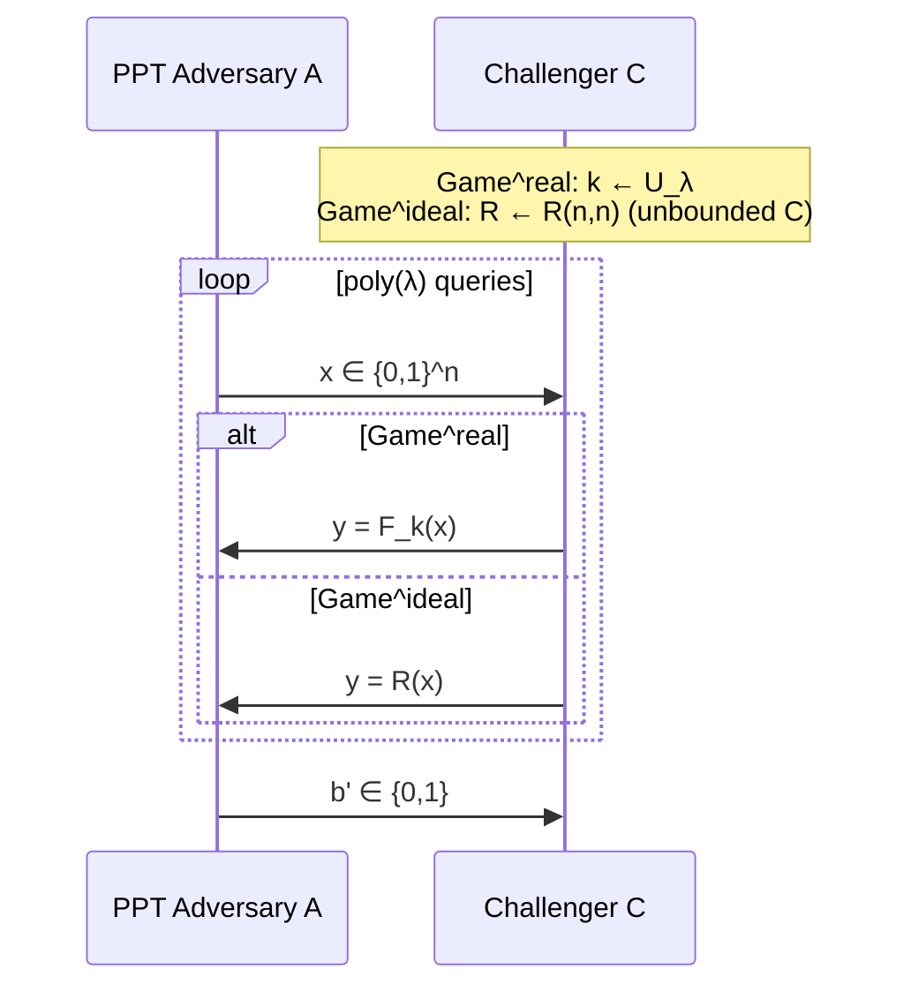
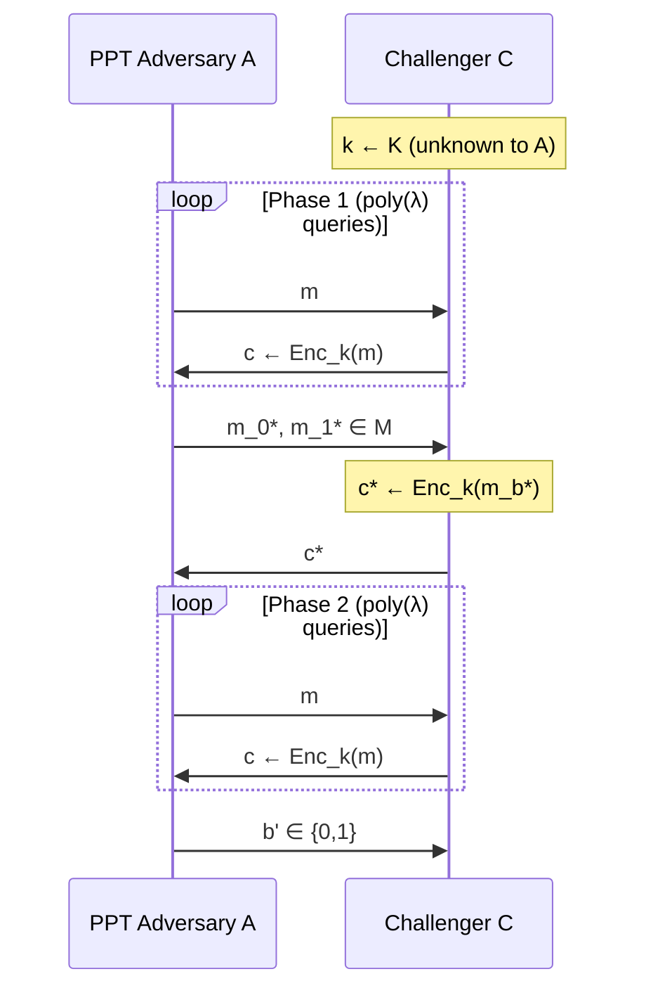
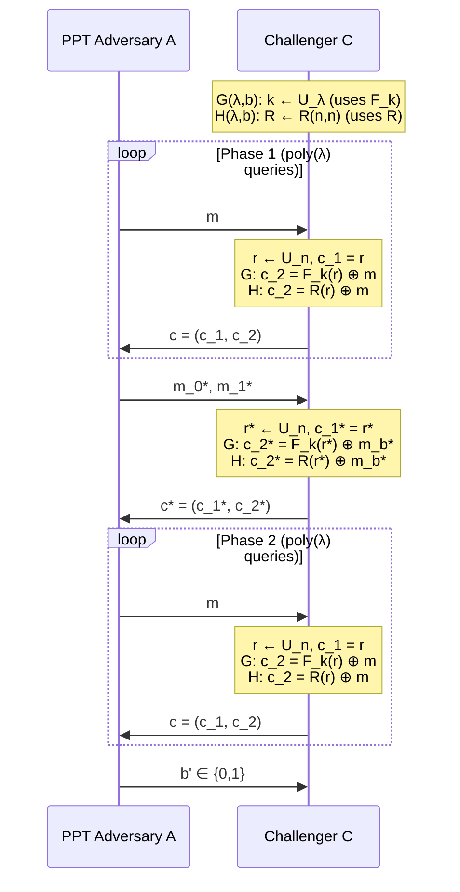
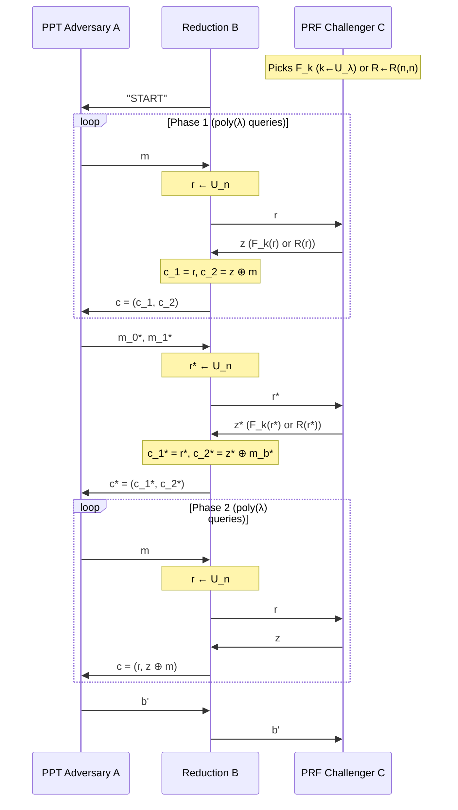

# pseudorandom
**note**: we have seen SKE systems that are unsecure with multiple messages encrypted

**def. PRF**: 
$$
\mathcal F = \{ F_{k}: \{ 0,1 \}^n \to \{ 0,1 \}^n \}_{k\in \{ 0,1 \}^\lambda}
$$
* for $k \gets U_{\lambda}$
* no efficient $\mathcal A$ can identify if a sample is from $F_{k}(\cdot)$ or from a uniformly random function $R: \{ 0,1 \}^n \to \{ 0,1 \}^n$

> **Note**: $R$ is still deterministic but picked randomly among all possible maps on $\{ 0,1 \}^n \to \{ 0,1 \}^n$ ($|\mathcal{R}(n,n)| = (2^n)^{2^n}$, so $\text{Game}^{\text{ideal}}$ takes $\exp$ time / unbounded $\mathcal{C}$). #gemini

**def**. $\mathcal F$ is a PRF if:

$$
\text{Game}_{\mathcal F, \mathcal A}^{\text{real}}(\lambda) \approx_{c} \text{Game}_{\mathcal F, \mathcal A}^{\text{ideal}} (\lambda)
$$

**what does it mean**? we want for $\mathcal A$ to be hard to distinguish between $\text{Game}^{\text{real}}$ and $\text{Game}^{\text{ideal}}$

**Exercise**: No $\mathcal F$ is a PRF against unbounded adversaries.

How to create a PRF?
* **practice**: use AES, DES or any blockcipher.
	* **note**: cannot prove AES is a PRF
* **theory**: owf, but they are not practical. or use some assumptions like public-key cryptography based on factoring, discrete log, lattices.

**build practical SKE using PRFs:** 
* **practical**: one key, short, i can use it to encrypt many messages.

**def**. $\Pi=(\text{Enc, Dec})$ is CPA iff
$$
\text{Game}_{\Pi, \mathcal A}^\text{cpa}(\lambda,0) \approx_{c} \text{Game}_{\Pi, \mathcal A}^\text{cpa}(\lambda,1) 
$$

that is, for $b \in \{0,1\}$:

**goal**: encrypt many messages using the same key.

**REMARK**: $\text{Enc}_{k}$ **must** be randomized (deterministic $\text{Enc}_k$ is never CPA-secure), so $c\gets \text{Enc}_{k}(m) \equiv c=\text{Enc}_{k}(m;r)$ with $r \gets \mathcal R$ (a randomness space) #gemini
* **simply**: at every call of $\text{Enc}_{k}$, $r$ changes and is sampled uniformly from $U$

Usually $\text{Dec}_{k}(\cdot)$ is still deterministic. **Construction of CPA-secure SKE from any PRF** (Slide 6): #gemini
* $\text{Enc}(k,m)=(c_{1},c_{2})$
	* $c_{2} = F_{k}(r) \oplus m$, $r \gets U_{n}$
	* $c_{1}=r$
* $\text{Dec}(k, (c_{1},c_{2}))=F_{k}(c_{1}) \oplus c_{2}=m$

**thm**: assuming $\mathcal F$ is a PRF, then $\Pi = (\text{Enc, Dec})$ as above is CPA-secure

**proof**:
* $G(\lambda,b)\equiv \text{Game}_{\Pi, \mathcal A}^{\text{cpa}}(\lambda, b)$
* **goal**: $G(\lambda,0) \approx_{c} G(\lambda,1)$
* consider $H(\lambda,b)$ the same as $G(\lambda,b)$ except
	* $R \gets \mathcal R(n,n)$ instead of using  $F_{k}$

**Game hopping** ($G(\lambda,b)$ vs $H(\lambda,b)$): 
* **goal**: distinguish whether $c^*$ encrypts $m_0^*$ or $m_1^*$ (using $F_k$ in $G$, or truly random $R$ in $H$). 

why the proof works?
1. **FACT 1**: no PPT adversary can tell $F_{k}$ apart from $R$
	1. so $G(\lambda, b) \approx_{C} H(\lambda,b)$ with $b \in \{ 0,1 \}$
2. **FACT 2**: $R(r^*) \oplus m$ with $r^*\gets U_{n}$ acts like a one time pad (unless $r^*$ collides with a query), so it is impossible to distinguish between $b=0$ or $b=1$
	1. so $H(\lambda,0) \approx_{s} H(\lambda,1)$

> **note**: we will prove FACT 1 and FACT 2 in this lesson.

**FACT 3**:
$$
G(\lambda,0) \approx_{C} H(\lambda,0) \approx_{S} H(\lambda,1) \approx_{C} G(\lambda,1)
$$

so: $G(\lambda,0) \approx_{C} G(\lambda,1)$ by triangle inequality.

> [!error] $\approx_{C}$ and $\approx_{S}$
> * $\approx_{S}$: two distributions are actually almost identical. It's hard to distinguish them even using infinite computing power.
> 	* $\text{SD}(X;Y) \leq \text{negl}(\lambda)$
> * $\approx_{C}$: two distributions can be different for an unbounded attacker, but look the **same to any PPT (computationally bounded) attacker**. #gemini
> 	* $|\Pr[\mathcal{A}(X)=1] - \Pr[\mathcal{A}(Y)=1]| \leq \text{negl}(\lambda)$ #gemini

**lemma**: $G(\lambda, b) \approx_{c} H(\lambda, b),\; \forall b \in \{ 0,1 \}$

**remember**:
* $G$ is the game that encrypts using $F_{k}$
* $H$ is the game that encrypts using $R$

**proof**: by reduction to PRF security (perfect reduction): 
* suppose PPT $\mathcal A$ can tell $G(\lambda,b)$ apart from $H(\lambda,b)$ with non negligible advantage.
* **goal of $\mathcal B$**: $\mathcal B$ uses $\mathcal A$ as a subroutine to win PRF.
	* **what we are doing**: creating a bridge between the hybrid games ($G$ vs $H$) and PRF. #gemini
		* $\mathcal A$: distinguishes $G(\lambda,b)$ from $H(\lambda,b)$ for a fixed $b \in \{0,1\}$ #gemini
		* PRF: understand if we are in $\text{real}$ or $\text{ideal}$ world
			* **real**: we use $F_{k}$ #gemini
			* **ideal**: we use $R$ #gemini
	* $\mathcal A$ can distinguish $G(\lambda,b)$ vs $H(\lambda,b)$ #gemini
	* $C$ issues PRF challenge.
	* $\mathcal B$ wants to use $\mathcal A$ to win PRF

**two cases**:
* $\mathcal C$ is $\text{Game}^\text{real} \implies z=F_{k}(r)$
	* challenge is $c^*=(r^*, F_{k}(r^*) \oplus m_{b}^*)$
	* so $\mathcal A$ is playing $G(\lambda,b)$ that we already seen
* $\mathcal C$ is $\text{Game}^\text{ideal} \implies z=R(r)$
	* challenge is $c^* = (r^*, R(r^*) \oplus m_{b}^*)$
	* so $\mathcal A$ is playing $H(\lambda,b)$ that we already seen.

**so**: $\mathcal B$ breaks $\text{PRF } \mathcal F$ using the same non-negligible advantage $\varepsilon(\lambda)$

**contradiction**: but $\mathcal F$ is a PRF so such $\mathcal A$ does not exist, thus $G(\lambda, b) \approx_{C} H(\lambda,b) \;\square$

> And $\approx_{C}$ means that $G$ and $H$ are equivalent to a PPT attacker.

**Lemma**:
$$
H(\lambda,0) \approx_{s} H(\lambda,1)
$$
* so long as the (unbounded) attacker makes at most $q(\lambda)=\text{poly}(\lambda)$ queries ($\implies H(\lambda,0) \approx_c H(\lambda,1)$). 

**proof**: suppose that
* $\mathcal A$ makes no enc queries.
* $\mathcal A$ just sends $m_{0}^*$ and $m_{1}^*$
* and **receives** $c^*=(r^*, R(r^*) \oplus m_{b}^*)$ with $r^* \gets U_{n}$
* **OTP**: since $R$ is a truly random table, $c^* = (r^*, z^* \oplus m_b^*)$ with $r^*, z^* \gets U_n$ (uniform and independent), which is literally a One-Time Pad (Slides 10–11). #gemini

**we can say that**: for $q=0$, $H(\lambda,0) \equiv H(\lambda,1)$, but for $q>0$? does enc queries leak information?
* suppose that we are **very lucky**, and that the challenger samples the same randomness
* e.g., $\mathcal{A}$ queries $m = 0^n$ and $\mathcal{C}$ picks $r_{i}=r^* \implies c = (r^*, R(r^*) \oplus 0^n)$ (Slide 11) #gemini
* and by that, using XOR, can recover $m^*_{b}$
* and guess with $\Pr=1$.

**note**: $\mathcal A$ cannot force $r_{i}=r^*$, since they are sampled u.a.r.

let $\text{BAD}$ be the **collision event** that $r^*$ collides with any of the $r$'s in encryption queries (Slide 12).
* **Conditioned on $\overline{\text{BAD}}$**: $H(\lambda,0) \equiv H(\lambda,1)$ because we can replace $R(r^*)$ with uniform $z^* \gets U_n$ independent of everything (Slide 12). #gemini
* **Bounding $\Pr[\text{BAD}]$**:
	* $\Pr[\text{BAD}] \leq \Pr_{r_i, r_j}[\exists i,j: r_{i}=r_{j}]$ #gemini
	* $\leq \sum_{\substack{i,j=1 \\ i \neq j}}^q \Pr[r_{i}=r_{j}]$
	* $= \sum_{i,j} \text{Col}(U_{n})$
	* $\leq \underbrace{\binom {q}{2}}_{\text{all the pairs}} \cdot \underbrace{2^{-n}}_{\Pr[r_{i}=r_{j}]}$
	* with $n=n(\lambda)=\text{poly}(\lambda)$
	* so $= \text{poly}(\lambda) \cdot \text{negl}(\lambda) = \text{negl}(\lambda)$

One can show that the above two facts imply (Slide 13): #gemini
$$
\text{SD}(H(\lambda,0); H(\lambda,1)) \leq \Pr[\text{BAD}] = \text{negl}(\lambda) \;\square
$$