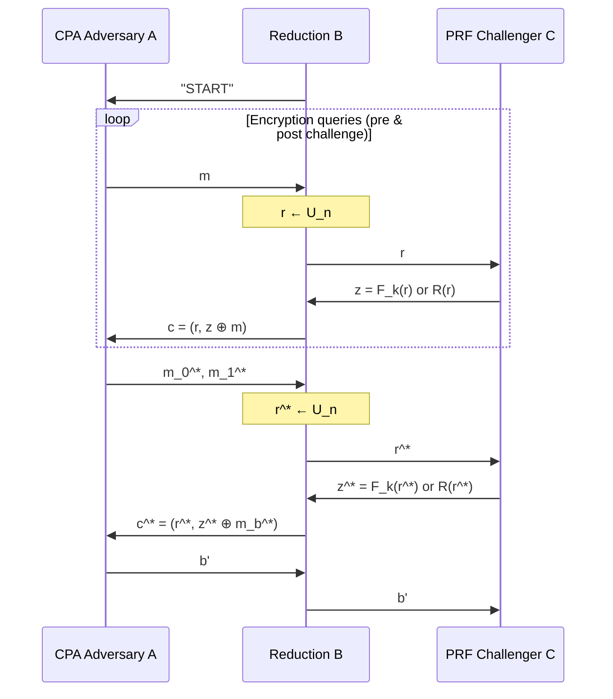

# pseudorandom functions
**note**: we have seen SKE systems that are insecure with multiple messages encrypted

**def. PRF**: 
$$
\mathcal F = \{ F_{k}: \{ 0,1 \}^n \to \{ 0,1 \}^n \}_{k\in \{ 0,1 \}^\lambda}
$$
* for $k \gets U_{\lambda}$
* no efficient $\mathcal A$ can identify if samples are from $F_{k}(\cdot)$ or from a uniformly random function $R: \{ 0,1 \}^n \to \{ 0,1 \}^n$

> **Note**: $R$ is still deterministic, but picked randomly among all possible maps on $\{ 0,1 \}^n \to \{ 0,1 \}^n$

**def**. $\mathcal F$ is a PRF family if:

$$
\text{Game}_{\mathcal F, \mathcal A}^{\text{real}}(\lambda) \approx_{c} \text{Game}_{\mathcal F, \mathcal A}^{\text{ideal}} (\lambda)
$$

$\text{Game}^\text{real}$:
1. $\mathcal A$ does a query for $x\in \{ 0,1 \}^n$.
	1. can do as many as he wants (repeat)
2. $\mathcal C$ has chosen $k \gets U_{\lambda}$, replies with $y=F_{k}(x) \in \{0,1\}^n$
3. $\mathcal A$ outputs $b'$

$\text{Game}^\text{ideal}$:
1. $\mathcal A$ does a query for $x\in \{ 0,1 \}^n$.
	1. can do as many as he wants (repeat)
2. $\mathcal C$ has chosen $R \gets \mathcal R(n,n)$ (the set of all maps from $\{0,1\}^n \to \{0,1\}^n$), replies with $y=R(x) \in \{0,1\}^n$ #gemini
3. $\mathcal A$ outputs $b'$

> **REMARK**: The ideal game takes exp time (i.e., $\mathcal C$ is unbounded, since $|\mathcal R(n,n)| = (2^n)^{2^n}$). #gemini

**Exercise**: No $\mathcal F$ is a PRF against unbounded adversaries!

How to create a PRF?
* **practice**: use AES, DES or any blockcipher.
	* **note**: nobody knows how to prove AES is a PRF
* **theory**: OWFs (not practical); or use same assumptions as public-key cryptography (factoring, discrete log, lattices) — practical and efficient (still less efficient than AES). #gemini

**build practical SKE using PRFs:** 
* **practical**: one key, short, can use it to encrypt many messages (i.e., CPA-secure SKE).

**def**. $\Pi=(\text{Enc, Dec})$ is CPA-secure iff
$$
\text{Game}_{\Pi, \mathcal A}^\text{cpa}(\lambda,0) \approx_{c} \text{Game}_{\Pi, \mathcal A}^\text{cpa}(\lambda,1) 
$$

that is:
$$
\text{Game}_{\Pi, \mathcal A}^\text{cpa}(\lambda,b\in \{ 0,1 \}) 
$$
1. $\mathcal A$ queries as many times he wants $m$
2. $\mathcal C$ replies with $c \gets \text{Enc}_{k}(m)$
3. $\mathcal A$ sends $m_{0}^*,m_{1}^* \in \mathcal M$ to $\mathcal C$
4. **note**: $\mathcal C$ has chosen an unknown key $k \gets \mathcal K$ at the start
5. $\mathcal C$ replies with $c^*\gets \text{Enc}_{k}(m_{b}^*)$
6. $\mathcal A$ queries as many times he wants $m$
7. $\mathcal C$ replies with $c \gets \text{Enc}_{k}(m)$
8. $\mathcal A$ outputs $b'$

**REMARK**: $\text{Enc}_{k}(\cdot)$ must be randomized, so $c\gets \text{Enc}_{k}(m) \equiv c=\text{Enc}_{k}(m;r)$ with $r \gets \mathcal R$ (a randomness space). Usually $\text{Dec}_k(\cdot)$ is still deterministic. #gemini

Let's build it from **any** PRF:
* $\text{Enc}(k,m)=(c_{1},c_{2})$
	* $c_{2} = F_{k}(r) \oplus m$, $r \gets U_{n}$
	* $c_{1}=r$
* $\text{Dec}(k, (c_{1},c_{2}))=F_{k}(c_{1}) \oplus c_{2}=m$

**thm**: assuming $\mathcal F$ is a PRF family, then $\Pi = (\text{Enc, Dec})$ as above is CPA-secure

**proof**:
* $G(\lambda,b)\equiv \text{Game}_{\Pi, \mathcal A}^{\text{cpa}}(\lambda, b)$
* **goal**: $G(\lambda,0) \approx_{c} G(\lambda,1)$
* consider $H(\lambda,b)$: the same as $G(\lambda,b)$ except we use $R \gets \mathcal R(n,n)$ instead of $F_{k}$

**Game attack** $G(\lambda,b)$:
* **goal**: for $\mathcal A$ to tell apart $b=0$ vs $b=1$ when $\mathcal C$ encrypts with $F_{k}$ (for a fixed $k \gets U_\lambda$) #gemini
1. $\mathcal A$ queries $m$ as many times to $\mathcal C$
2. $\mathcal C$ replies with $c=(c_{1},c_{2})$
	1. $\mathcal C$ chose and fixed $k \gets U_{\lambda}$
	2. $c_{1} = r \gets U_{n}$
	3. $c_{2} = F_{k}(r) \oplus m$
3. $\mathcal A$ queries $m_{0}^*, m_{1}^*$
4. $\mathcal C$ replies with $c^*=(c_{1}^*, c_{2}^*)$
	1. $c_{1}^* = r^* \gets U_{n}$
	2. $c_{2}^* = F_{k}(r^*) \oplus m_{b}^*$
5. $\mathcal A$ queries $m$ as many times to $\mathcal C$
6. $\mathcal C$ replies with $c=(c_{1},c_{2})$
7. $\mathcal A$ outputs $b'$

**Game attack** $H(\lambda, b)$:
* **goal**: for $\mathcal A$ to tell apart $b=0$ vs $b=1$ when $\mathcal C$ encrypts with $R \gets \mathcal R(n,n)$ instead of $F_k$ #gemini
1. $\mathcal A$ can ask $m$ queries as many times he wants.
2. $\mathcal C$ replies with $c=(c_{1},c_{2})$
	1. $\mathcal C$ chose and fixed $R \gets \mathcal R(n,n)$
	2. $c_{1} = r \gets U_{n}$
	3. $c_{2} = R(r) \oplus m$
3. $\mathcal A$ queries $m_{0}^*, m_{1}^*$
4. $\mathcal C$ replies with $c^*=(c_{1}^*, c_{2}^*)$
	1. $c_{1}^* = r^* \gets U_{n}$
	2. $c_{2}^* = R(r^*) \oplus m_{b}^*$
5. $\mathcal A$ queries $m$ as many times to $\mathcal C$
6. $\mathcal C$ replies with $c=(c_{1},c_{2})$
7. $\mathcal A$ outputs $b'$

**lemma**: $G(\lambda, b) \approx_{c} H(\lambda, b), \quad \forall b \in \{ 0,1 \}$

**proof**: by reduction to PRF security.
1. $\mathcal B$ starts the challenge by sending `"START"` to $\mathcal A$ (where $\mathcal B$ attacks the PRF challenger $\mathcal C$, and simulates the CPA challenger for $\mathcal A$ with fixed bit $b$) #gemini
2. Whenever $\mathcal A$ queries $m$ (before or after the challenge), $\mathcal B$ does: #gemini
	1. $\mathcal B$ samples $r \gets U_{n}$ and queries $r$ to $\mathcal C$
	2. $\mathcal C$ replies with $z$ (where either $z = F_{k}(r)$ or $z = R(r)$)
	3. $\mathcal B$ replies to $\mathcal A$ with $c=(c_{1},c_{2})$ where $c_{1}=r$ and $c_{2}= z \oplus m$
3. $\mathcal A$ sends $m_{0}^*,m_{1}^*$ to $\mathcal B$
4. $\mathcal B$ samples $r^* \gets U_n$ and queries $r^*$ to $\mathcal C$
5. $\mathcal C$ replies with $z^*$
6. $\mathcal B$ replies to $\mathcal A$ with $c^* = (c_1^*, c_2^*)$:
	1. $c_{1}^*=r^*$
	2. $c_{2}^*=z^* \oplus m^*_{b}$
7. $\mathcal A$ outputs $b'$, then $\mathcal B$ outputs $b'$ to $\mathcal C$

**gemini**: explain why this is a proof for $G \approx_{c} H$
* **Perfect Reduction (Slide 9–10)**: $\mathcal{B}$ runs in PPT and uses its PRF oracle $\mathcal{C}$ to evaluate the unknown function (either $F_k$ or $R$) on each random $r \gets U_n$: #gemini
	* If $\mathcal{C}$ uses $F_k$ ($\text{Game}_{\mathcal{F},\mathcal{B}}^{\text{real}}$), then $z = F_k(r)$ and $z^* = F_k(r^*)$, so $\mathcal{B}$ perfectly simulates $G(\lambda, b)$ for $\mathcal{A}$: #gemini
	  $$\Pr[\text{Game}_{\mathcal{F},\mathcal{B}}^{\text{real}}(\lambda) = 1] = \Pr[G(\lambda, b) = 1]$$
	* If $\mathcal{C}$ uses $R$ ($\text{Game}_{\mathcal{F},\mathcal{B}}^{\text{ideal}}$), then $z = R(r)$ and $z^* = R(r^*)$, so $\mathcal{B}$ perfectly simulates $H(\lambda, b)$ for $\mathcal{A}$: #gemini
	  $$\Pr[\text{Game}_{\mathcal{F},\mathcal{B}}^{\text{ideal}}(\lambda) = 1] = \Pr[H(\lambda, b) = 1]$$
* Therefore, if $\mathcal{A}$ could distinguish $G(\lambda, b)$ from $H(\lambda, b)$ with non-negligible advantage, $\mathcal{B}$ would distinguish $\text{Game}^{\text{real}}$ from $\text{Game}^{\text{ideal}}$ with the exact same advantage, contradicting $\mathcal{F}$ being a PRF. #gemini
