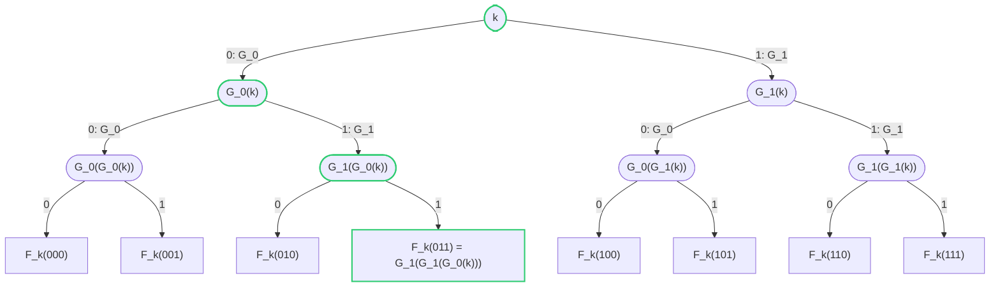
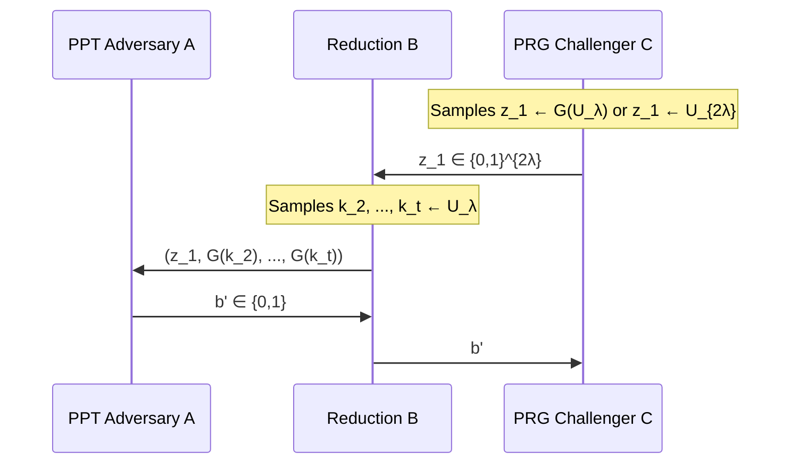
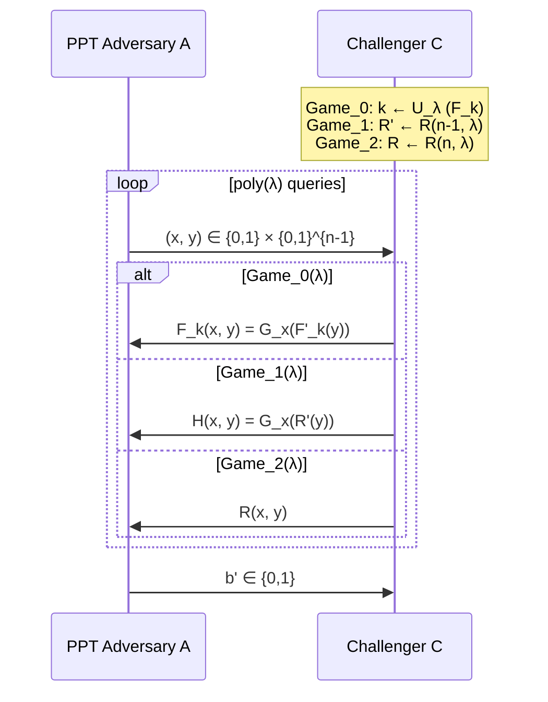
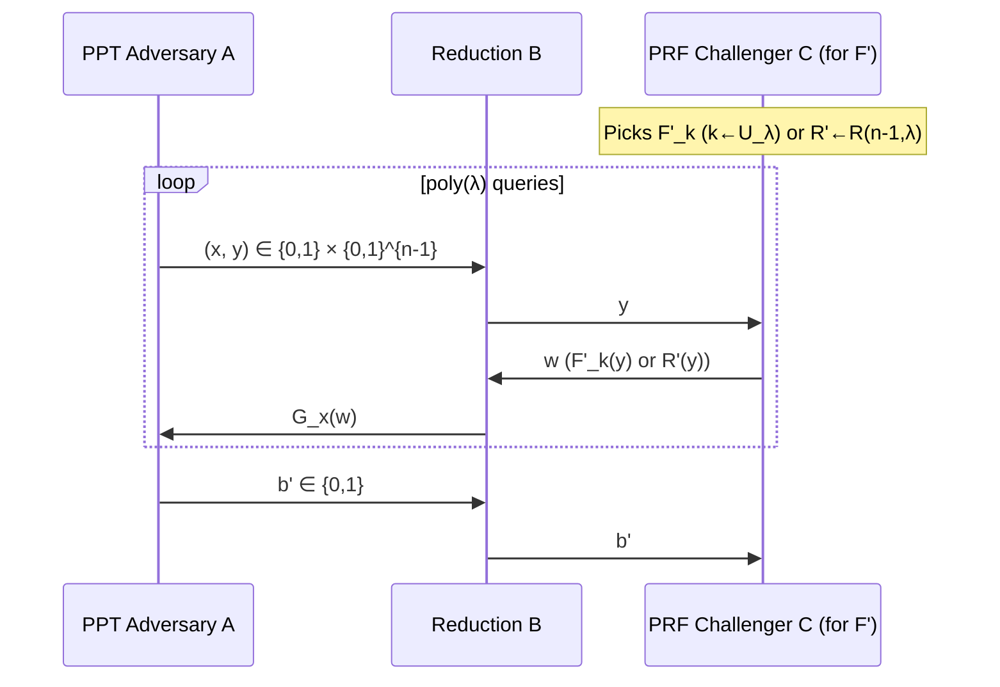
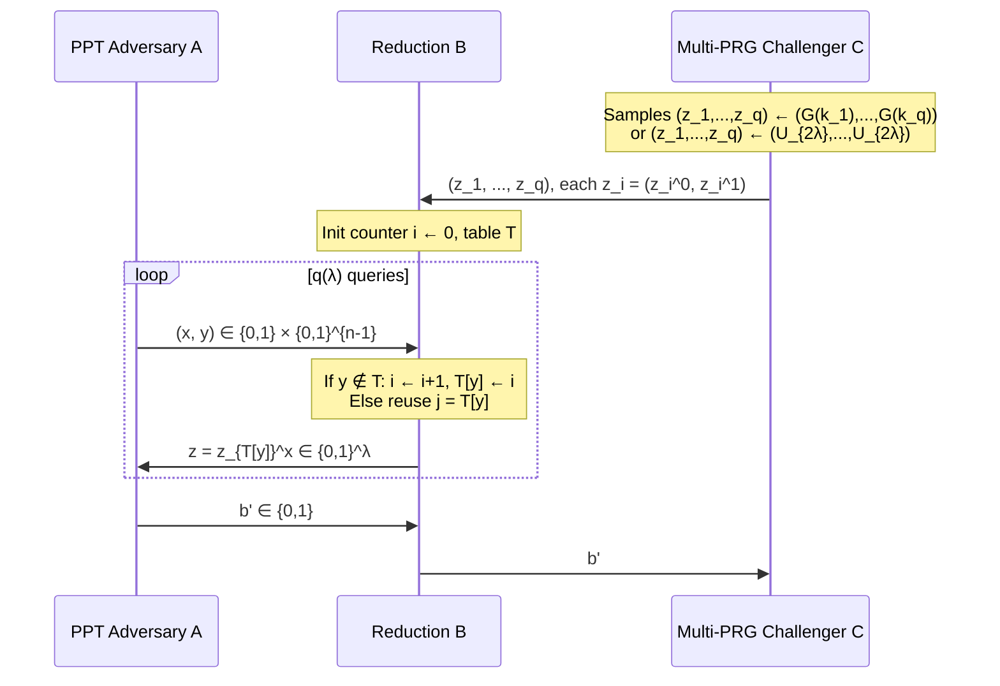

> [!info] References #gemini
> * **Course Slides**: Daniele Venturi, [Lecture 8 — Constructing PRFs from OWFs (GGM)](https://dventuri83.github.io/assets/pdf/crypto_lecture08_2627.pdf) #gemini
> * **Reference Notes**: Simone Bianco, [Cryptography.pdf](https://github.com/Exyss/university-notes/raw/main/Master/Cryptography/Cryptography.pdf), Section 4.2.1 (*The GGM Tree*, pp. 35–38) #gemini
> * **Textbook**: Katz & Lindell, *Introduction to Modern Cryptography* — 3rd ed. Section 8.5 (Theorem 8.21) / 2nd ed. Section 7.5 #gemini

> **note**: everything, even if noted is mostly generated by gemini since reference notes sucks 

How to build a PRF?
* from any OWF
* from any PRG *(today)* 

**GGM**: 
* assume $G: \{ 0,1 \}^\lambda \to \{ 0,1 \}^{2\lambda}$
* we want to build $F_{k}: \{ 0,1 \}^n \to \{ 0,1 \}^\lambda$
* think of $G(k)=(G_{0}(k), G_{1}(k))$ 
	* $G_{0}$ outputs first $\lambda$ bits of $G(k)$ 
	* $G_{1}$ outputs last $\lambda$ bits of $G(k)$
	* $|G_{0}(k)|=|G_{1}(k)|=|k|=\lambda$ 

Then we can define (for $n=2$): 
* $F_{k}(00)=G_{0}(G_{0}(k))$
* $F_{k}(01)=G_{1}(G_{0}(k))$
* $F_{k}(10)=G_{0}(G_{1}(k))$
* $F_{k}(11)=G_{1}(G_{1}(k))$

these four strings are pseudorandom, even when viewed together:
* **intuition**: $G_{0}(k)||G_{1}(k)$ is pseudorandom and indistinguishable from $k_{0}||k_{1}$ (two independent uniform keys) 
* and so is $F_{k}(00)||F_{k}(01)||F_{k}(10)||F_{k}(11)$ 
* since $G$ is a PRG (applying $G$ independently to pseudorandom seeds $k_0, k_1$ keeps the outputs pseudorandom). 

**GGM Tree (Fig. 7.2, $n=3$)**: 
* Each input bit $x_i$ chooses whether to take the left branch ($0 \to G_0$) or the right branch ($1 \to G_1$) starting from the root key $k$. 
* Evaluating $F_k(x)$ only traverses **one root-to-leaf path** (equals to $n$ calls to $G$)
* So it runs in poly-time without ever materializing all $2^n$ leaves
* below, green highlights $F_k(011) = G_1(G_1(G_0(k)))$. 

$$
F_{k}(x) = G_{x_{n}}(G_{x_{n-1}}(\dots G_{x_{1}}(k)\dots))
$$
$$
x=x_{1}\dots x_{n} \in \{ 0,1 \}^n
$$
**what we are doing**: constructing a PRF on $n$-bit inputs using only a length-doubling PRG $G$ (and $n$ sequential evaluations of $G$).

> [!note] question for venturi
> why we cannot use a PRG as a PRF?
> * **Answer**: (1) A PRG takes **no input $x$** — it stretches a secret seed $k$ once, whereas a PRF takes an adversary-chosen $x \in \{0,1\}^n$ ($F_k(x) = G(k \| x)$ is insecure since $x$ is known/chosen, breaking uniform-seed security). (2) Stretching $k$ to $2^n\lambda$ bits directly with a PRG to index $2^n$ outputs would take $\Omega(2^n)$ exponential time instead of poly-time. #gemini

**Thm**: assuming $G$ is a PRG 
* with expansion factor $\ell(\lambda)=2\lambda$ (in Katz & Lindell notation: $\ell(n)=2n$) 
* so $G_{0},G_{1}: \{0,1\}^\lambda \to \{0,1\}^\lambda$ 
$$
\mathcal F = \{ F_{k}: \{ 0,1 \}^n \to \{ 0,1 \}^\lambda\} \text{ is a PRF.}
$$
**intuition (Slides 3–4)**:
* $k$ is random
* so $(G_{0}(k), G_{1}(k)) \approx_{C} (U_{\lambda}, U_{\lambda})$, and ideally we could replace all $2^n$ leaves of the tree with uniform strings. 
* **goal of the proof**: to show that $\mathcal F$ is a PRF we have to show that all the levaves of the GGM tree look truly like independent uniform strings.
* **Why that naive idea fails**: replacing all $2^n$ leaves one by one requires **exponentially many hybrids** ($2^n$) 
* So we would need to build $H_{0},H_{1},\dots,H_{T}$ hybrids with $T=2^n$
* But to use hybrids, and to have a polinomial attacker we don't want an exponential number of hybrids! So we need another idea.

**lemma**: for any $t(\lambda)=\text{poly}(\lambda)$ 
$$
(G(k_{1}),\dots,G(k_{t})) \approx_{C} (U_{2\lambda}, \dots, U_{2\lambda})
$$
* where $k_{i} \gets U_{\lambda}$

**proof**: requires hybrids (Slides 4–5, Bianco Lemma 4.1). 
* $H_0 \equiv (G(k_1), G(k_2), \dots, G(k_t))$
* $H_1 \equiv (U_{2\lambda}, G(k_2), \dots, G(k_t))$ 
* $H_i \equiv (\underbrace{U_{2\lambda}, \dots, U_{2\lambda}}_{i}, G(k_{i+1}), \dots, G(k_t))$ 
* $H_t \equiv (U_{2\lambda}, U_{2\lambda}, \dots, U_{2\lambda})$ 

**we want to prove that**: 
$$
H_{0} \approx_{C} H_{1} \approx_{C} \dots \approx_{C} H_{t-1} \approx_{C} H_{t} \implies H_{0} \approx_{C} H_{t}
$$
> **means**: it's impossible to distinguish in polynomial time between $t$ random strings of size $2\lambda$ from $t$ pseudorandom strings of size $2\lambda$

**let's see $H_{0} \approx_{C} H_{1}$ (Slides 5–6)**

* **Goal of $\mathcal{A}$**: distinguish $H_0$ from $H_1$
	* understand whether the first $2\lambda$-bit block is $G(k_1)$ 
	* or uniform $U_{2\lambda}$ 
* **Goal of $\mathcal{B}$**: break the PRG security of $G$
	* understand whether $\mathcal{C}$ gave $z_1 = G(k_1)$ or $z_1 \gets U_{2\lambda}$)
* **Algorithm of $\mathcal{B}$**: on input $z_1 \in \{0,1\}^{2\lambda}$ from $\mathcal{C}$, $\mathcal{B}$ samples $k_2, \dots, k_t \gets U_\lambda$, 
	* computes $(z_1, G(k_2), \dots, G(k_t))$, 
		* so $\mathcal B$ knows $G$ that $\mathcal C$ is using.
	* calls $\mathcal{A}$ **once** on this tuple, 
	* and outputs $\mathcal{A}$'s bit $b'$ to $\mathcal{C}$. 
	* (For a general step $H_{i-1} \approx_C H_i$, $\mathcal{B}$ puts $i-1$ uniform $U_{2\lambda}$ blocks before $z_i$ and $G(k_{i+1}), \dots, G(k_t)$ after it.) 
* **contraddiction**: $\mathcal A$ can break $C$ by reduction, but $PRG$ by definition is unbreakable. so $\not \exists A\square$

now we still have to prove the following:
**Thm**: assuming $G$ is a PRG 
* with expansion factor $\ell(\lambda)=2\lambda$ 
* so $G_{0},G_{1}: \{0,1\}^\lambda \to \{0,1\}^\lambda$ 
$$
\mathcal F = \{ F_{k}: \{ 0,1 \}^n \to \{ 0,1 \}^\lambda\} \text{ is a PRF.}
$$

**proof**: induction on $n(\lambda)=\text{poly}(\lambda)$ *(in Slides 6–12 written with $m(\lambda) = \text{poly}(\lambda)$)* 
* let $F'_{k}: \{ 0,1 \}^{n-1} \to \{ 0,1 \}^{\lambda}$
* let $F_{k}: \{ 0,1 \}^{n} \to \{ 0,1 \}^{\lambda}$ 
* $F_{k}(x,y)=G_{x}(F'_{k}(y))$
	* *this just a way to build $F_{k}$ using $F'_{k}$ that takes $n-1$ bits instead of $n$*
	* $x \in \{ 0,1 \}$ and $y \in \{ 0,1 \}^{n-1}$ *(matching $F_k(x_1\dots x_n) = G_{x_n}(\dots G_{x_1}(k)\dots)$, here $y = x_1\dots x_{n-1}$ is the prefix and $x = x_n$ is the last bit applied at the leaf)* #gemini

* **Base case ($n = 1$, Slide 7)**: 
	* $F_k(0) = G_0(k)$ so it calls just $G_{0}$,
	* $F_k(1) = G_1(k)$ is the same
	* all of this $\implies (G_{0}(k), G_{1}(k)) \approx_{C} (U_{\lambda}, U_{\lambda})$ 
		* why? b.c. **G is PRG**; since the entire domain $\{0,1\}^1$ has only $\{0,1\}$, querying $F_k$ vs a random $R \gets \mathcal{R}(1,\lambda)$ gives $(G_0(k),G_1(k))$ vs $(R(0),R(1)) \equiv (U_\lambda,U_\lambda)$, so $F_k$ is a PRF for $n=1$. #gemini
* **Inductive step (Slides 8–9)**: 
	* Assume $F'_k$ is a PRF for length $n-1$. 
	* **goal**: show $F_{k}$ is a PRF for length $n$
	* Define three games for $\mathcal{A}$ querying $(x, y)$: 
		* $\text{Game}_0(\lambda)$: oracle returns $F_k(x,y) = G_x(F'_k(y))$
		* $\text{Game}_1(\lambda)$: oracle returns $H(x,y) = G_x(R'(y))$, where $R' \gets \mathcal{R}(n-1, \lambda)$ 
		* $\text{Game}_2(\lambda)$: oracle returns $R(x,y)$, where $R \gets \mathcal{R}(n, \lambda)$

* **Lemma 1 ($\text{Game}_0(\lambda) \approx_C \text{Game}_1(\lambda)$, Slides 9–10, Bianco Claim 1)**: 
	* $\mathcal A$ wants to distinguish $\text{Game}_0(\lambda)$ from $\text{Game}_1(\lambda)$ 
		* **goal**: distinguish $G_x(F'_k(y))$ from $G_x(R'(y))$ 
	* $\mathcal B$ wants to break the PRF security of $F'$ 
		* **goal**: distinguish $F'_k$ from $R'$ 
	* **how the reduction works (for each query $(x, y)$ from $\mathcal{A}$)**: 
		* $\mathcal{B}$ forwards **$y \in \{0,1\}^{n-1}$** to $\mathcal{C}$, who returns $w = F'_k(y)$ or $w = R'(y)$ 
			* (note: $\mathcal{C}$ evaluates on query $y$, NOT on $k$) 
		* **$\mathcal B$ sends $G_{x}(w)$ to $\mathcal A$** 
			* if $w = F'_k(y)$: $\mathcal{A}$ receives $G_x(F'_k(y)) = F_k(x,y)$ ($\text{Game}_0(\lambda)$) 
			* if $w = R'(y)$: $\mathcal{A}$ receives $G_x(R'(y)) = H(x,y)$ ($\text{Game}_1(\lambda)$) 
		* when $\mathcal{A}$ outputs $b'$, $\mathcal{B}$ forwards $b'$ to $\mathcal{C}$ (perfect reduction)

* **Lemma 2 ($\text{Game}_1(\lambda) \approx_C \text{Game}_2(\lambda)$, Slides 10–12, Bianco Claim 2)**: 
	* **recall ($\text{Game}_1(\lambda)$ vs $\text{Game}_2(\lambda)$)**: 
		* $\text{Game}_1(\lambda)$: 
			* on query $(x,y) \in \{0,1\} \times \{0,1\}^{n-1}$
			* oracle returns $H(x,y) = G_x(R'(y))$ 
			* where $R' \gets \mathcal{R}(n-1,\lambda)$ 
		* $\text{Game}_2(\lambda)$: 
			* on query $(x,y) \in \{0,1\} \times \{0,1\}^{n-1}$
			* oracle returns $R(x,y)$ 
			* where $R \gets \mathcal{R}(n,\lambda)$ 
		* so distinguish between $G_{x}(\text{Random thing})$ and just a $\text{Random thing}$ *(specifically: in $\text{Game}_1$, $(H(0,y), H(1,y)) = G(R'(y))$ share the same random seed $R'(y)$, whereas in $\text{Game}_2$, $(R(0,y), R(1,y))$ are two independent random strings)* #gemini
	* **goal of the attack game**: prove $\text{Game}_1(\lambda) \approx_C \text{Game}_2(\lambda)$ by reduction to the $q$-tuple PRG lemma $(G(k_1), \dots, G(k_q)) \approx_C (U_{2\lambda}, \dots, U_{2\lambda})$
		* where $q(\lambda) = \text{poly}(\lambda)$ is the number of queries made by $\mathcal{A}$ 
		* (if $\mathcal{A}$ distinguishes $\text{Game}_1$ from $\text{Game}_2$, $\mathcal{B}$ breaks the PRG lemma $\implies$ contradiction) 
	* **actors & goals**: #gemini
		* **$\mathcal{C}$ (Multi-PRG Challenger)**: 
			* samples $(z_1, \dots, z_q)$ 
			* either from $(G(k_1), \dots, G(k_q))$ ($k_i \gets U_\lambda$) 
			* or from $(U_{2\lambda}, \dots, U_{2\lambda})$
			* he sends the tuple to $\mathcal{B}$, and checks $\mathcal{B}$'s guess $b'$ 
		* **$\mathcal{A}$ (PPT Adversary)**: 
			* **goal** — distinguish $\text{Game}_1(\lambda)$ from $\text{Game}_2(\lambda)$ 
			* by adaptively making $q$ queries $(x,y)$ and outputting $b' \in \{0,1\}$ 
		* **$\mathcal{B}$ (PPT Reduction)**: 
			* **goal** — distinguish $(G(k_1), \dots, G(k_q))$ from $(U_{2\lambda}, \dots, U_{2\lambda})$ 
			* by simulating $\text{Game}_1$ or $\text{Game}_2$ for $\mathcal{A}$ ($\mathcal{B}$ is PPT since $q(\lambda) = \text{poly}(\lambda)$ and each query takes $O(1)$ table work) #gemini
	* **data passed & reduction algorithm**: 
		* $\mathcal{C} \to \mathcal{B}$: $(z_1, \dots, z_q) \in (\{0,1\}^{2\lambda})^q$;
			* $\mathcal{B}$ splits each $z_i = (z_i^0, z_i^1)$ with $z_i^0, z_i^1 \in \{0,1\}^\lambda$,
			* initializes counter $i \gets 0$ and table $T$ 
		* $\mathcal{A} \to \mathcal{B}$: query $(x,y) \in \{0,1\} \times \{0,1\}^{n-1}$ (up to $q$ times, so $\mathcal{B}$ never runs out of $z_1, \dots, z_q$; any unused $z_j$ are ignored) #gemini
		* $\mathcal{B}$'s lookup: if $y \notin T$, set $i \gets i + 1$ and $T[y] \gets i$ (fresh $z_i$); else reuse $j = T[y]$ (so repeated $y$ shares the same $z_j$) #gemini
			* **why**? to simulate the game for $\mathcal A$ we have to record which $z_{i}$ was assigned to $y$ #gemini
			* if $\mathcal A$ asks for $(x,y)$ and we return $z_{i}^{x}$ from $z_{i}$, for later queries with the same $y$ (e.g., $(1-x, y)$ or repeated $(x,y)$) we must reuse that same $z_i$ so the oracle stays deterministic and consistent #gemini
		* $\mathcal{B} \to \mathcal{A}$: returns $z = z_{T[y]}^x \in \{0,1\}^\lambda$ #gemini
		* $\mathcal{A} \to \mathcal{B} \to \mathcal{C}$: $\mathcal{A}$ outputs guess $b' \in \{0,1\}$ after polynomial queries, and $\mathcal{B}$ forwards $b'$ to $\mathcal{C}$ 

	* **why reusing $z_{T[y]}$ works (Slides 11–12)**: #gemini
		* **case $y_2 \neq y_1$**: $\mathcal{B}$ assigns a fresh $z_2$ to $y_2$ and returns $z_2^{x_2}$: #gemini
			* if $z_i = G(k_i)$: $z_1^{x_1} = G_{x_1}(k_1)$ and $z_2^{x_2} = G_{x_2}(k_2)$ use independent uniform seeds (matching $R'(y_1), R'(y_2)$ in $\text{Game}_1(\lambda)$) #gemini
			* if $z_i \gets U_{2\lambda}$: $z_1^{x_1}$ and $z_2^{x_2}$ are independent uniform $\lambda$-bit strings (matching $R(x_1,y_1), R(x_2,y_2)$ in $\text{Game}_2(\lambda)$) #gemini
		* **case $y_2 = y_1$ (with $x_2 \neq x_1$)**: $\mathcal{B}$ reuses $z_1$ and returns $z_1^{x_2}$: #gemini
			* if $z_i = G(k_i)$: both queries use the same seed $k_1$ (representing $R'(y_1)$), so $\mathcal{A}$ gets $G_{x_1}(k_1)$ and $G_{x_2}(k_1)$ (matching $\text{Game}_1(\lambda)$) #gemini
			* if $z_i \gets U_{2\lambda}$: $z_1^0$ and $z_1^1$ are the two independent uniform $\lambda$-bit halves of $z_1$ (matching $R(0,y_1)$ and $R(1,y_1)$ in $\text{Game}_2(\lambda)$) #gemini
	* **advantage & contradiction**: since $\mathcal{B}$ simulates $\text{Game}_1(\lambda)$ identically when $z_i = G(k_i)$ and $\text{Game}_2(\lambda)$ identically when $z_i \gets U_{2\lambda}$, $|\Pr[\mathcal{B}(G(k_1),\dots,G(k_q))=1] - \Pr[\mathcal{B}(U_{2\lambda},\dots,U_{2\lambda})=1]| = |\Pr[\mathcal{A}^{\text{Game}_1}=1] - \Pr[\mathcal{A}^{\text{Game}_2}=1]|$; if $\mathcal{A}$ has non-negligible advantage, $\mathcal{B}$ breaks the $q$-tuple PRG lemma. #gemini
* **Conclusion (Inductive Step)**: #gemini
	* By Lemma 1, $\text{Game}_0(\lambda) \approx_C \text{Game}_1(\lambda)$ (assuming $F'_k$ is a PRF on $n-1$ bits). #gemini
	* By Lemma 2, $\text{Game}_1(\lambda) \approx_C \text{Game}_2(\lambda)$ (assuming $G$ is a PRG). #gemini
	* By transitivity of $\approx_C$, $\text{Game}_0(\lambda) \approx_C \text{Game}_2(\lambda)$, so $F_k: \{0,1\}^n \to \{0,1\}^\lambda$ is a PRF. Since $n(\lambda) = \text{poly}(\lambda)$, unrolling the $n$ inductive levels keeps the total distinguishing advantage $\text{poly}(\lambda) \cdot \text{negl}(\lambda) = \text{negl}(\lambda)$. $\square$ #gemini