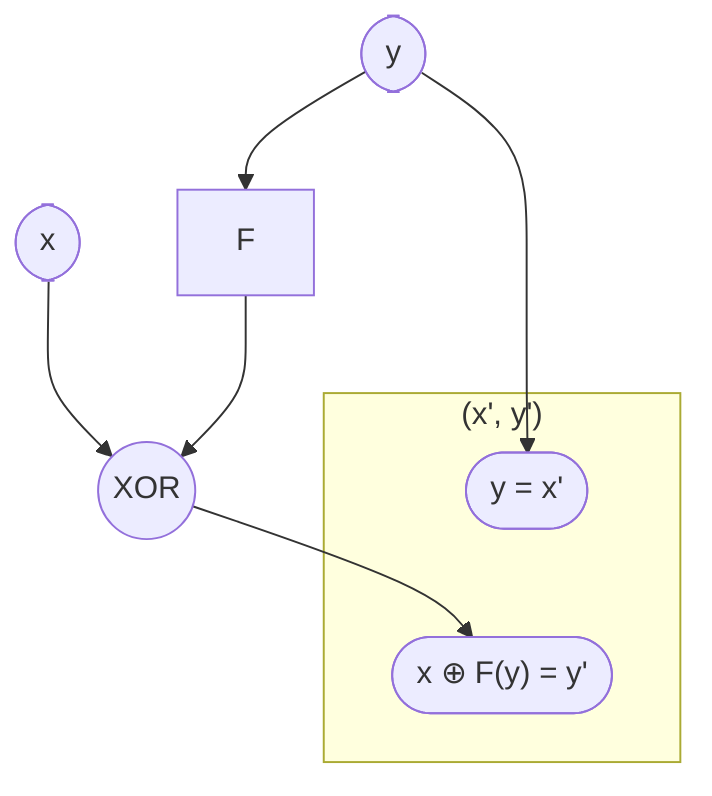
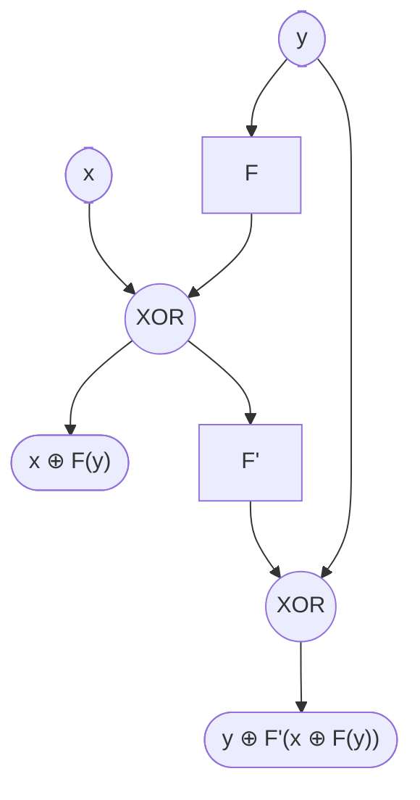
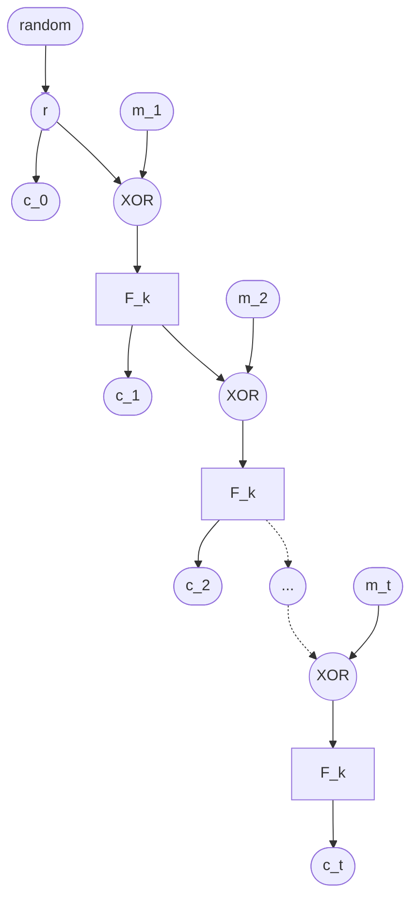
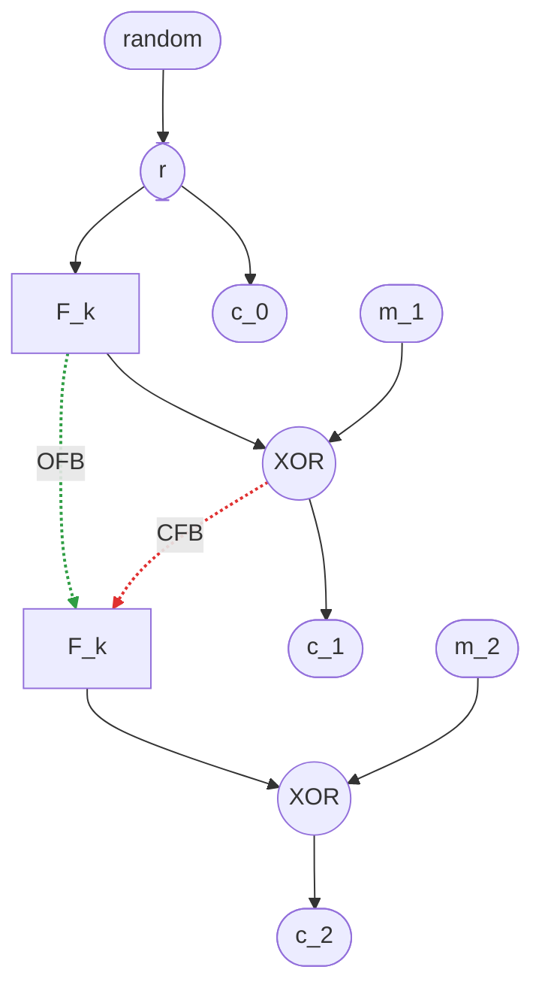
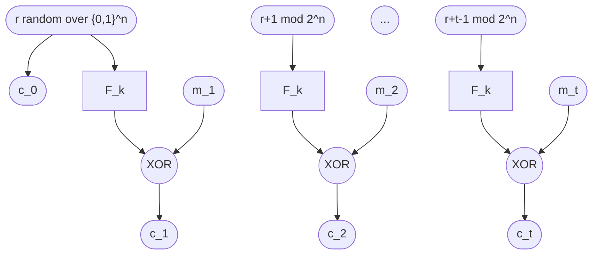
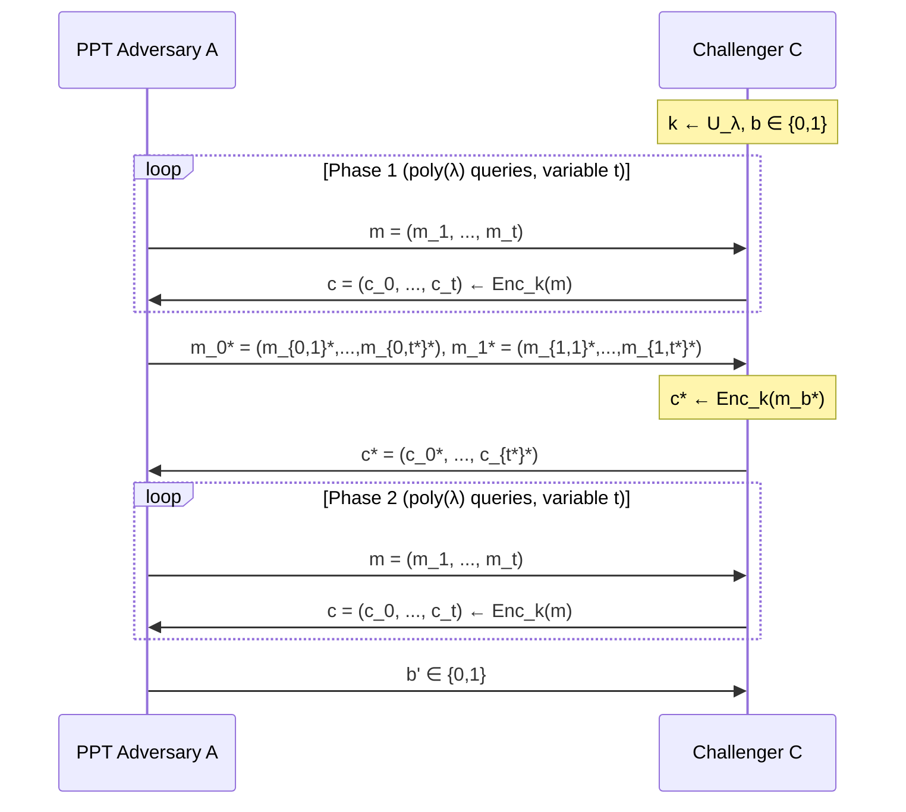

> [!info] References #gemini
> * **Course Slides**: Daniele Venturi, [Lecture 9 — Blockciphers, Feistel Networks & Modes of Operation](https://dventuri83.github.io/assets/pdf/crypto_lecture09_2627.pdf) #gemini
> * **Reference Notes**: Simone Bianco, [Cryptography](https://github.com/Exyss/university-notes/raw/main/Master/Cryptography/Cryptography.pdf), Sec. 4.3 (pp. 41–45) & Sec. 4.6 (pp. 56–60) #gemini

# Block ciphers
**note**: the name is actually misleading, because they are not ciphers on their own. Actually they are pseudorandom permutations.

**examples**: DES, AES, ...

**invertible**: b.c  are used often as an instantiation of a PRF, but they are more, as they are **invertible**. How do we make a PRF invertible?

**feistel network**: design at IBM by feistel and is the inspiration of many block ciphers.

$$\Psi_{F}(x,y) = (y, x \oplus F(y)) = (x',y')$$

$$\Psi^{-1}_F(x',y') = (F(x') \oplus y', x')$$
* note that $x'$ is actually $y$, just look at $\Psi_{F}(x,y)$
* **invertible**: so we can invert $\Psi$ even if $F$ is not invertible.

**Q**: is this a PRP, assuming $F$ a PRF? 
**R**: No, because 1st output half equals 2nd half of the input.
* the input $y$ (second half), cost in the first half of the output. always.

**Stackable**: i can stack $\Psi$ and iterate. So we can solve the problem exposed in $Q$.

* $F,F'$ are independent random functions. 
* $F$ has its own key, and $F'$ has a different key.
* **keys**: block ciphers use different keys inside their algorithm.
$$
\Psi_{F,F'}(x,y) = \Psi_{F'}(\Psi_{F}(x,y))= \Psi_{F'}(y, x \oplus F(y))$$

 $$
 = (x \oplus F(y), y \oplus F'(x \oplus F(y)))
$$

**Q**: Did we get a PRP?
**R**: No.

**Observation**: 
$$
\Psi_{F,F'}(x,y) \oplus \Psi_{F,F'}(x',y) = \left( x \oplus x', \dots \right)
$$
* because $(x \oplus F(y) \oplus x' \oplus F(y), \dots) = (x \oplus x', \dots)$
* so we are leaking some information.
* **what we are doing**: we make two different queries but same $y$.
* it turns out this is the "only problem".

**Fix**: add one more round. We'll get a PRP this time.

$F$, in the real word:
* $F$ is heuristic
* all the keys are derived from single $k$ using an heuristic PRG

**Lemma**: for every unbounded attacker making $q=\text{poly}(\lambda)$ queries, then the following are indistinguishable:
1. $S: \Psi_{F,F'}(x,y);$ 
	1. $F,F' \gets \mathbb R(n,n)$ #gemini
	2. $F,F'$ are just two random functions
2. $R: R(x,y); R \gets \mathbb R(2n, 2n)$
* **important assumption**: So as long the queries made by $\mathcal A$ are $y\text{-unique}$ ($y$ are all different).

> $\mathbb{R}(n,n)$ is the set of all functions $\{0,1\}^n \to \{0,1\}^n$ (from $2^n$ elements to $2^n$ elements); similarly $\mathbb{R}(2n,2n)$ is $\{0,1\}^{2n} \to \{0,1\}^{2n}$. #gemini

## the proof that i did not understand at all

> [!warning] Complex Topic — Study on Your Own: 2-Round Feistel Hybrid Proof #gemini
> * **What to study**: Why $y$-uniqueness guarantees $F(y_i)$ is an unseen random value $r$, and why avoiding a collision $x_i \oplus r = x_j \oplus F(y_j)$ ($j < i$) makes $F'(x_i \oplus r)$ a fresh random $r'$, transforming query $i$ from $S$ ($H_i$) to $R$ ($H_{i-1}$). #gemini
> * **References**: Venturi [Lecture 9 Slides](https://dventuri83.github.io/assets/pdf/crypto_lecture09_2627.pdf), pp. 5–8. #gemini

**proof**: 
* let $H_{i}$ be the experiment where we reply to the first $i$ queries as in $S$, and all other as in $R$.
* we switch gradually from $S$ (its feistel) and then we switch to $R$ (random).
* $H_{0} \equiv R \text{ and } H_{q} \equiv S$.
* **goal**: show that $H_{0} \approx_{c} H_{q}$.
* Let us look at $H_{i}$, so the first $i$ queries that are sampled from $S$
	* $(x_{j} \oplus F(y_{j}), \; y_{j} \oplus F'(x_{j} \oplus F(y_{j})))$ for $j=1,\dots,i-1$ #gemini
	* $(x_{i} \oplus F(y_{i}), \; y_{i} \oplus F'(x_{i} \oplus F(y_{i})))$, $\dots$ #gemini
	* we want to show that $H_{i}$ is indistinguishable from $H_{i-1}$.

**since $y_{i}$ are all different** from all $y_{j}$'s, then $F(y_{i})$ is random (since $F$ is random) and also independent of $F(y_{1}),\dots,F(y_{i-1})$ and everything else. So:

$$
(x_{i} \oplus F(y_{i}), \; y_{i} \oplus F'(x_{i} \oplus F(y_{i})))_{j=1,\dots, i-1} \to \text{same as before}
$$
is equivalent to:
$$
(x_{i}\oplus r, \; y_{i} \oplus r') \text{ with }r,r' \text{random}
$$
* with a random $r$
* **essentially**: i can replace $F(y_{i})$ with $r$ because $y_i$ are all different by assumption. 

**question**: can i replace $F'(x_{i} \oplus r)$ with $F'(r)$? so the input is completely random looking (???)
* **Answer**: Replace $F'(x_{i} \oplus r)$ with a fresh random $r'$, provided $x_{i} \oplus r$ does not collide with any previous input $x_{j} \oplus F(y_{j})$ ($j < i$) to $F'$.

What's the probability that $x_{i} \oplus r = x_{j} \oplus F(y_{j})$? it is negligible, at most $(i-1) 2^{-n}$
* $(i-1)2^{-n}$: the event in wich $x_{i} \oplus r$ collides with $x_{j} \oplus F(y_{j})$ for $j<i$
* $\sum_{i} (i-1) 2^{-n} \leq q^2 \cdot 2^{-n} = \text{negl}(\lambda) \square$

**what happened**: we got from $H_{i}$ to $H_{i-1}$ iteratively.

**By the hybrid argument** knowing $H_{0},\dots,H_{q}$ we can estimate $\text{SD}(S;R)$. 
$$SD(S;R) = \text{SD}(H_{q}; H_{0}) \leq \sum_{i=1}^q \text{SD}(H_{i}; H_{i-1}) \\ \leq \sum_{i} (i-1)2^{-n} \leq q^2 2^{-n} = \text{negl}(\lambda) \square$$
## feistel proof

**THM**: assuming $\mathcal F$ a PRF family, then 3 rounds of feistel with independent keys is a PRP.

**proof**: consider the following systems (what box the adversary can query).
1. $T: \Psi_{F_{k_{3}}}(\Psi_{F_{k_{2}}}(\Psi_{F_{k_{1}}}(x,y))); \; k_1,k_2,k_3 \gets U_\lambda$ 
2. $S: \Psi_{F,F'}(\Psi_{F''}(x,y))$ 
3. $R: R(x,y); R \gets \mathbb R(2n, 2n)$
	1. $\mathbb R$ is a random function
4. $P: P(x,y); P \gets \mathbb P(2n, 2n)$
	1. $\mathbb P$ is a random permutation

> **note**: a pseudorandom function is indistinguishable from a random function, **not** necessarily invertible (even given $k$); Feistel makes it invertible, and we prove it is a PRP. #gemini

>[!note] **Recall ($\approx_c$ vs $\approx_s$)**: #gemini
	> * $X \approx_c Y$ (**computational indistinguishability**): no **PPT** adversary $\mathcal{A}$ can distinguish $X$ from $Y$ with non-negligible advantage. 
	> * $X \approx_s Y$ (**statistical indistinguishability**): even an **unbounded** adversary $\mathcal{A}$ (here limited to $q=\text{poly}(\lambda)$ queries) has $\text{SD}(X;Y) \le \text{negl}(\lambda)$ (stronger than $\approx_c$: $\approx_s \implies \approx_c$). 

proof for 1-4.
1. $T \approx_{c} S$. Why? By the fact that $\mathcal{F}$ is a PRF $\square$
2. $S \approx_{S} R$. for $\text{poly}(\lambda)$ queries. 
	1. **IDEA**: 1 round gives you $y\text{-uniqueness}$,  $\Psi_{F''}(x_i, y_{i})$ satisfies $y\text{-uniqueness}$
		1. take $(x_{i}, y_{i}) \neq (x_{j}, y_{j})$
		2. we want to compute the $\text{Pr}$ so that the two do not satisfy $y\text{-uniqueness}$
		3. **case 1**: $y_{i}=y_{j}$, then $x_{i} \neq x_{j}$
			1. $y_{i}'' = x_{i} \oplus F''(y_{i}) = x_{i} \oplus F''(y_{j})$
			2. $\neq x_{j} \oplus F''(y_{j}) = y_{j}''$
			3. so they are always different.
		4. **case 2**: let $y_{i} \neq y_{j}$, then we would need
			1. $x_{i} \oplus F''(y_{i}) = x_{j} \oplus F''(y_{j})$
			2. or $x_{i} \oplus x_{j} = F''(y_{i}) \oplus F''(y_{j})$
			3. this happens with $\text{pr} \leq 2^{-n}$
		5. so: $\text{Pr}[\lnot y\text{-unique}] \leq \binom{q}{2} \cdot 2^{-n} = \text{negl}(\lambda)$
		6. then $S \approx_{s} R$ by the lemma before $\square$. #gemini
3. $R \approx_{S} P$. A random function is already statistically indistinguishable from a random permutation assuming $q=\text{poly}(\lambda)$ queries (collision prob. $\leq \binom{q}{2} 2^{-2n} = \text{negl}(\lambda)$). #gemini

But one question remains: we can do SKE beating Shannon assuming any PRF.

$$
C = (r, F_{k}(r) \oplus m), \text{ with } r \text{ random}
$$
* we are using 1-block CPA-secure SKE constructio from [[1o anno M/cockgraphy/lez. 7|lez. 7]]
* we are using OTP to mask $m$ using $r$ random.
* to decrypt $C$: $F_{k}(r) \oplus (F_{k}(r) \oplus m) = m$.

> [!note] why PRF beats shannon?
> A PRF, fixed a short key $k$ returns just a deterministic random looking value. So reusing the key is not a problem, the output looks unrelated to $k$, since it looks random. The key can be even much shorter than the message. And so PPT adversaries are blown up.

> [!note] so what's the point?
> We showed up to this point that a non invertible PRF can be turned into PRP using 3 rounds feistel.

What about **very long messages**: $m = m_{1},\dots,m_{t}$ with $m_{i} \in \{ 0,1 \}^n$? we need to define how to encrypt them in a secure way.

 can only beat **Mode of operation/Domain Extension**: describe how do we use cipher $X$ to encrypt a long message? 
* **ECB**: (Electronic CodeBook), perhaps the simplest idea is to just do 
	* $m_{1} \to F_{k} \to c_{1}$
	* ...
	* $m_{t} \to F_{k} \to c_{t}$.
	* It's insecure, because $F_{k}$ is deterministic fixed $k$
* **Break**: $m_i = m_j \implies c_i = c_j$ (e.g., challenge $m_0^*=(a,a)$ vs $m_1^*=(a,b)$ and check $c_1^* \stackrel{?}{=} c_2^*$). #gemini
* Nobody uses ECB.

**CBC**:

* **Break (if IV predictable / CCA)**: predictable IV $r'$ lets $\mathcal{A}$ force $r' \oplus m = r \oplus m'$ (CPA break); flipping bits in $c_{i-1}$ flips the same bits in $m_i$ (malleable). #gemini
	* vulnerable if can predict $r$ (gemini check this)
	* vulnerable to chose cyphertext: changing a bit in $c$ changes the correspective bit in $m$

**CFB and OFB**:

**OFB**: the value to use to XOR $m_{2}$ is obtained by putting $F_{k}(r)$ again inside $F_{k}$. Then $c_{2}= F_{k}(F_{k}(r)) \oplus m_{2}$

**CFB**: the value to use to XOR $m_{2}$ is obtained by putting $F_{k}(r) \oplus m_{1}$ inside $F_{k}$. Then $c_{2} = F_{k}(F_{k}(r) \oplus m_{1}) \oplus m_{2}$

* **Break (if $r$ reused / CCA)**: reusing $r$ leaks $c_1 \oplus c_1' = m_1 \oplus m_1'$ (OFB leaks the full keystream $c \oplus c' = m \oplus m'$); bit-flipping $c_i$ flips the same bits in $m_i$ (malleable). #gemini

**note**: in some constructions you can parallelize computation. understand which one as exercise.
* In OFB you can precompute all the $F_{k}^i(\cdot)$ with $F_{k}^i(\cdot)=F_{k}(F_{k}(\dots(r)))$ i times.
* In CFB you have to compute the $i-1$ step to procede with $i$-th step.
* In CBC also, visually each step depends on the previous ones.

**CTR**: is fully parallelizable.

* **Break (if counter overlaps / CCA)**: reusing $r$ (or overlapping $r+i$) repeats the pad $F_k(r+i) \implies c \oplus c' = m \oplus m'$; also bit-flipping $c_i$ flips the same bits in $m_i$ (malleable), so its CCA. #gemini

**thm**: CTR is CPA (for variable input length!) secure assuming F is a PRF. 
* Note that adversary can choose input length

> **note**: all modes (except the first one) are secure.

**Proof**: we need to prove that no adversary can distinguish encryption of $m_{0}$ from $m_{1}$ where they have arbitrary length.
* **note**: a message $m$ is made of $t$ blocks, wich length can vary. also each $m_{i}$ is made of $n$ fixed length bits.

Let $G_{0}$ be the above game with $b=0$ and using **CTR** for encryption. Same for $G_{1}$ with $b=1$. We need to show $G_{0} \approx_{c} G_{1}$. 
* CTR means that $c_{0} =r, c_{1}=F_{k}(r) \oplus m_{1}, \dots, c_{t} = F_{k}(r + t-1) \oplus m_{t}$ (addition $\bmod 2^n$) #gemini 
* By security of $F$ we can replace $F_{k}$ with $R \gets \mathbb R(n,n)$, let us call this $H_{0}, H_{1}$. 
* So $G_{0} \approx_{c} H_{0}$ and $G_{1} \approx_{c} H_{1}$. 
	* **why**? Since $F$ is PRF, so replacing it with $R$ is unpredicatble for a PPT $\mathcal A$.
* We finally introduce $H_{2}$ s.t. $c_{0}^*, c_{1}^*, \dots, c_{t^*}^*$ is uniformly random. We will show that $H_{0} \approx_{S} H_{2}$ and $H_{1} \approx_{S} H_{2}$ assuming $\#$ queries is $q=\text{poly}(\lambda)$.

$$
H_{0} \approx_{S} H_{2} \approx_{S} H_{1}
$$

Look at the challenge: #gemini
$$
c_0^* = r^* \gets U_n; \quad c_1^* = R(r^*) \oplus m_{b,1}^*, \dots, c_{t^*}^* = R(r^* + t^* - 1) \oplus m_{b,t^*}^*
$$
Let $\text{OVERLAP}$ be the event that $r^*, r^*+1, \dots, r^*+t^*-1$ overlaps with any of $r, r+1, \dots, r+t-1$ (from encryption queries). 
* If $\text{OVERLAP}$ does not happen: $H_0 \equiv H_2 \equiv H_1$. 
* So we only need to show $\Pr[\text{OVERLAP}] \leq \text{negl}(\lambda)$.