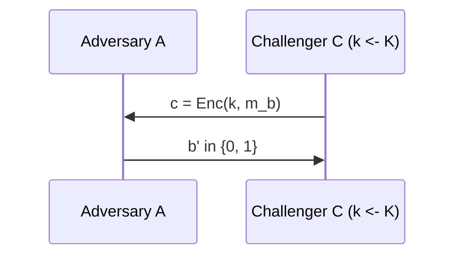
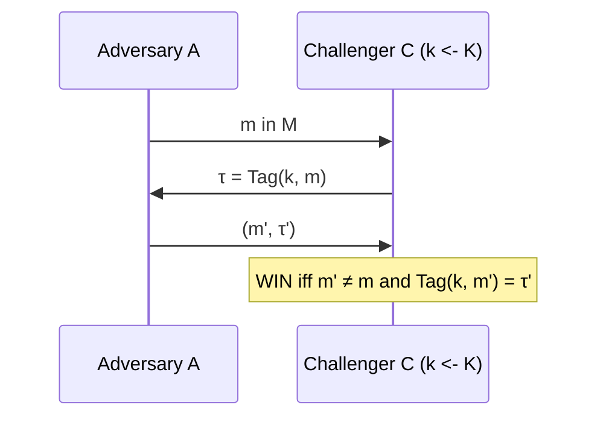
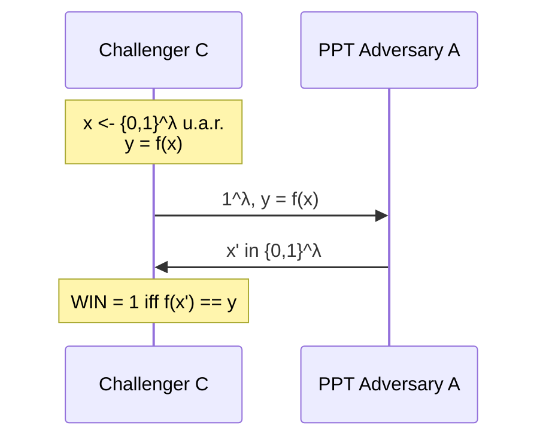

# lez.1 

**perfect secrecy**: 
* **assume**: $M$ on $\mathcal M$, $K$ uniform over $\mathcal K$, $C= \text{Enc}(K,M)$ over $\mathcal C$, with $\text{Enc}$ deterministic.
* $\Pi$ is perfectly secure if, $\forall M, m\in \mathcal M, c\in\mathcal C$
* $\Pr[M=m] = \Pr[M=m|C=c]$

**thm**: the following are equivalent 
* perfect secrecy
* $M,C$ are independent distirbutions
* $\forall m,m' \in \mathcal{M}, \forall c \in \mathcal{C}$ then $\Pr[\text{Enc}(K,m)=c] = \Pr[\text{Enc}(K,m')=c]$

**otp**: is perfectly secret, but...
* length of $k$ same as $m$ ($|k| = |m| = \ell$), because you have to do bitwise XOR.
* **key can only be used once**:

# lez. 2

**thm**: any SKE with perfect secrecy has $|\mathcal{K}| \geq |\mathcal{M}|$

**Adversary**: with $k \gets \mathcal{K}$ u.r. (unknown to $\mathcal{A}$), $\text{Game}(b,m_{0},m_{1});\; b\in \{ 0,1 \},\; m_{0},m_{1}\in \mathcal{M}$

**perfect secrecy (game-based)**: $\Pi$ is perfectly secret if #gemini
* $\forall \mathcal{A}$ (unbounded), $\forall m_{0},m_{1} \in \mathcal{M}$
* $\text{Game}_{\mathcal{A}}(b) = \text{Game}_{\mathcal{A}}(b, m_{0}, m_{1})$
$$
|\Pr[b'=1: \text{Game}_{\mathcal{A}}(1)] - \Pr[b'=1 : \text{Game}_{\mathcal{A}}(0)]| = 0
$$
or:
$$
\text{Game}_{\mathcal{A}}(0) \equiv \text{Game}_{\mathcal{A}}(1)
$$
**mac**: symmetric primitive allowing integrity checks.
* **tag**: $\text{Tag}: \mathcal{K} \times \mathcal{M} \to \mathcal{T}$, deterministic.
* **forgery definition**: given a valid pair $(m,\tau)$, can Eve forge another valid pair $(m',\tau')$ with $m' \neq m$?

**def. $\mathcal E$-statistically secure**:  let $\text{Tag}$ be a MAC over $(\mathcal{K}, \mathcal{M}, \mathcal{T})$. It is **(one-time) $\varepsilon$-statistically** secure if for 
* every $m,m' \in \mathcal{M}$ and $\tau, \tau' \in \mathcal{T}$ with $m \neq m'$ 
* and $\Pr[\tau = \text{Tag}(K,m)] > 0$
$$\Pr[\tau' = \text{Tag}(K,m') \mid \tau = \text{Tag}(K,m)] \leq \varepsilon$$
* **one-time definition**: applies only in case given $k$, Alice tags **one** message $(m, \tau)$. If Alice tags more messages the definition does not apply.
* we don't care how (unbounded $\mathcal{A}$), we want that it's almost impossible

$$
\forall \mathcal{A}: \Pr[\text{WIN}] \leq \varepsilon
$$
**definition**: a family $\mathcal{H} = \{ h_{k}: \mathcal{M} \to \mathcal{T} \}_{k\in \mathcal{K}}$ is **pairwise independent** if for every $m \neq m'$ then $(h(K,m), h(K,m'))$ is uniform over $\mathcal{T}^2$.

**goal**: can we define a MAC using $\text{Tag}(k,m)=h_{k}(m)$

# lez. 3
**lemma**: $h_{a,b}(m) = a\cdot m+b \mod p$ with large $p$ is pairwise independent.

**thm**: every pairwise independent $\mathcal H$ is also $\mathcal E\text{-start}$ secure MAC with $\mathcal E = \frac{1}{|\mathcal T|}$

**randomness extraction**: we start with imperfect source, and generate "pure" randomness

**min-entropy**: $H_{\infty}(X) = -\log \max_{x} \Pr[X=x]$
* **meaning**: $H_{\infty}(X)$ measures the worst-case unpredictability in $X$.

**bound** $X$:
$$
H_{\infty}(X) \geq k \iff p_{\text{max}} \leq 2^{-k}
$$
> [!note] what does actually mean $H_{\infty}(X) \geq k$?
> No single outcome $x \in \{ 0,1 \}^n$ jas probability $> 2^{-k}$, and this probability is distributed among all the $n$ bits! 
> 
> **What you must not say**: $H_{\infty}(X) \geq k \to k$ bits are completely unpredictable

**thm**: there is no such deterministic $\text{Ext}: \{ 0,1 \}^n \to \{ 0,1 \}$ even if $k=n-1$.

**seeded extraction**:
$$
\text{Ext}:  \underbrace{\{ 0,1 \}^d}_{\text{seed}} \times \underbrace{\{ 0,1 \}^n}_{\text{source}} \to \underbrace{\{ 0,1 \}^{\ell}}_{\text{output}}
$$
* is $(k,\mathcal E)$ seeded extarctor iff
* if $\forall X$ s.t. $H_{\infty}(X) \geq k$ we have:
* $(S, \text{Ext}(S,X)) \approx_{\varepsilon} (S,U_{\ell}) \equiv U_{d+\ell}$
* $\approx_{\mathcal E}$ means $\text{SD}(X,Y) \leq \mathcal E$
* $\text{SD}(X,Y) = \frac{1}{2} \sum_{z} |\Pr[X=z]-\Pr[Y=z]|$

**thm**: left-over hash lemma
* let $\mathcal{H} = \{ h_{s}: \{ 0,1 \}^n \to \{ 0,1 \}^{\ell} \}_{s\in \{ 0,1 \}^d}$ pairwise independent
* $\text{Ext}(s,x) = h_{s}(x)$ is a $(k,\varepsilon)\text{-SeededExtractor}$ for...
$$
k \geq \ell + \underbrace{2\log\left( \frac{1}{\varepsilon} \right) - 2}_{\text{min-entropy gap}}
$$

# lez. 4
**lemma**: let $Y$ random var over $\mathcal Y$.
* assume $\text{Col}(Y) = \sum_{y \in \mathcal{Y}} \Pr[Y=y]^2 = \Pr[Y = Y'] \leq \frac{1}{|\mathcal{Y}|}(1 + 4\varepsilon^2)$
* then: $SD(Y,U) \leq \mathcal E$.

**proof uses**:
* $\vec{q}$, $\vec{s}$
* $SD(YU) \leq \frac{1}{2} \sqrt{ <\vec{q},\vec{q}> <\vec{s},\vec{s}> }$
* and a lot of things

**computational security**: how to deply a provably and efficient crypto system? do the following assumptions:
* $\text{Adv} \equiv PPT$
	* random
* $P\neq NP$: there are hard problems that $\text{Adv}$ cannot solve.
	* $P$ set of problems solvable by PPT
	* $NP$ set of problems verifiable by PPT

**consequences**: we have only two options
* either $\Pi$ is **secure**, OR 
* $\Pi$ is **not secure** $\implies P=NP$ 

**thm**: if factoring is hard, then $\Pi$ secure.
* if $\Pi$ not secure then factoring not hard
* implies: $\exists \text{Poly. Time T.M.}$ that solves factoring.

**def**. a deterministic function $f: \mathcal X \to \mathcal Y$ is a owf iff:
1. $f$ is **efficiently computable** in deterministic $\text{poly}(\lambda)$-time, and #gemini
2. $f$ is **hard to invert on average**: $\forall \text{PPT } \mathcal A$ #gemini
$$
\text{Pr}[\text{Game}_{\mathcal A, f}^\text{owf}(\lambda)=1] \text{ is "small"}
$$
in other words:
$$
\text{Pr}[\text{WIN}] = \Pr_{x \gets \mathcal{X}}\big[f(x') = y \;:\; y = f(x),\; x' \gets \mathcal{A}(1^\lambda, y)\big] \leq \text{negl}(\lambda)
$$
> so you know that $f(x)=y$, adversary chooses for you $x'$. you have to compute $y$ s.t. $f(x')=y$

**def. negligible**: $\varepsilon(\lambda)$ is negligible ($\varepsilon \in \text{negl}(\lambda)$) iff:
* $\varepsilon(\lambda) = O\left( \frac{1}{p(\lambda)} \right)$ 
* for every positive polynomial $p(\lambda) = \text{poly}(\lambda)$ (i.e. $\forall c \in \mathbb{N},\; \exists \lambda_0 \in \mathbb{N} : \forall \lambda > \lambda_0,\; \varepsilon(\lambda) < \lambda^{-c}$) #gemini
