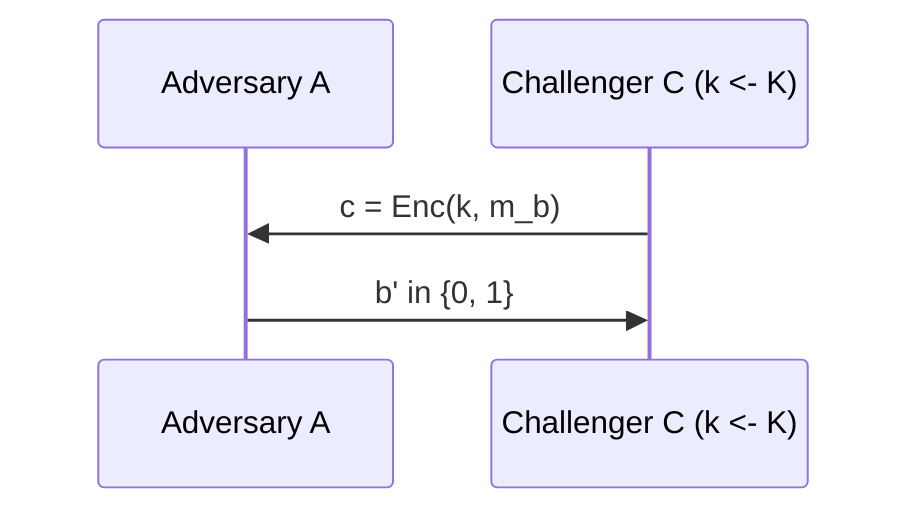
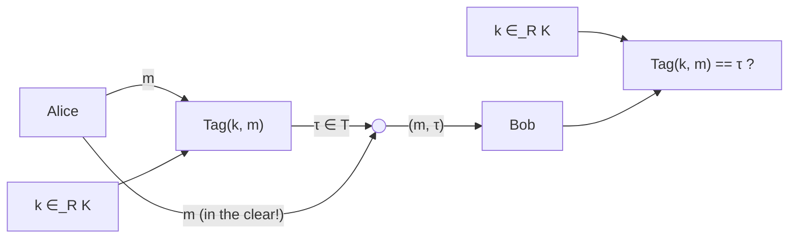
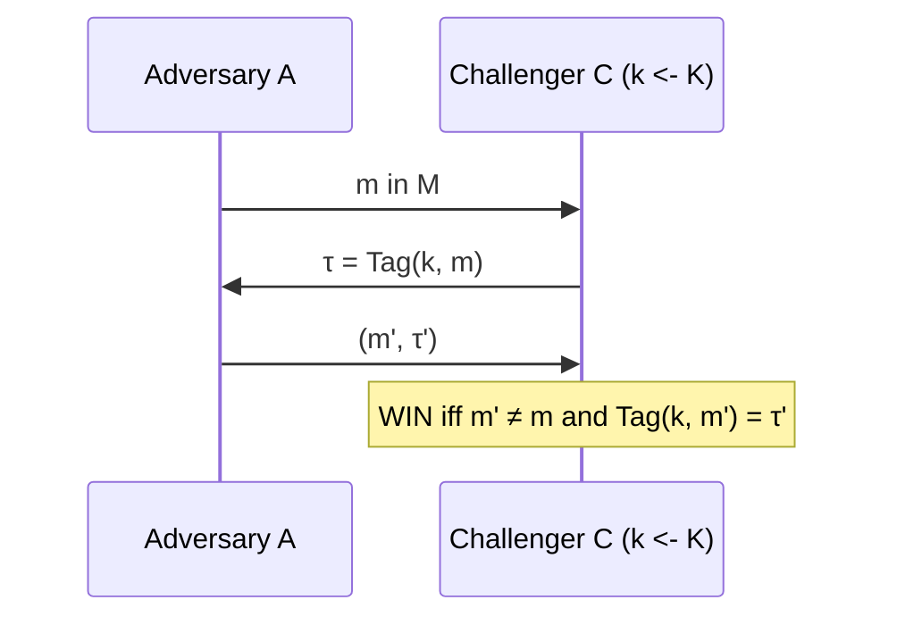

# lez. 1
* unconditional security
* **prop1. confidentiality** and **prop2. integrity**
* diagram for Enc and Dec flow between $\mathcal A, \mathcal B, E$
* $\text{Enc}$ is deterministic, while $M,K$ are often assumed to be uniform distributions.
* no security by obscurity
* secure encryption: $c =\text{Enc}(k,m)$ does not leak $k$ or $m$
* **def. perfect secrecy**: 
	* assumptions: for every $M$, $m\in \mathcal M$, $c \in \mathcal C$ with $\Pr[C=c]>0$
	* $\Pr[M=m]=\Pr[M=m|C=c]$
* **thm. the following are equivalent**:
	* perfect secrecy
	* $I(M; C)=0$, so $\forall m \in \mathcal{M}, \forall c \in \mathcal{C}: \Pr[M=m \land C=c] = \Pr[M=m]\cdot\Pr[C=c]$
	* $\forall m,m' \in \mathcal{M}, \forall c \in \mathcal{C}$ then $\Pr[\text{Enc}(K,m)=c] = \Pr[\text{Enc}(K,m')=c]$
* **cor.** **OTP is perfectly sec**, because $\Pr[\text{Enc}(K,m)=c]=2^{-l}$
* **limitations**: $|k|=|m|$ and $k$ used only once.
* **proof thm. the following are equiv**:
	* $1\to 2$ **goal**: $\Pr[M=m \land C=c] = \Pr[M=m]\Pr[C=c]$ using $\textcolor{blue}{\text{Pr}[M=m]}= \textcolor{red}{\frac{\Pr[M=m \land C=c]}{\Pr[C=c]}}$
	* $2 \to 3$ **goal**: $\textcolor{red}{\Pr[\text{Enc}(K,m)=c]}= \textcolor{orange}{\Pr[C=c]} = \textcolor{blue}{\Pr[\text{Enc}(K,m')=c]}$
	* $3\to 1$ **goal**:
		* **show**: $\Pr[C=c|M=m] = \Pr[C=c]$ using $= \sum_{m'} \Pr[\text{Enc}(K,m)=c] \cdot \Pr[M=m']$
		* **then**: decompose $\Pr[M=m | C=c]$ using bayes and obtain $\frac{\Pr[M=m\land C=c]}{\Pr[C=c|M=m]}=\Pr[M=m]$ 

# lez. 2

* **thm**: any SKE with perfect secrecy has $|\mathcal K| \geq |\mathcal M|$
	* **use**:  $\{ \text{Dec}(k,m):k\in \mathcal K \}$
* $\text{Game}(b,m_{0},m_{1})$

* **perfectly secure**: $\forall \mathcal A$ unbounded, $\text{Game}_{\mathcal A} (0) \equiv \text{Game}_{\mathcal A} (1)$
	* $|\Pr[b'=1: \text{Game}_{\mathcal{A}}(1)] - \Pr[b'=1 : \text{Game}_{\mathcal{A}}(0)]| = 0$
* **meaning**: $\mathcal A$ cannot distinguisi $b=1$ and $b=0$

* **forgery**: given $(m,\tau)$ valid can i forge $(m',\tau')$? i don't know $k$.
* TAG $\mathcal E$ stat. secure, from forgery def.: $\Pr[\tau' = \text{Tag}(K,m') \mid \tau = \text{Tag}(K,m)] \leq \varepsilon$
* $\mathcal E=0$ is impossible
* $\text{OTP}$ for MAC is insecure

**pairwise independent**: if $(h(K,m), h(K,m'))$ uniform over $\mathcal T^2$
* $\mathcal{H} = \{ h_{k}: \mathcal{M} \to \mathcal{T} \}_{k\in \mathcal{K}}$
