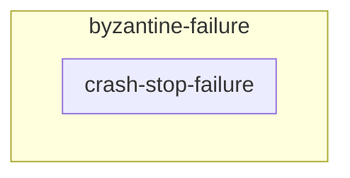
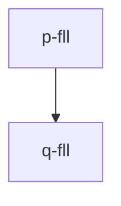
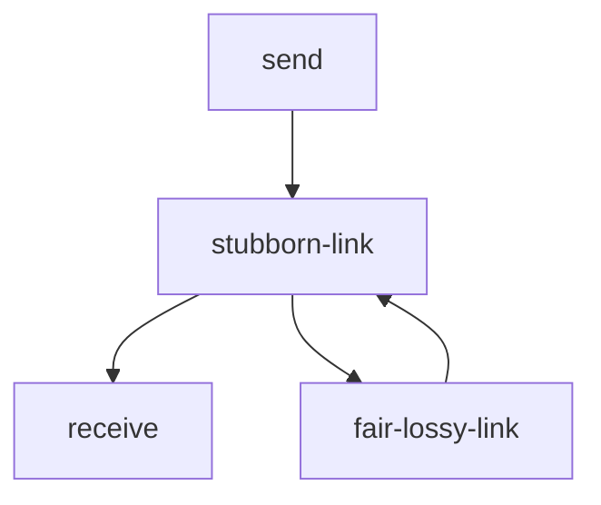

**synch vs asynch**:
* **syncrhony**: if there is a fixed bound on the delay of messages, on the time of actions exectued by processes, and a bound between the execution of actions.
	* **execution time**: each action takes at most $t \text{ms}$
* **asynch**: process do not have access to a **clock**, no bound on time that actions can take, and so on... is an unbounded system in time.
	* we can track time in a discrete way using a **logical clock**
* **eventually-synchronous**: i can predict the delay "most" of the time.

> so an adversary can choose the delay between messages
## model of failures
* crasch-stop failure
* byzantine failure

> **failure**: when a process fails, then all its modules fail too

**crash-stop failure**: segmentation fault for example. 
> *The process does not execute any local computation, and it does not send any message to other processes.*
![[Pasted image 20261103120148.png]]
* $\text{Crash}(p_{j})$: after this event, $p_{j}$ does not exists anymore.
* $\star$: denotes a crash. a message towards $\star$ is lost.

> an algorithm that is crash-stop resilient should not rely on some specific processes to do its work since they may crash and stop the algorithm.

**assume**: if $p_{j}$ arrow stops earlier than others, then it crashed.

**note**: after $\text{Crash}$ $p_{j}$ cannot be restored

**byzantine failure**: or an arbitrary fail.
* **arbitrary fail**: the process deviates from the algorith assigned
* $\text{Byz}(p_{j})$: after this event $p_{j}$ does not follow the algorithm anymore.
	* $p_{j}$ could also execute the original algorithm
	* $p_{j}$ might be corrupted by an adversary
	* $p_{j}$ acts like someone evil.
* you should think about byzantine failure in an alogirthm if you system is vulnerable to attacks.

**inclusion**: let $\text{byz}$ be an algorith resistant to $\text{Byzantine}$ failure
* $\text{byz}$ is also resistant to crash-stop failure
	* crash-stop failure is a Byzantine failure where the affected $p_{i}$ just does nothing.
* crash-stop 

**example**: $\text{byz}$ algoritmo che e' resistante ad un processo $\text{Byz}$
* the algorithm also works with a **crash-stop failure**
* crash-stop failure is a byzantine that stops answering

* it's easier to manage crash-stop than byzantine
* $\text{Crash} \subseteq \text{Byzantine}$

**process correct**: a process is defined to be correct if it never crashes and it executes and infinite number of steps.

**problem**: there is no oracle at the start for correct process

$f$: max number of processes that can experience a faiulre.
* usually bound to $n-1$ or something else
* why $n-1$? if everyone dies there's no concurrent system anymore.

> So an algorithm with a certain $f$ should execute on software/hardware that very unlikely will crash more than $f$ processes.

# abstraction, pseudocode, algorithm
## abstraction and properties
1. define a system model
2. formalize a problem, with an abstraction
3. implement abstraction: write the distributed protocol
4. prove that protocol implements abstraction

**abstracting communication link**:
* **informal description**: connects $p$ with $q$ using a link with probability $\text{pr}$ of loosing messages (maybe because of noise), it can duplicate messages a finite number of times and it does not create messages from the air.
	* **example**: tcp does duplication
	* **from the air**: if receiver, received something, then it was sent by someone
	* so the amount of errors is not larger than the amount of sent messages
* **expected**: to send message from one side, and arrive it to the other side.
* 2 **events**: exposing interface for p and q.
	* **requests/input**: $<\text{Send}|q,m>$: send $m$ to $q$
	* **indication/output**: $<\text{Deliver, p, m}>$: deliver $m$ from process $p$

**properties**: let's formalize the informal description. a property specifies something about an object.
* FL1 (Fair-Loss): *If a correct process $p$ **infinitely often** sends a message $m$ to a correct process $q$, then $q$ delivers $m$ an **infinite number** of times.*
	* comes from: *connects $p$ with $q$ using a link with probability $\text{pr}$ loses messages*
	* **remove pr**: we have to remove $\text{pr}$ from the definition, it cannot be arbitrary
		* the term **infinity** replaces $\text{pr}$, for any probability: it makes proof easier. it's an object that abstract $\text{pr}$.
	* **goal**: guarantees that the link does not systematically drop every message
* $\text{FL2 (Finite Duplication)}$:  *If a correct process $p$ sends a message $m$ a **finite** number of times to process $q$, then $m$ **cannot be delivered an infinite** number of times by $q$.*
	* comes from: *it can duplicate messages a finite number of times*
	* **goal**: guarantees that the link does not retransmit a message an infinite amout of times
* $\text{FL3 (No creation)}$: *if some process $q$ delivers a message $m$ with sender $p$, then $m$ was **previously** sent by $p$ to $q$.*
	* **goal:** guarantees that the network does not create or corrupt messages.

**fair-lossy link**:

**properties classes**:
* **safety property**: is a property that can be violated at some time $t$ and never be satisfied again after that time.
	* **goal**: a safety prop. states wrong things that an alogrithm should never do.
	* **in practice**: if we can determine a time $t$ were 
	* **in terms of execution**: if violated in execution $E$, then there is a partial execution $E'$ s.t. the property is violated in any extension of $E'$
		* $E=(e_{1},e_{2},e_{3})$
		* $E'=(e_{1},e_{2},e_{3}',e_{4}', \dots)$
* **liveness property**: is a property that ensures that something good will happen. For any time $t$ there is hope that the property is satisfied at a time $t'\geq t$
	* **goal**: states that something will eventually happend

> $\text{liveness } \equiv \text{"while there is life there is hope."}$

> $\text{FL3}$ is a **sefety property**, we can find an instant were it is violated.

> $\text{FL1}$ is **liveness property**. It's talking about infinite so we cannot find an instant $t$ where $\text{FL1}$ is broken. It tells us that eventually messages will be received.

> $\text{FL2}$ is a **liveness property**. It talks about infinite, and we cannot violated it in a finite execution.

**example**: let $\text{FL2: (At-most7 dup)}$ a property stating that for each message $m$, process $q$ delivers $m$ at most seven times.
* it's a **safety property** because we can show an exectuion where we deliver a message 8 times and any extension of $E'$ violates the property.

**other prop**:
* **mutual exclusion**: if a process $p$ is granted a resource $r$ at time $t$, then no other process $q$ is granted $r$ at $t$.
	* it's a **safety property**.
* **no-deadlock**: if $r$ is not already granted, eventually get a grant on resource $r$
	* it's a liveness
* **no-starvation**: if $p$ request a grant on $r$, it will eventually get it.
	* it's liveness

**badly written prop**: if $p$ send $m$ to $q$, then $q$ will eventually deilver it and this deilver is unique. it's mixing
* **liveness**: $q$ will eventually deliver 
* **safety**: the deliver is unique 

**example**: if $p$ send $m$ to $q$, then $q$ will receive $m$ in 2 hours
* it's safety
# algorithm diocane
**fairy-loss link**: how to remove the word **infinitely** from the properties?

**stubborn link**: hides the lower-layer **fair-loss link** that might use rentransmission mechanism to eventually deliver messages.

**SL1** $\text{}$: if correct processes $p$ and $q$ are connected and $p$ sends $m$ to $q$, then $q$ delivers $m$ infinitely often.
* from FL1 e FL2

**reactive computing model**: manages events! peffo!
* write a set of event handler, a thread waiting for something maybe
* the handler can create new events
* **assumption**: handlers are atomic, otherwise it would be painful.
	* **crash**: can interrupt handlers.

**stubborn-link**:pseudocode
* send message an infinitely amount of time and receive ain infinitely amount
	* in fact loop over $\text{sent}$.
* we don't know 

$\text{FL3}$ is true, **proof**: assume false
* `deliver sl` violets $\text{FL3}$ only if `deliver dl` violats it

SL1 is true, **proof**: assume false
* `deliver sl` is triggered a finite amount of time only if `deliver fill` is triggered a finite amount
* we know/assume $p$ is **correct**, so `Timeout` is triggered a infinite amount of time

**SL1 is ugly**: it delivers too many messages. 

**PL (Perfect Link)**, guarantees that:
* PL1: if $p$ correct send $m$ to $q$, then $q$ eventually deilvers $m$
* PL2: a message is delivered at most once
* $\text{FL3}$: if some porcess $q$ delivers a messsage $m$ with sender $p$asdfadsf

