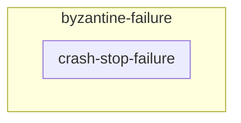
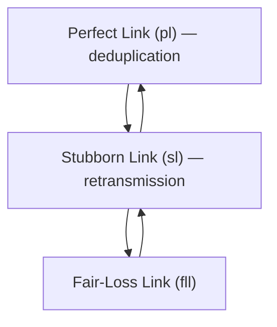

**synch vs asynch**:
* **synchrony**: if there is a fixed bound on the delay of messages, on the time of actions executed by processes, and a bound between the execution of actions.
	* **execution time**: each action takes at most $t \text{ms}$
* **asynch**: process do not have access to a **clock**, no bound on time that actions can take, and so on... is an unbounded system in time.
	* we can track time in a discrete way using a **logical clock**
* **eventually-synchronous**: i can predict the delay "most" of the time.

> so an adversary can choose the delay between messages
## model of failures
* crash-stop failure
* byzantine failure

> **failure**: when a process fails, then all its modules fail too

**crash-stop failure**: segmentation fault for example. 
> *The process does not execute any local computation, and it does not send any message to other processes.*
![[Pasted image 20261103120148.png]]
* $\text{Crash}(p_{j})$: after this event, $p_{j}$ does not exist anymore.
* $\star$: denotes a crash. a message towards $\star$ is lost.

> an algorithm that is crash-stop resilient should not rely on some specific processes to do its work since they may crash and stop the algorithm.

**assume**: if $p_{j}$ arrow stops earlier than others, then it crashed.

**note**: after $\text{Crash}$ $p_{j}$ cannot be restored

**byzantine failure**: or an arbitrary fail.
* **arbitrary fail**: the process deviates from the algorithm assigned
* $\text{Byz}(p_{j})$: after this event $p_{j}$ does not follow the algorithm anymore.
	* $p_{j}$ could also execute the original algorithm
	* $p_{j}$ might be corrupted by an adversary
	* $p_{j}$ acts like someone evil.
* you should think about byzantine failure in an algorithm if your system is vulnerable to attacks.

**inclusion**: let $\text{byz}$ be an algorithm resistant to $\text{Byzantine}$ failure
* $\text{byz}$ is also resistant to crash-stop failure
	* crash-stop failure is a Byzantine failure where the affected $p_{i}$ just does nothing.

**example**: $\text{byz}$ algoritmo che e' resistente ad un processo $\text{Byz}$
* the algorithm also works with a **crash-stop failure**
* crash-stop failure is a byzantine that stops answering

* it's easier to manage crash-stop than byzantine
* $\text{Crash} \subseteq \text{Byzantine}$

**process correct**: a process is defined to be correct if it never crashes and it executes an infinite number of steps.

**problem**: there is no oracle at the start for correct process

$f$: max number of processes that can experience a failure.
* usually bound to $n-1$ or something else
* why $n-1$? if everyone dies there's no concurrent system anymore.

> So an algorithm with a certain $f$ should execute on software/hardware that very unlikely will crash more than $f$ processes.

# abstraction, pseudocode, algorithm
## abstraction and properties
1. define a system model
2. formalize a problem, with an abstraction
3. implement abstraction: write the distributed protocol
4. prove that protocol implements abstraction

**abstracting communication link**:
* **informal description**: connects $p$ with $q$ using a link with probability $\text{pr}$ of losing messages (maybe because of noise), it can duplicate messages a finite number of times and it does not create messages from the air.
	* **example**: tcp does duplication
	* **from the air**: if receiver, received something, then it was sent by someone
	* so the amount of errors is not larger than the amount of sent messages
* **expected**: to send message from one side, and arrive it to the other side.
* 2 **events**: exposing interface for p and q.
	* **requests/input**: $<\text{Send}|q,m>$: send $m$ to $q$
	* **indication/output**: $<\text{Deliver}|p,m>$: deliver $m$ from process $p$

**properties**: let's formalize the informal description. a property specifies something about an object.
* FL1 (Fair-Loss): *If a correct process $p$ **infinitely often** sends a message $m$ to a correct process $q$, then $q$ delivers $m$ an **infinite number** of times.*
	* comes from: *connects $p$ with $q$ using a link with probability $\text{pr}$ loses messages*
	* **remove pr**: we have to remove $\text{pr}$ from the definition, it cannot be arbitrary
		* the term **infinity** replaces $\text{pr}$, for any probability: it makes proof easier. it's an object that abstract $\text{pr}$.
	* **goal**: guarantees that the link does not systematically drop every message
* $\text{FL2 (Finite Duplication)}$:  *If a correct process $p$ sends a message $m$ a **finite** number of times to process $q$, then $m$ **cannot be delivered an infinite** number of times by $q$.*
	* comes from: *it can duplicate messages a finite number of times*
	* **goal**: guarantees that the link does not retransmit a message an infinite amount of times
* $\text{FL3 (No creation)}$: *if some process $q$ delivers a message $m$ with sender $p$, then $m$ was **previously** sent by $p$ to $q$.*
	* **goal:** guarantees that the network does not create or corrupt messages.

**fair-lossy link**:
![[Pasted image 20261103194026.png]]

| Property | Class | Formal Definition | Intuition / Role |
| :--- | :--- | :--- | :--- |
| **FL1 (Fair-Loss)** | Liveness | $p, q$ correct, $p$ sends $m$ $\infty$-often $\implies q$ delivers $m$ $\infty$-often | Abstracts loss probability $pr$; avoids systematically dropping all messages |
| **FL2 (Finite Duplication)** | Liveness | $p$ correct sends $m$ finite times $\implies q$ delivers $m$ finite times | Network cannot retransmit indefinitely on its own |
| **FL3 (No Creation)** | Safety | $q$ delivers $m$ from $p \implies p$ previously sent $m$ to $q$ | No spontaneous or corrupted messages |

**properties classes**:
* **safety property**: is a property that can be violated at some time $t$ and never be satisfied again after that time.
	* **goal**: a safety prop. states wrong things that an algorithm should never do.
	* **in practice**: if we can determine a time $t$ where the property is violated, it is a safety property. #gemini
	* **in terms of execution**: if violated in execution $E$, then there is a partial execution $E'$ s.t. the property is violated in any extension of $E'$
		* $E=(e_{1},e_{2},e_{3})$
		* $E'=(e_{1},e_{2},e_{3}',e_{4}', \dots)$
* **liveness property**: is a property that ensures that something good will happen. For any time $t$ there is hope that the property is satisfied at a time $t'\geq t$
	* **goal**: states that something will eventually happen

> $\text{liveness } \equiv \text{"while there is life there is hope."}$

> $\text{FL3}$ is a **safety property**, we can find an instant where it is violated.

> $\text{FL1}$ is **liveness property**. It's talking about infinite so we cannot find an instant $t$ where $\text{FL1}$ is broken. It tells us that eventually messages will be received.

> $\text{FL2}$ is a **liveness property**. It talks about infinite, and we cannot violate it in a finite execution.

**example**: let $\text{FL2: (At-most7 dup)}$ a property stating that for each message $m$, process $q$ delivers $m$ at most seven times.
* it's a **safety property** because we can show an execution where we deliver a message 8 times and any extension of $E'$ violates the property.

**other prop**:
* **mutual exclusion**: if a process $p$ is granted a resource $r$ at time $t$, then no other process $q$ is granted $r$ at $t$.
	* it's a **safety property**.
* **no-deadlock**: if $r$ is not already granted, eventually get a grant on resource $r$
	* it's a liveness
* **no-starvation**: if $p$ request a grant on $r$, it will eventually get it.
	* it's liveness

**badly written prop**: if $p$ send $m$ to $q$, then $q$ will eventually deliver it and this deliver is unique. it's mixing
* **liveness**: $q$ will eventually deliver 
* **safety**: the deliver is unique 

**example**: if $p$ send $m$ to $q$, then $q$ will receive $m$ in 2 hours
* it's safety

### summary: safety vs liveness #gemini

| Dimension | Safety Property | Liveness Property |
| :--- | :--- | :--- |
| **Intuition** | "Nothing bad happens" | "Something good eventually happens" |
| **Violation** | In a **finite** prefix $E'$ (irremediable in any extension) | **Never** in a finite prefix (always remediable at $t' \ge t$) |
| **Verification** | Exists an instant $t$ of failure | Requires infinite executions to assess |
| **Link examples** | $\text{FL3}$ (No creation), $\text{PL2}$ (No duplication) | $\text{FL1}$ (Fair-loss), $\text{FL2}$ (Finite dup), $\text{PL1}$ (Reliable delivery) |
| **System examples** | Mutual exclusion, bounded delivery ($t \le 2\text{h}$) | No-deadlock, No-starvation, eventual recovery |

# stubborn link
**fair-loss link**: how to remove the word **infinitely** from the properties?

**stubborn link**: hides the lower-layer **fair-loss link** that might use retransmission mechanism to eventually deliver messages.

**From FL1 & FL2 to SL1** $\text{Stubborn-delivery}$: if correct processes $p$ and $q$ are connected and $p$ sends $m$ to $q$, then $q$ delivers $m$ infinitely often.
* **goal**: every message sent over the stubborn link is delivered an unbounded number of times.

**SL2 is FL3** $\text{No creation}$: if some process $q$ delivers a message $m$ with sender $p$, then $m$ was previously sent to $q$ by process $p$.

**reactive computing model**: manages events! 
* write a set of event handler, a thread waiting for something maybe
* the handler can create new events
* **assumption**: handlers are atomic, otherwise it would be too complicate
	* **crash**: can interrupt handlers.

## algorithm (2.1 in the book)
**Implements:** `StubbornPointToPointLinks`, instance `sl`.
**Uses:** `FairLossPointToPointLinks`, instance `fll`.

**upon event $<\text{sl}, \text{Init}>$ do:**
1. $\text{sent} := \emptyset$
2. $\text{starttimer}(\Delta)$
	1. **note**: start the retransmit timer

**upon event $<\text{Timeout}>$ do:**
1. **forall $(q,m) \in \text{sent}$ do**:
	1. **trigger** $<\text{fll}, \text{Send} | q,m>$
	2. **note**: for every message sent since the start of the algorithm we send it again
2. $\text{starttimer}(\Delta)$
	1. **note**: restart the retransmit timer

**upon event $<\text{sl}, \text{Send}|q,m>$ do:**
1. **note**: when event Send was triggered on $\text{sl}$
2. **trigger** $<\text{fll, Send}|q,m>$
3. $\text{sent} := \text{ sent } \cup \{ (q,m) \}$
	1. **note**: remember what message you sent for retransmission.

**upon event $<\text{fll, Deliver} | p,m>$ do**:
1. **trigger** $<\text{sl, Deliver}|p,m>$
2. **note**: pass the message to the stubborn link

**description**: the stubborn link sends a message for an infinitely amount of time by iterating at each timeout over the $\text{sent}$ set.

$\text{FL3}$ **dim**: if some process $q$ delivers a message $m$ with sender $p$, then $m$ was sent by $p$ to $q$
* **by contradiction**.
* assume $q$ delivered a message $m$ with sender $p$
* but $p$ did not send $m$ to $q$
* if $q$ delivers a message, is because its triggered by the **event** $<\text{fll, Deliver}|p,m>$
* $q$ delivers a message if **$\text{fll}$ is not fair-lossy.**
* but **fll is by definition fair-lossy** and does not create from the air.

$\text{SL1 (Stubborn Delivery)}$ **dim**: If correct processes p sends m to q, then $q$ delivers $m$ infinitely often.
* **by contradiction**: $q$ delivers $m$ for a finite amount of time
* **fact 1**: $p$ sends $m$ infinitely often because of **event $<\text{Timeout}>$**
	* Timeout is triggered infinitely times for $(q,m)$ when we first trigger event $<\text{sl}, \text{Send}>$
* **fact 2**: $<\text{fll, Deliver}|p,m>$ triggers $<\text{sl,Deliver}|p,m>$.
	* so $\text{sl,Deliver}$ is triggered a finite amount of time iff $\text{fll,Deliver}$ is triggered a finite amount of time.
* we know/assume $p$ is **correct**, so **event** $<\text{Timeout}>$ is triggered a infinite amount of time
* by $\text{FL1}$, since $p, q$ are correct and $p$ sends $m$ infinitely often on $\text{fll}$, $q$ triggers $<\text{fll, Deliver}|p,m>$ infinitely often (contradiction). #gemini

**SL1 is ugly**: it delivers too many messages. 

## perfect link
**PL (Perfect Link)**, guarantees that:
* PL1 **Reliable Delivery**: if $p$ correct sends $m$ to $q$, then $q$ eventually delivers $m$
* PL2 **No Duplication**: a message is delivered at most once
* $\text{PL3 (FL3)}$ **No Creation**: if some process $q$ delivers a message $m$ with sender $p$, then $m$ was previously sent to $q$ by process $p$. #gemini

![[Pasted image 20261103232617.png]]

**upon event $<\text{pl, Init}>$ do:**
1. $\text{delivered} := \emptyset$

**upon event $<\text{pl, Send}|q,m>$ do**:
1. trigger $<\text{sl, Send}|q,m>$

**upon event $<\text{sl, Deliver}|p,m>$ do**:
1. **if $m \notin \text{delivered}$ then**
	1. $\text{delivered} := \text{delivered} \cup \{ m \}$
	2. **trigger** $<\text{pl, Deliver} |p,m>$
2. **note**: perfect link delivers a message only if it has not been retransmitted.

$FL3$ **dim**: same as before.
* by contraddiction.
* If $q$ delivers a message, then it delivers it thanks to **event** $<\text{sl, Deliver}|p,m>$
* but $\text{sl}$ is a stubborn link so it does not create messages from the air. $\square$
 
$\text{PL}2$ **dim**: A message is delivered at most once.
* inside event $<\text{sl}, \text{Deliver}|p,m>$ there is a "guard" check
* by contraddiction.
* suppose $m$ delivered twice
* but the event handler is atomic
* and so we executed one time $\text{deliver := deliver} \cup \{ m \}$
* so we cannot enter a second time in the guard check.
* contraddiction $\square$

$\text{PL1}$ **dim**: if a correct process $p$ sends $m$ to $q$, then $q$ eventually delivers $m$
* by contraddiction
* $p$ sends $m$ and $q$ does not deliver it.
	* **case 1**: $m$ delivered when the handler is executed
		* if $m$ is delivered then $q$ eventually will execute 
		* **trigger** $<\text{pl, Deliver|p,m}>$
		* contraddiction $\square$
	* **case 2**: the delivery handler is never trigger
		* so $\text{sl}$ is not stubborn
		* contraddiction $\square$

### summary: link abstractions hierarchy #gemini

| Layer | Underlying Link | Delivery Guarantee | Duplication | Creation | Main Limitation / Trade-off |
| :--- | :--- | :--- | :--- | :--- | :--- |
| **FLL** *(Fair-Loss)* | Physical lossy network | If sent $\infty$-often $\implies$ delivered $\infty$-often (Liveness) | Finite (if sent finite times) | No creation ($\text{FL3}$) | Drops messages if not resent infinitely |
| **SL** *(Stubborn)* | $\text{FLL}$ + periodic timer $\Delta$ | If sent once $\implies$ delivered $\infty$-often (Liveness) | **Unbounded** ($\infty$ duplicates) | No creation ($\text{SL2}$) | Infinite memory ($\text{sent}$ set grows forever) |
| **PL** *(Perfect)* | $\text{SL}$ + `delivered` history | If sent once $\implies$ delivered once (Liveness) | **None** ($\le 1$, Safety) | No creation ($\text{PL3}$) | Unbounded `delivered` log without garbage collection |

