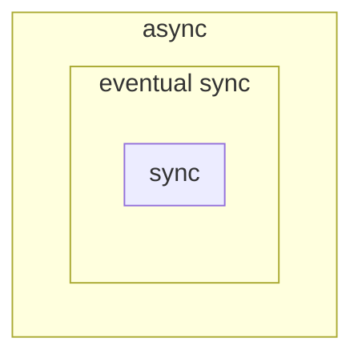

**D1**: what two problems of Perfect Point-to-Point Links (PP2P) are shown by the Counting Server example, and how does FIFO Link solve both? (out-of-order, deduplication, sequence number) #gemini
* **R1**: (1) messages can arrive out of order (`INC`, `GET`, `INC` returns `1`), and (2) identical messages (`INC`, `INC` or `GET`, `GET`) are dropped by PP2P's `if m not in delivered` check; attaching a unique sequence number $[seq, m]$ makes every message distinct and allows reordering at the receiver. #gemini
**D2**: state the properties of a FIFO Point-to-Point Link. (PL1, PL2, FL3, FIFO) #gemini
* **R2**: inherits PL1 (Reliable Delivery), PL2 (No Duplication), FL3 (No Creation) from PP2P, plus **FIFO delivery**: if a process $p$ delivers $m$ before $m'$, then $m$ was sent before $m'$. #gemini
**D3**: what happens in the FIFO Link algorithm if we remove `pending := pending \ {(s, k, m)}` or change $k = \text{next}[s]$ to $k \ge \text{next}[s]$? (memory leak, violation) #gemini
* **R3**: removing the set deletion keeps the algorithm correct (since $\text{next}[s]$ increments) but causes a memory leak; changing $k = \text{next}[s]$ to $k \ge \text{next}[s]$ violates **FIFO** and **PL1 (Reliable Delivery)** because an early message with $k_2 > \text{next}[s]$ is delivered immediately and advances $\text{next}[s]$, causing delayed messages with $k_1 < k_2$ to remain stuck in `pending` forever. #gemini
**D4**: what is the difference between Asynchronous, Synchronous, and Eventually-Synchronous (Partially Synchronous) models? (delay bound $\Delta$, stabilization time $T$) #gemini
* **R4**: Asynchronous has no bound on message delays or step times; Synchronous has a known bound $\Delta$ on message delays and bounded step times; Eventually-Synchronous behaves asynchronously until an unknown stabilization time $T$, after which it is synchronous forever. #gemini
**D5**: in an Eventually-Synchronous system, what happens to Safety and Liveness properties during asynchronous phases? (prefix, stabilization) #gemini
* **R5**: **Safety** (e.g., Mutual Exclusion) must **never** be violated even during asynchronous phases (a finite-prefix violation is irremediable); **Liveness** (e.g., No-Starvation) may stall during async phases and is guaranteed once the system stabilizes after $T$. #gemini
**D6**: how do the sets of Executions and Solvable Problems relate across Sync, E-Sync, and Async? (inclusion reversal) #gemini
* **R6**: Executions: $\text{Sync} \subset \text{E-Sync} \subset \text{Async}$; Solvable problems: $\text{Async} \subset \text{E-Sync} \subset \text{Sync}$ (stronger assumptions restrict possible executions, making more problems solvable). #gemini
**D7**: define hardware clock $H_i(t)$, software clock $C_i(t)$, skew, and drift rate. (oscillator, $\alpha, \beta$, difference, derivative) #gemini
* **R7**: $H_i(t) = \int_0^t h_i(\tau)d\tau$ counts oscillator ticks; $C_i(t) = \alpha H_i(t) + \beta$ scales and shifts $H_i(t)$; $\text{Skew}_{i,j}(t) = |C_i(t) - C_j(t)|$ is the instantaneous difference between two clocks; drift rate $\frac{dH(t)}{dt}$ measures how fast a clock runs relative to real time ($=1$ perfect, $>1$ fast, $<1$ slow). #gemini
**D8**: when is a hardware clock $\rho$-correct, and how often must two clocks resynchronize to keep skew $\le \Delta$? (drift bound, $\Delta / 2\rho$) #gemini
* **R8**: correct if $1-\rho \le \frac{dH(t)}{dt} \le 1+\rho$; since two clocks can diverge at most at rate $2\rho$, they reach skew $\Delta$ in $t = \frac{\Delta}{2\rho}$, which is the maximum resynchronization interval. #gemini
**D9**: what is clock monotonicity and how do we correct a fast clock without violating it? (causality, hiding interrupts) #gemini
* **R9**: monotonicity requires $t' > t \implies C(t') > C(t)$; we cannot set a fast clock backwards in the past (violates causality), so we slow its rate $\alpha$ by hiding/skipping hardware timer interrupts. #gemini
**D10**: what is the difference between External and Internal clock synchronization, and how are their bounds related? (UTC source $S$, accuracy vs agreement, $D \implies 2D$) #gemini
* **R10**: External sync keeps $|S(t) - C_i(t)| < D$ w.r.t. an external UTC source $S$ (*accuracy*); Internal sync keeps $|C_i(t) - C_j(t)| < D$ between all pairs of processes (*agreement*). External sync within $D$ implies Internal sync within $2D$, but not vice versa. #gemini

# fifo link
**FIFO-Link properties** (inherits PL1–PL3 from PP2P + FIFO): #gemini
* **PL1 (Reliable delivery)**: if a correct process $p$ sends $m$ to a correct $q$, then $q$ eventually delivers $m$. #gemini
* **PL2 (No duplication)**: a message is delivered at most once. #gemini
* **FL3 (No creation)**: if some process $q$ delivers $m$ with sender $p$, then $m$ was sent by $p$ to $q$. #gemini
* **FIFO (First-In First-Out)**: if a process $p$ delivers $m$ before $m'$, then $m$ was sent before $m'$. #gemini

**problem for PP2P (Counting Server example)**: #gemini
1. **Out-of-order**: PP2P does not preserve the order in which messages are sent. If $m_{2}$ arrives before $m_{1}$ we should wait for $m_{1}$ before delivering $m_{2}$ (e.g., client sends `INC, INC, GET` and receives `1` because `GET` overtakes the second `INC`). #gemini
2. **Duplicate payload suppression**: in PP2P (`EliminateDuplicates`), `if m not in delivered` drops identical payloads sent multiple times (e.g., second `INC` or second `GET` is ignored forever). Attaching a sequence number $[seq, m]$ makes each message unique and fixes both issues. #gemini

**FIFO property**: if a process $p$ delivers $m$ before $m'$, then $m$ was sent before $m'$.
* this property must apply to any pair $m,m'$
* **so it implies that the order of messages received is in order.**

**we want to build FIFO-link over PP2P-link:**
* **idea for the sender**: use a counter $t$ to attach to the messages. so we send $<m,t=0>$ for the first messages
	* then we send $<m',t=1>$
	* so on...
* **idea for the receiver**: enqueue out of order messages inside set $e$ of messages with $m$ and $t$.
	* receiver also needs a counter that tells the expected counter of the next incoming message
	* when i increase the counter i have to check if there are messages to deliver

**codice**:
1. **upon event** $<\text{fpl, Init}>$:
	1. $\text{pending} \gets \emptyset$
	2. forall $q\in \Pi$:
		1. $\text{seq}[q] \gets 0$
		2. $\text{next}[q] \gets 1$
2. **upon event** $<\text{fpl, Send}|q,m>$:
	1. $\text{seq}[q] \gets \text{seq}[q]+1$
	2. $\text{trigger} <\text{pl, Send}|q,[\text{seq}[q],m]>$

3. **upon event** $<\text{pl, Deliver}|s,[k,m]>$ do:
	1. $\text{pending} \gets \text{pending} \cup \{ (s,k,m) \}$
	
4. **upon** $\exists(s,k,m) \in \text{pending}$ such that $k = \text{next}[s]$
	1. $\text{pending} \gets \text{pending} \setminus \{ (s,k,m) \}$
	2. $\text{next}[s] \gets \text{next}[s]+1$
	3. $\text{trigger} <\text{fpl}, \text{Deliver}|s,m>$
	   
**note**: we never send $\text{seq}[q]=0$, because we increment and then send (in the slides' variant, $\text{seq}$ and $\text{del\_seq}$ both start at $0$ and increment after send/deliver). #gemini
**note**: $s$ is the source of Deliver
**note**: 4th event means if i receive a message from $s$ in which its sequence number is the same as the value i expected.

**show FIFO property**:
* **by contradiction**: suppose $p$ delivers $m'$ and then $m$, even though $m$ was sent before $m'$ ($t_{1} = \text{seq}(m) < t_{2} = \text{seq}(m')$). #gemini
* let $t$ be the instant at which $p$ delivers $m'$: this requires $\text{next}[s] = t_{2}$. #gemini
* since $\text{next}[s]$ starts at $1$ and increments by $1$ only upon each delivery, to reach $t_{2} > t_{1}$ it must have previously taken value $t_{1}$, meaning $m$ was already delivered before $t$ (contradiction) $\square$. #gemini

what if we remove $4.1$?
* algorithm is **still correct** (since $\text{next}[s]$ increments, old tuples never match $k = \text{next}[s]$ again) but keeps populating **memory**. #gemini

**exercise|EXAM**: what if $k= \text{next}[s]$ becomes $k \geq \text{next}[s]$?
* show why it violates and if it holds for every properties.
* **solution**: suppose $s$ sends $m_1$ ($k=1$) then $m_2$ ($k=2$), and $m_2$ arrives first while $\text{next}[s]=1$. Since $2 \ge 1$, $m_2$ is delivered immediately and $\text{next}[s]$ becomes $2$. When $m_1$ ($k=1$) later arrives, $1 < \text{next}[s]=2$, so $m_1$ is **never delivered** (violates **PL1 Reliable Delivery**). If a third message $m_3$ ($k=2$ or if $m_1$ were somehow delivered) occurred, order is lost (violates **FIFO**). **PL2 (No Duplication)** and **FL3 (No Creation)** still hold. #gemini

# time
**asynchronous**: there is no bound on message delay or on activation of processes (steps can be arbitrarily slow or extremely fast).
* **no global clock**
* **models everything**: any algorithm correct in the asynchronous model works everywhere
* impossible to solve agreement (e.g., FLP) and many other problems when faults occur

**logical clock** (Lamport):
* each process $p$ keeps a **logical clock** $l_{p}$
* whenever an event happens at process $p$, $l_{p}$ is incremented by $1$ discrete unit
* $p$ sending a message attaches a timestamp denoted $t(e)$
* when $p$ receives a message $m$, it updates the logical clock: $l_{p} = \max \{ l_{p}, t_{m} \}+1$.

**happened-before relation** ($\to$): 
* using logical clocks we can capture causal relations: $e_{1} \to e_{2}$ iff: #gemini
	* $e_{1}$ and $e_{2}$ occurred at the same process $p$ and $e_{1}$ occurred before $e_{2}$
	* $e_{1}$ is the send of $m$ and $e_{2}$ is the receive of $m$ #gemini
	* $\exists e'$ s.t. $e_{1} \to e'$ and $e' \to e_{2}$ (transitivity) #gemini
* $e_{1} \to e_{2} \implies t(e_{1})<t(e_{2})$ (note: the converse $t(e_1) < t(e_2) \implies e_1 \to e_2$ does **not** hold) #gemini

**synchronous**: there is a known bound on message delay (if sent at $t$, received by $t+\Delta$ where $\Delta$ is known) and process execution speed.
* you can synchronize clocks (up to a known precision)
* almost everything is solvable
* models only restricted networks.

**eventually-synchronous** (partial synchrony): there is an **unknown stabilization time $T$** after which the system becomes synchronous forever. Intuitively, the system behaves synchronously **most of the time**. #gemini

### summary: models of time #gemini

| Model | Message Delay & Step Bounds | Clocks | Executions Set | Solvable Problems | Trade-off / Realism |
| :--- | :--- | :--- | :--- | :--- | :--- |
| **Asynchronous** | Unbounded | No global clock (only logical) | Largest ($\text{Async}$) | Smallest (no fault-tolerant agreement) | Models all networks, too weak for many problems |
| **Eventually-Synchronous** | Bounded after unknown time $T$ | Synchronizable after $T$ | $\text{Sync} \subset \text{Ev-Sync} \subset \text{Async}$ | Intermediate (Consensus solvable) | Realistic ("synchronous most of the time") |
| **Synchronous** | Known bound $\Delta$ always | Synchronized physical clocks | Smallest ($\text{Sync}$) | Largest (almost everything) | Only models restricted/real-time networks |

**example**: `ping`, most of the time you have a delay of $40\text{ ms} \pm 10\text{ ms}$, but suddenly you could get a spike of $700\text{ ms}$ delay.
* we must formalise: **most of the time**

![[Pasted image 20261104115550.png]]

![[Pasted image 20261104115532.png]]

**take away**: real systems are **eventually synchronous**
* nelle sezioni sync: ho per esempio $40\text{ ms}$ di delay (sotto la soglia)
* nelle sezioni async: ho per esempio $700\text{ ms}$ di delay (sopra la soglia)
* there's a supposed delay **threshold**: crossing it transitions the system between sync and async intervals.

$T$: **unknown stabilization time**. After $T$ the system is **synchronous forever** (in practice, stays synchronous long enough for the algorithm to terminate). #gemini

**safety vs liveness in eventually-synchronous systems**: #gemini
* **Safety properties** (e.g., Mutual Exclusion, Agreement) must **never be violated**, not even during asynchronous periods (once violated in a finite prefix, the execution is permanently wrong). #gemini
* **Liveness properties** (e.g., No-Starvation, Termination) may stall during asynchronous periods, and are guaranteed to hold once stabilization time $T$ is reached. #gemini
* We design algorithms assuming a delay threshold $\Delta$, without needing to know when $T$ occurs. #gemini

**relationship between executions** ($\text{Sync} \subset \text{Eventual-Sync} \subset \text{Async}$):

* Every synchronous execution is also eventually-synchronous ($T=0$), and every eventually-synchronous execution is valid in an asynchronous model. Thus, an algorithm that works in `async` works in all subsets, whereas `sync` has fewer possible executions (adversary is weaker) so more problems are solvable. #gemini

**relationship of solvable problems** ($\text{Problems}(\text{Async}) \subset \text{Problems}(\text{Eventual-Sync}) \subset \text{Problems}(\text{Sync})$):
![[Pasted image 20261104121424.png]]

## clock synchronisation in synchronous systems
**clock**: used to order events and timestamp messages to decide the next action.
* you can attach the physical clock time to messages. 
* executions that were indistinguishable using only logical clocks can now be distinguished using real-time timestamps.

**physical clocks**: how do we measure time?
* **hardware clock**: quartz oscillator + counter register: $H_{i}(t) = \int_{0}^t h_{i}(\tau)d \tau$ (counts oscillations since $t=0$). #gemini
* **software clock**: $C_{i}(t)=\alpha H_{i}(t)+ \beta$
	* $\alpha$ scales the **speed/frequency** (e.g., if $H_{i}(t)$ pulses twice a second, to count seconds we set $\alpha=\frac{1}{2}$) #gemini
	* $\beta$ adjusts the **offset** to synchronize the clock with other processes. #gemini

$\text{Skew}_{i,j}(t) = |C_{i}(t) - C_{j}(t)|$: instantaneous difference in time between two software clocks at real time $t$.

**drift rate**: gradual misalignment of clocks caused by slight physical inaccuracies of the oscillator (e.g., manufacturing, aging, **temperature**).
* $\frac{d H(t)}{dt}=1$: perfect clock, no drift
* $\frac{dH(t)}{dt}>1$: fast clock
* $\frac{dH(t)}{dt}<1$: slow clock

**example**: a drift rate of $2\ \mu\text{s/sec}$ ($\frac{d H(t)}{dt} = 1 + 2\cdot 10^{-6}$) means that after $1\text{ real second}$, the clock advances by $1\text{ s} + 2\ \mu\text{s}$. #gemini
* Typical maximum drift rates $\rho$: ordinary quartz $\sim 10^{-5}\text{ s/s}$ ($1\text{ s}$ error every $11\text{–}12\text{ days}$), high-precision quartz $10^{-7}\text{–}10^{-8}\text{ s/s}$, atomic Cesium-133 oscillator $\sim 10^{-13}\text{ s/s}$. #gemini

If we realize that a clock is fast or slow we can adjust $\alpha,\beta$, but we **cannot do it once and forget about it forever**:
* drift rate changes continuously over time (e.g., due to temperature fluctuations affecting quartz oscillation), so periodic resynchronization is required. #gemini

**correct hardware clock**: a hardware clock is **correct** if its drift rate is bounded by a known constant $\rho > 0$:
$$1-\rho \leq \frac{dH(t)}{dt} \leq 1+\rho$$

This implies that over any real-time interval $[t_0, t_1]$ (with $t_0 \le t_1$):
$$
(1-\rho)(t_{1}-t_{0}) \leq H(t_{1}) - H(t_{0}) \leq (1+\rho)(t_{1}-t_{0})
$$

> **Explanation of the formula**: Since $H(t_1) - H(t_0) = \int_{t_0}^{t_1} \frac{dH(\tau)}{d\tau} d\tau$, integrating the drift inequality $1-\rho \le \frac{dH(\tau)}{d\tau} \le 1+\rho$ over $[t_0, t_1]$ directly yields the bounds above. Physically, when measuring a true elapsed interval $\Delta t = t_1 - t_0$, the hardware clock reading $H(t_1)-H(t_0)$ deviates from $\Delta t$ by at most $\pm \rho \Delta t$. #gemini

### summary: physical clocks, skew & synchronization #gemini

| Concept / Property | Formula / Condition | Key Takeaway / Meaning |
| :--- | :--- | :--- |
| **Hardware Clock** | $H_i(t) = \int_0^t h_i(\tau)d\tau$ | Counts raw quartz oscillations; subject to physical drift |
| **Software Clock** | $C_i(t) = \alpha H_i(t) + \beta$ | $\alpha$ adjusts speed (rate), $\beta$ adjusts offset |
| **Clock Skew** | $\text{Skew}_{i,j}(t) = \lvert C_i(t) - C_j(t) \rvert$ | Instantaneous difference between two clocks at time $t$ |
| **Correct Clock Bound** | $(1-\rho)\Delta t \le H(t_1)-H(t_0) \le (1+\rho)\Delta t$ | Max measurement error over $\Delta t = t_1-t_0$ is $\pm \rho \Delta t$ |
| **Max Resync Period** | $t_{\text{sync}} \le \frac{\Delta}{2\rho}$ | Worst-case divergence is $2\rho t$ (one $+ \rho$, one $-\rho$) |
| **Monotonicity** | $t' > t \implies C(t') > C(t)$ | Fast clocks are slowed down (hiding interrupts), never set back |
| **External Sync** | $\lvert S(t) - C_i(t) \rvert < D$ | Clocks are **accurate** w.r.t. UTC ($S$); implies Internal Sync within $2D$ |
| **Internal Sync** | $\lvert C_i(t) - C_j(t) \rvert < D$ | Clocks **agree** with each other; does **not** imply External Sync |

