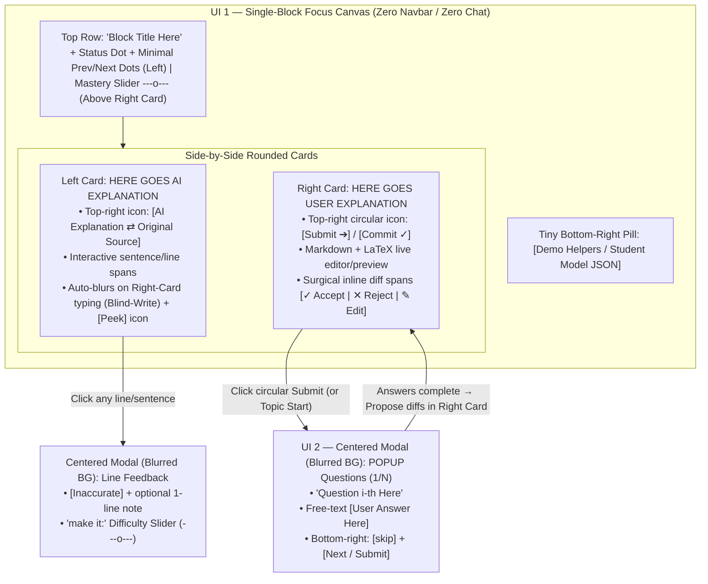

# UX Mockup Implementation Plan (v2 — Aligned with Wireframe UI 1 & UI 2)

Based on [out.md](file:///home/davidel/appunti/AI-SLOP/out.md), the provided wireframe (`UI 1 - Studying a block` & `UI 2 - POPUP Questions`), and our design alignment, this plan defines the revised single-file interactive HTML/CSS/JS prototype (`mockup.html`).

---

## 1. Visual Architecture & Wireframe Fidelity

### Key Decisions from Design Alignment
1. **Strict Wireframe Silhouette (`UI 1`):**
   * **No top navigation bar or persistent bottom drawer.** The screen is a clean, distraction-free frame containing only the current block pair.
   * **Single-Block Focus View:** Only one block-pair (`Module 3.2: IND-CPA Security`) is displayed on the canvas at a time, with minimal prev/next dots (`● ○ ○`), a subtle verification status dot (`Verified` green / `Unverified` amber) beside `Block Title Here`, and the **Mastery Slider** (`---o---`) positioned directly above the top-right of the Right Card.
   * **Tiny Floating Demo Pill:** Demo shortcuts (state jump, sample answer fill, and live Student Model JSON inspection) are tucked into a discreet collapsible pill in the bottom-right corner.

2. **Two Distinct Sliders (`Mastery Slider` vs. `Line Feedback Popup`):**
   * **Top-Right `Mastery Slider` (`UI 1`):** Controls the baseline scaffolding depth for the entire block (`Novice [1] ↔ Intermediate [2] ↔ Advanced [3]`). Auto-initialized by the `UI 2` Diagnostic Pretest, and manually draggable anytime.
   * **Centered `Feedback` Popup (`UI 1` Overlay):** Clicking any line/sentence in the Left Card blurs the workspace and centers the compact `Feedback` modal:
     * **`[Inaccurate]` button** (reveals an optional 1-line note input $\rightarrow$ forces source check and attaches a `[Verified: Cryptography.pdf, p. 42]` badge to that line).
     * **`make it:` difficulty slider (`---o---`)** (rewrites *only* that selected sentence from worked intuition $\leftrightarrow$ terse formal notation and immediately closes — **Edit and Stop**).

3. **Unified `UI 2 - POPUP Questions` Modal (Pretest & Post-Submit Review):**
   * Uses the exact centered card layout over a blurred background for both flows:
     * Header: `Question i-th Here` (with step indicator `1 / 3` for Diagnostic Pretest or `1 / 2` for Post-Submit Review).
     * Body: Rounded free-text input box (`User Answer Here`, supporting LaTeX preview + `Enter` to submit).
     * Footer: `skip button here` at the bottom-right (logs `override_used: true` / marks block `unverified` when skipping review questions, or defaults mastery on pretest skip).

4. **Inline Minimal Diffs & Circular Submit/Commit Button (`UI 1` Right Card):**
   * Inside the top-right corner of the Right Card sits the circular action button (`⊗` / `➔`).
   * **While Writing:** Clicking the circular button triggers `UI 2` (Post-Submit Review Questions `1/2 → 2/2`).
   * **After `UI 2` Questions Complete:** The modal closes and the user's Right Card text displays **surgical inline diffs** (`strikethrough old` / `green new`) directly inside the prose. Clicking/hovering a diff span shows a compact floating pill `[✓ Accept | ✕ Reject | ✎ Edit]`.
   * **Commit:** Once in diff mode, the top-right circular button becomes a **`✓ Commit`** button that finalizes the block (`verified` or `unverified`) and advances the block pagination dot to the next micro-module.

5. **Blind-Write Auto-Blur:**
   * Focusing or typing inside the Right Card automatically blurs the text inside the Left Card to enforce closed-book recall.
   * A small eye (`Peek`) icon beside the Left Card's top-right switcher lets the user reveal the Left Card as a soft override (marking the current block `unverified`).

---

## 2. Interactive Walkthrough & Cryptography Content (`IND-CPA`)

| Phase | Active Screen | User Interaction | System / Pedagogical Response |
| :--- | :--- | :--- | :--- |
| **1. Topic Pretest** | `UI 2` Centered Popup (`1/3 → 3/3`) | User answers 3 short free-text diagnostic questions on $\mathsf{negl}(\lambda)$, random-guess baseline $\frac{1}{2}$, and deterministic $\mathsf{Enc}_k$ (or clicks `skip`). | Scores responses $\rightarrow$ animates the top-right **Mastery Slider** to `Novice`, `Intermediate`, or `Advanced`. |
| **2. Study Block** | `UI 1` Left Card (`HERE GOES AI EXPLANATION`) | User reads the 3 clickable sentences of the ~130w IND-CPA explanation, or clicks the top-right switcher icon to toggle the verbatim `Cryptography.pdf (p. 42)` excerpt. | Toggles cleanly in-place between adaptive prose and anchored source passage. |
| **3. Line Feedback** | `UI 1` Centered `Feedback` Popup (blurred BG) | User clicks a specific sentence in the Left Card $\rightarrow$ clicks `[Inaccurate]` (+ optional note) or drags the `make it:` slider (`---o---`). | Rewrites **only** that sentence in the Left Card (attaching `[Ref: p. 42, Def 3.22]` if flagged `Inaccurate`) and closes the popup. |
| **4. Blind-Write** | `UI 1` Right Card (`HERE GOES USER EXPLANATION`) | User focuses/types their Markdown + LaTeX proof in the Right Card. | Left Card prose blurs automatically (`Blind-Write`). Clicking the Left Card `Peek` icon unblurs and logs `override_used: true` (`unverified`). |
| **5. Review Questions** | `UI 2` Centered Popup (`1/2 → 2/2`) | User clicks the circular top-right Submit button on the Right Card $\rightarrow$ answers 2 targeted questions on their proof's flaws (or clicks `skip`). | Evaluates answers to construct surgical span-level patches without rewriting the user's paragraph. |
| **6. Inline Diff & Commit** | `UI 1` Right Card (Diff Mode) | User clicks inline diff spans (`\le \mathsf{negl}(\lambda)` $\rightarrow$ `\le \frac{1}{2} + \mathsf{negl}(\lambda)`) to `[✓ Accept | ✕ Reject | ✎ Edit]`, then clicks the top-right circular `✓` button. | Saves finalized block as `verified` (or `unverified` if peek/skip/unresolved override was used) and advances to the next block dot. |

---

## 3. Implementation & Deployment Steps

1. **Rebuild `/home/davidel/appunti/AI-SLOP/mockup.html` to Match `UI 1` & `UI 2`:**
   * Replace the previous multi-bar layout with the clean `UI 1` framed canvas, side-by-side rounded cards, top-right `Mastery Slider`, top-right card icons (`Source Switcher` on left card, circular `Submit/Commit` on right card), and sentence-level hover/click states.
   * Implement the blurred-background centered `Feedback` modal (`[Inaccurate]` + optional 1-line note + `make it:` difficulty slider).
   * Implement the blurred-background centered `UI 2 - POPUP Questions` modal with 1-by-1 question stepping (`1/N`), free-text `User Answer Here` input, and bottom-right `skip` button.
   * Implement inline span diff pills (`[✓ Accept | ✕ Reject | ✎ Edit]`) directly inside the Right Card and tuck demo/telemetry helpers into a tiny bottom-right floating pill.
2. **Validate & Publish to GitHub Pages (`gh-pages`):**
   * Verify JS syntax (`node --check`) and KaTeX rendering.
   * Update `index.html` and `mockup.html` on the `gh-pages` branch and verify the live deployment at `https://davidelights.github.io/appunti/`.
