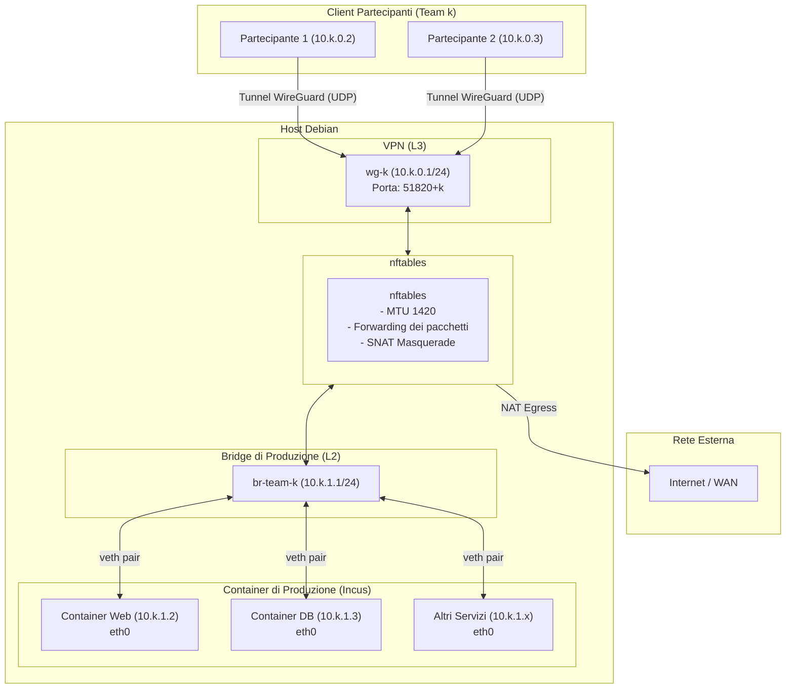
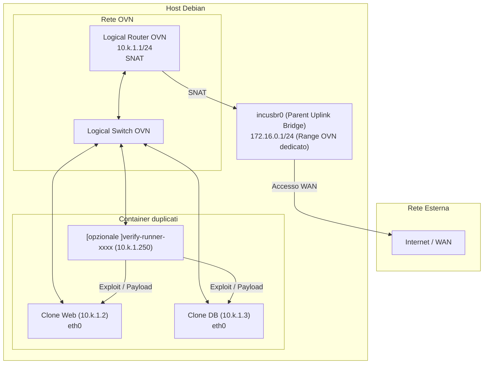

# 3.1 Architettura di Rete

La topologia e' suddivisa logicamente in due reti:
* **Una rete di produzione per ogni team**, dove la rete $\text{production-}k$ identifica gli oggetti di rete usati per  collegare i container vulnerabili alla rete per il team $k$
* **Al piu' una rete di verifica per ogni team**, dove la rete $\text{verify-}k$ identifica gli oggetti di rete ed i container duplicati utilizzati per la verifica richiesta dal $\text{team-}k$

Dunque schema di indirizzamento prevede una netta separazione tra lo spazio di gioco del team $k$, la rete WireGuard e la rete di Incus:
* `10.k.0.0/24`: sottorete WireGuard per i membri del team $k$.
* `10.k.1.0/24`: sottorete LAN per i container di produzione e per i cloni di verifica.
* `172.16.0.0/24`: sottorete gestita da $\text{incusbr0}$ per fornire la connettività esterna e le reti OVN tramite NAT.

## 3.1.1 Rete $\text{production-}k$

La rete $\text{production-}k$ e' fatta cosi, contiene:
* $\text{wg-}k$: dispositivo L3 gestito da WireGuard, fa da terminazione per il tunnel del team $k$-esimo. Ha come IP gateway: `10.k.0.0/24`
* $\text{br-team-}k$: dispositivo L2 gestito dal kernel Linux. Ha come IP gateway: `10.k.1.0/24`
* $\text{eth0}$: le interfacce di rete $\text{eth0}$ dei container vengono collegate a $\text{br-team-}k$.

$\text{wg-}k$ serve per fronire ai membri del team $k$ l'endpoint per la connessione tramite VPN, in questo modo i membri del team saranno connessi direttamente alla rete $\text{production-}k$. Ogni membro ha la sua configurazione WireGuard associata al suo peer impostato sull'interfaccia $\text{wg-}k$. Aggiungere un peer all'interfaccia WireGuard significa permettere ad un client con una certa chiave pubblica di collegarsi con un certo indirizzo ip (**cryptokey routing**), dunque ogni membro del team `k` ha il suo indirizzo nella sottorete `10.k.0.0/24`.

L'interfaccia $\text{br-team-}k$ permette di creare una rete LAN per i container del team $k$. Ogni interfaccia `eth0` dei container istanziati dal team $k$, vengono "collegati" (tramite l'utilizzo di un profilo Incus) a $\text{br-team-}k$. La connessione tra bridge e container viene gestita direttamente da Incus.

Questo collegamento avviene tramite l'utilizzo di una `veth pair` (Virtual Ethernet) per container: una estremita e' collegata a `br-team-k`, l'altra all'interffacia del container `eth0`. Dunque all'interno del kernel appesantiamo il carico nella gestione delle interfacce, infatti avremmo oltre ad `eth0`, una coppia `veth` per ogni container.

> `veth`: E' utile per collegare interfacce che risiedono per esempio su differenti Network Namespace (ossia il modo in cui sono implementati i container). Utilizzano poca CPU e poca memoria, dato che l'implementazione risiede direttamente nel kernel. Dunque per centinaia di `veth` non si ha un degrado evidente delle prestazioni. [^1]

Tramite regole di routing, il traffico dell'interfaccia $\text{wg-}k$ viene instradato verso $\text{br-team-}k$ e viceversa. Il routing viene applicato aggiungendo al sistema, dentro al set `team_links` la coppia di interfacce. Le regole ed i comandi usati per implementare l'inoltro verranno esposti piu avanti.

---

## 3.1.2 Rete $\text{verify-}k$

La rete $\text{verify-}k$ e' fatta cosi, contiene:
* $\text{verify-ovn-}k$: rete virtuale logica gestita via SDN tramite OVN e orchestrata da Incus [^2]. Non costituisce una singola interfaccia di rete convenzionale del kernel, ma una topologia virtuale  isolata composta da uno switch e un router con gateway: `10.k.1.1/24`.
* $\text{incusbr0}$: bridge di rete di Incus sull'host con gateway `172.16.0.1/24`. Svolge il ruolo di interfaccia per l'instradamento verso l'esterno della rete OVN.
* $\text{eth0}$: sono le interfacce di rete dei container clonati (`10.k.1.x`) che vengono collegate a $\text{verify-ovn-}k$.

> Incus e' in grado di gestire da solo il collegamento tra $\text{incusbr0}$ ed $\text{verify-ovn-}k$. Questo semplifica di molto la gestione delle interfacce di verifica per BlueAgent.

Le interfacce dei container e la rete $\text{verify-ovn-}k$ sono gestite dalla SDN (*Software Defined Network*). $\text{verify-ovn-}k$ e' implementata da:
1. un **Logical Switch** (denominato internamente da Incus nel DB di OVN come `incus-net<ID>-ls-int` [^2]): rappresenta la LAN su cui si agganciano le interfacce virtuali dei container di verifica.
2. un **Logical Router** (denominato `incus-net<ID>-lr` [^2]): agisce come gateway (`10.k.1.1/24`), permettendo ai container clonati di preservare l'identica configurazione IP rispetto alla produzione.

> **Tunneling Geneve e considerazioni sull'MTU:** OVN impiega il protocollo di tunneling **Geneve** (*Generic Network Virtualization Encapsulation*) [^3] per realizzare la rete overlay, incapsulando i frame L2 all'interno di pacchetti UDP. Il tunnel Geneve opera interamente confinato all'interno dell'host, isola il traffico di verifica impedendo che transiti sulle interfacce di rete visibili ai partecipanti.

L'incapsulamento Geneve introduce tuttavia un overhead di intestazione di 58 byte, riducendo l'MTU effettiva della rete di verifica a $1442$ byte (rispetto ai 1500 byte standard). In combinazione con il tunnel WireGuard (avente MTU $1420$), abbiamo una riduzione complessiva del *Path MTU*. Se pacchetti di dimensione eccedente hanno il flag *Don't Fragment* (DF) abilitato, rischiano di essere scartati generando un fenomeno di *Path MTU Blackhole*. Questo problema viene risolto forzando il *clamping* del MSS per il traffico TCP via `nftables` [^4], mentre il traffico UDP deve rimanere entro i limiti imposti dall'MTU minima della catena.

Questo approccio *garantisce l'assenza di conflitti di routing* grazie a una netta separazione tra **spazio utente** e **spazio kernel** [^5]:
* **Spazio Utente (Control Plane):** i demoni di controllo di OVN (`ovn-controller`, `ovn-northd`) e di Open vSwitch (`ovs-vswitchd`) elaborano la topologia logica e la traducono in flussi OpenFlow. Il router OVN esiste puramente a questo livello logico fino ad ora esiste solo logicamente.
* **Spazio Kernel (Data Plane):** l'effettivo inoltro dei frame avviene ad alte prestazioni tramite il modulo kernel di Open vSwitch. Il kernel gestisce una tabella di flussi in cache (*datapath flow cache*), instradando e modificando i pacchetti senza passare dallo stack di rete IP standard dell'host.

Il collegamento tra i container e la rete OVN sfrutta sempre una coppia `veth pair`: un'estremità risiede all'interno del container come `eth0`, mentre l'altra estremità sull'host viene agganciata direttamente al bridge di Open vSwitch.

> `SDN (Software Defined Networking)`: Paradigma architetturale che separa il **piano di controllo** dal **piano dei dati**, consentendo di gestire e programmare l'infrastruttura di rete interamente via software.
>
> `Open vSwitch (OVS)`: Switch virtuale operante nel kernel Linux come Data Plane. Sostituisce il classico bridge Linux eseguendo l'inoltro dei frame ad alte prestazioni basandosi su tabelle di flussi (*flow tables*).
>
> `OpenFlow`: Protocollo standard che permette al controller SDN di comunicare con lo switch e programmare le regole di matching e le azioni direttamente all'interno delle pipeline di Open vSwitch.
>
> `OVN (Open Virtual Network)`: Sistema SDN che opera come Control Plane per Open vSwitch. Traduce topologie logiche (Logical Switch, Logical Router, NAT e ACL) in flussi OpenFlow distribuiti, istruendo Open vSwitch su come instradare il traffico senza creare molteplici interfacce o bridge dedicati nel kernel host. E' costituito da due interfacce:
> * **OVN Northbound**: e' l'interfaccia dove dichiaro le reti che voglio creare e le loro proprietà che devono rispettare.
> * **OVN Southbound (SB) DB:** Memorizza le tabelle di flussi logici compilate e le associazioni di chassis (host fisici) 

La comunicazione verso l'esterno avviene collegando il Logical Router OVN al bridge parent $\text{incusbr0}$, da cui ottiene un indirizzo IP. L'accesso a Internet sfrutta un meccanismo di NAT a due stadi:
* **SNAT in OVN**: quando un container (`10.k.1.x`) invia traffico all'esterno, il Logical Router riscrive l'indirizzo sorgente sostituendolo con l'IP uplink assegnato su `incusbr0`. Se non fosse applicato, i pacchetti in uscita manterrebbero l'indirizzo sorgente `10.k.1.x` e le risposte dall'esterno verrebbero erroneamente instradate verso l'ambiente di produzione.
* **SNAT sull'host**: una volta raggiunto `incusbr0`, le regole `nftables` dell'host applicano la regola di masquerade verso l'interfaccia fisica per uscire su Internet.

Il NAT a due stadi e' necessario per evitare collisioni di routing sull'host: il primo stadio "nasconde" gli indirizzi duplicati `10.k.1.x` traducendoli in un IP univoco sull'infrastruttura `172.16.0.0/24`, mentre il secondo stadio permette la navigazione esterna condividendo l'IP dell'host.

> `NAT (Network Address Translation)`: Meccanismo di rete che modifica le informazioni di intestazione IP (e opzionalmente le porte di livello 4) dei pacchetti in fase di routing. [^6].

> `SNAT (Source NAT)`: Variante del NAT applicata al traffico uscente (**egress**, fase di postrouting). Modifica l'indirizzo IP sorgente del pacchetto con un indirizzo pubblico o instradabile dalla rete esterna.

> `Masquerading`: Variante dinamica di `SNAT`. Si ha  quando l'indirizzo sorgente viene mappato dinamicamente sull'IP dell'interfaccia di uscita dell'host.

[^1]: https://dev.to/godofgeeks/virtual-ethernet-devices-veth-ofd
[^2]: Documentazione ufficiale Incus, OVN network driver: https://linuxcontainers.org/incus/docs/main/reference/network_ovn/
[^3]: Documentazione architetturale OVN e Geneve: https://docs.ovn.org/en/latest/topics/geneve.html
[^4]: Documentazione Netfilter, TCP MSS Clamping: https://wiki.nftables.org/wiki-nftables/index.php/Forwarding_traffic
[^5]: Documentazione Open vSwitch, architettura Datapath Kernel vs Userspace: https://docs.openvswitch.org/en/latest/intro/what-is-ovs/
[^6]: Documentazione Netfilter, Network Address Translation (NAT): https://wiki.nftables.org/wiki-nftables/index.php/Performing_Network_Address_Translation_(NAT)