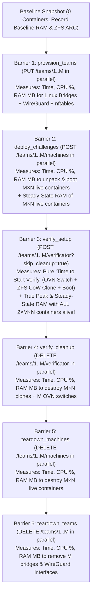

# Redesigned Benchmark Plan: Per-Step CPU/RAM Subprocess Telemetry & Synchronized Verify Setup

## Goal Description

Redesign the BlueAgent benchmark suite so that **every infrastructure lifecycle step** has accurate **time, CPU utilization (%), and RAM consumption (MB)** telemetry across both **Alpine Linux (`alpine`, 3.21 MiB)** and **Ubuntu Heavy (`ubuntu-heavy`, 544.18 MiB compressed / ~1.5 GB unpacked with `systemd`, `nginx`, `python3`, `postgresql`, `sqlite3`)**.

Two critical architectural improvements are introduced based on our design alignment:
1. **Dedicated 100ms CPU & RAM Sampler Subprocess:** A standalone Python subprocess (`resource_sampler.py` / `SubprocessResourceMonitor`) continuously reads `/proc/stat`, `/proc/meminfo`, and `/proc/spl/kstat/zfs/arcstats` every `100ms`, attributing exact CPU % (total + iowait) and RAM MB (total used, ZFS ARC cache, and net container RAM delta) to every barrier step.
2. **Synchronized Verify Setup vs. Verify Cleanup (6 Barriers):** Previously, `POST /teams/{k}/verificator` ran setup, check, and teardown inside a single call—causing fast teams to delete their clones while slower teams were still cloning. By separating **Barrier 3 (`verify_setup` — Start Verify)** from **Barrier 4 (`verify_cleanup` — Teardown Verify)**, all $M$ sandboxes finish starting before any cleanup begins. This measures the pure **time to start verification** and captures the **true peak RAM and CPU** when all $2 \times M \times N$ containers ($M \times N$ live + $M \times N$ clones) are running simultaneously.

---

## 6-Barrier Synchronized Architecture

---

## Scenarios to Execute (9 Scenarios × 2 Images)

For both `alpine` (128MB limit) and `ubuntu-heavy` (256MB limit), we will run the 9 scenarios that cover the single-container baseline, the $N=5$ bridge points for smooth 2D scaling curves ($M \in \{2, 5, 10\}$ and $N \in \{5, 7, 10\}$), and all 6 Tier 3 high-load scenarios:

| # | Scenario | Teams ($M$) | Containers/Team ($N$) | Live Containers ($M \times N$) | Peak Containers in Verify ($2 \times M \times N$) | Purpose in Thesis |
| :--- | :--- | :--- | :--- | :--- | :--- | :--- |
| **1** | **Test 1 Baseline** | 1 | 1 (10 cycles) | 1 | 2 | Zero-contention baseline & micro-phase profile |
| **2** | **Bridge $M=2, N=5$** | 2 | 5 | 10 | 20 | Connects $N=5$ curve at low $M$ |
| **3** | **Tier 3 $M=2, N=7$** | 2 | 7 | 14 | 28 | Medium container density |
| **4** | **Tier 3 $M=2, N=10$** | 2 | 10 | 20 | 40 | High per-team container density |
| **5** | **Bridge $M=5, N=5$** | 5 | 5 | 25 | 50 | Connects both $M=5, N \in \{5,7,10\}$ and $N=5, M \in \{2,5,10\}$ |
| **6** | **Tier 3 $M=5, N=7$** | 5 | 7 | 35 | 70 | High multi-team + dense challenge load |
| **7** | **Tier 3 $M=5, N=10$** | 5 | 10 | **50** | **100** | Peak 100-container scale (dense teams) |
| **8** | **Tier 3 $M=10, N=2$** | 10 | 2 | 20 | 40 | High OVN switch concurrency ($M=10$) |
| **9** | **Tier 3 $M=10, N=5$** | 10 | 5 | **50** | **100** | Peak 100-container scale (many teams) |

---

## Proposed Changes

### 1. BlueAgent API & Service Layer: Synchronized Verify Setup & Cleanup

#### [MODIFY] [ovn.py](file:///home/debian/bluectfd/blueagent/src/blueagent/verifier/ovn.py)
- Add `cleanup_sandbox(engine: ContainerEngine, team_k: int, container_names: List[str], has_verifier: bool = False) -> Dict[str, float]` helper method on `OVNVerifier` so cleanup can be invoked either automatically inside `__aexit__` (default behavior) or explicitly via `DELETE /teams/{team_k}/verificator` when `skip_cleanup=True` was passed.

#### [MODIFY] [challenges.py (Service)](file:///home/debian/bluectfd/blueagent/src/blueagent/services/challenges.py)
- Update `verify_challenge(self, team_k: int, config: ChallengeConfig, skip_cleanup: bool = False) -> VerifyResultResp`:
  - When `skip_cleanup=False` (default): behaves identically to existing code (`__aenter__` $\to$ `run_checks` $\to$ `__aexit__`).
  - When `skip_cleanup=True`: executes `__aenter__()` and `run_checks()` (so clones are verified booted and reachable), records `step_timings`, and leaves the `verify-{team_k}-*` clones and `verify-{team_k}` OVN switch running until `cleanup_verify_sandbox(team_k, config)` is called.
- Add `cleanup_verify_sandbox(self, team_k: int, config: Optional[ChallengeConfig] = None) -> Dict[str, Any]` which stops/deletes all `verify-{team_k}-*` instances and deletes the `verify-{team_k}` OVN network in parallel, returning `{clones_teardown_sec, ovn_network_delete_sec, total_cleanup_sec}`.

#### [MODIFY] [challenges.py (API)](file:///home/debian/bluectfd/blueagent/src/blueagent/api/challenges.py)
- Add `skip_cleanup: bool = False` query parameter to `POST /teams/{team_k}/verificator`.
- Add `DELETE /teams/{team_k}/verificator` endpoint returning the cleanup step timings JSON `{ "step_timings": { "clones_teardown_sec": ..., "ovn_network_delete_sec": ..., "total_cleanup_sec": ... } }`.

#### [MODIFY] [client.py](file:///home/debian/bluectfd/blueagent/tests/usability/client.py)
- Add `skip_cleanup: bool = False` parameter to `verify_challenge()` and add `cleanup_verify(team_k: int, config_payload: Optional[ dict ] = None)` calling `DELETE /teams/{team_k}/verificator`.

---

### 2. Subprocess CPU & RAM Sampler and 3-CSV Exporter in [`benchmark_suite.py`](file:///home/davidel/.gemini/antigravity/brain/335ea41a-df46-4ffa-bb4c-eefc5a5248cd/scratch/benchmark_suite.py)

#### [MODIFY] [benchmark_suite.py](file:///home/davidel/.gemini/antigravity/brain/335ea41a-df46-4ffa-bb4c-eefc5a5248cd/scratch/benchmark_suite.py)
- **`ResourceSamplerSubprocess`**:
  - Spawns a dedicated child Python process (`subprocess.Popen`) before each scenario starts.
  - Every `100ms`, the child process reads:
    - `/proc/stat`: computes instantaneous `cpu_total_pct`, `cpu_user_pct`, `cpu_system_pct`, `cpu_iowait_pct` across the 8 cores.
    - `/proc/meminfo`: computes `ram_used_mb = (MemTotal - MemAvailable) / 1024`.
    - `/proc/spl/kstat/zfs/arcstats`: reads ZFS ARC `size` (`zfs_arc_mb`) and computes `net_ram_mb = ram_used_mb - zfs_arc_mb` (isolating true container + kernel memory from ZFS filesystem cache).
  - Writes JSONL lines with `time.perf_counter()` timestamps to a pipe/temp file.
  - As the parent `benchmark_suite.py` transitions across the 6 barriers (`provision_teams`, `deploy_challenges`, `verify_setup`, `verify_cleanup`, `teardown_machines`, `teardown_teams`), it records the exact `[t_start, t_end]` of each barrier and slices the 100ms samples into per-step statistics:
    - `cpu_avg_pct`, `cpu_p95_pct`, `cpu_max_pct`, `iowait_avg_pct`, `iowait_max_pct`
    - `ram_avg_mb`, `ram_peak_mb`, `zfs_arc_avg_mb`, `net_ram_avg_mb`, `net_ram_peak_mb`, `net_ram_delta_mb` (growth above pre-scenario baseline).
  - Also records steady-state memory snapshots after a 1.0s settle pause at two key points:
    1. **After Barrier 2 (`deploy_challenges`)**: `steady_live_net_ram_delta_mb` ($M \times N$ live containers running at rest).
    2. **After Barrier 3 (`verify_setup`)**: `steady_peak_net_ram_delta_mb` ($2 \times M \times N$ live + cloned containers running simultaneously at rest).
- **Outputs Exported per Image (`thesis_alpine_*` and `thesis_ubuntu_*`):**
  1. `*_results.csv`: One summary row per scenario containing all macro/micro timings + per-step CPU/RAM summary columns.
  2. `*_step_resources.csv`: Long-format table with one row per `(scenario, step_name)` (`provision_teams`, `deploy_challenges`, `verify_setup`, `verify_cleanup`, `teardown_machines`, `teardown_teams`), containing `duration_sec`, `cpu_avg_pct`, `cpu_p95_pct`, `cpu_max_pct`, `iowait_avg_pct`, `iowait_max_pct`, `ram_avg_mb`, `ram_peak_mb`, `zfs_arc_avg_mb`, `net_ram_avg_mb`, `net_ram_peak_mb`, `net_ram_delta_mb`.
  3. `*_timeseries.csv`: Raw 100ms time-series samples labeled with `step_name` and `elapsed_sec`.
  4. `*_raw_samples.csv`: Per-team HTTP and micro-phase timings.
  5. `*_report.md`: Formatted Markdown report with Macro Timings, Micro-Phase Breakdown (Deploy vs. CoW Clone speedup), and Step-by-Step CPU & RAM Utilization tables.

---

## Verification & Execution Plan

1. **Deploy Updated `blueagent` Service & Run Smoke Test:**
   - Sync updated `ovn.py`, `challenges.py`, `client.py`, and `benchmark_suite.py` to `debian@192.168.0.199`.
   - Restart `blueagent.service` and run a 1-cycle smoke test (`M=1, N=1`) to verify that:
     - `POST /teams/1/verificator?skip_cleanup=true` leaves `verify-1-app1` running.
     - `DELETE /teams/1/verificator` cleanly tears down `verify-1-app1` and `verify-1`.
     - All 4 CSV files (`_results.csv`, `_step_resources.csv`, `_timeseries.csv`, `_raw_samples.csv`) are populated with non-zero 100ms CPU% and RAM MB metrics.
2. **Run Alpine Benchmark Suite (`thesis_alpine` — 9 Scenarios):**
   - Run Test 1 Baseline (10 cycles) + Bridge points $(2,5), (5,5)$ + Tier 3 $(2,7), (2,10), (5,7), (5,10), (10,2), (10,5)$ with `--image alpine --memory-limit 128MB --output-prefix thesis_alpine`.
3. **Run Ubuntu Heavy Benchmark Suite (`thesis_ubuntu` — 9 Scenarios):**
   - Run the exact same 9 scenarios with `--image ubuntu-heavy --memory-limit 256MB --output-prefix thesis_ubuntu`.
4. **Update `thesis_notes.md` & Sync All CSVs Locally:**
   - Pull all `thesis_alpine_*` and `thesis_ubuntu_*` CSV/Markdown files into the local workspace and update `/home/debian/bluectfd/thesis_notes.md` (and local copy) with the complete Alpine vs. Ubuntu Heavy comparative analysis (CoW speedup factor, CPU saturation, and net RAM scaling).
