# BlueAgent — Specifica Entità, Classi e Relazioni (per Class Diagram)

---

## 1. Entità di Dominio e Persistenza (SQLite + Pydantic Models)

Rappresentano lo stato persistito in SQLite (`DatabaseManager`, [database.py](file:///home/davidel/.gemini/antigravity/brain/0c7fb467-238e-486e-aebe-55869fcb1806/scratch/repo/blueagent/src/blueagent/database.py)) e i relativi schemi in [models.py](file:///home/davidel/.gemini/antigravity/brain/0c7fb467-238e-486e-aebe-55869fcb1806/scratch/repo/blueagent/src/blueagent/models.py).

| Entità / Classe | Tabella SQLite | Attributi Chiave | Ruolo |
| :--- | :--- | :--- | :--- |
| **`TeamRecord`** | `teams` | `team_k: int` (PK, `0..254`), `name: str`, `bridge_name: str`, `wg_interface: str`, `created_at: datetime` | Identifica un team e le sue interfacce host dedicate (`br-team-k`, `wg-k`). |
| **`TeamMemberWG`** | `team_members` | `member_id: str` (PK), `team_k: int` (FK), `ctfd_user_id: int?`, `name: str`, `client_ip: str`, `public_key: str`, `private_key: str?`, `preshared_key: str?`, `config_text: str?` | Credenziali crittografiche WireGuard e IP VPN (`10.k.0.x`) assegnati a un membro del team. |
| **`TeamMemberResp`** | *(DTO)* | `user_id`, `member_id`, `team_k`, `name`, `client_ip`, `public_key`, `telemetry: PeerTelemetry?` | Vista pubblica del membro (senza chiavi private/PSK) arricchita con telemetria live. |
| **`PeerTelemetry`** | *(Value Object)* | `online: bool`, `endpoint: str?`, `latest_handshake: int`, `transfer_rx: int`, `transfer_tx: int`, `persistent_keepalive: str` | Statistiche runtime del peer WireGuard lette da `wg show dump`. |
| **`ImageRecord`** | `images` | `alias: str` (PK), `yaml_sha256: str`, `yaml_text: str`, `status: 'building'\|'ready'\|'failed'`, `fingerprint: str?`, `error: str?` | Immagine di sistema compilata con Distrobuilder e importata in Incus. |
| **`RunningContainerRecord`** | `running_containers` | `instance_name: str` (PK), `team_k: int` (FK), `spec_name: str`, `ip_address: str`, `image_alias: str` (FK), `challenge_id: str?` | Istanza container attiva (`c-{team_k}-{spec_name}`) collegata al bridge del team. |

---

## 2. Modelli IaC di Configurazione Challenge e DTO API ([models.py](file:///home/davidel/.gemini/antigravity/brain/0c7fb467-238e-486e-aebe-55869fcb1806/scratch/repo/blueagent/src/blueagent/models.py))

| Classe | Attributi / Metodi Chiave | Ruolo |
| :--- | :--- | :--- |
| **`ChallengeConfig`** | `challenge_id: str`, `team_k: int?`, `verify_internet_access: bool`, `verifier: VerifierSpec?`, `containers: List[ContainerSpec]`, `readiness_commands: List[CommandSpec]`, `verify_commands: List[CommandSpec]`, `render_for_team(team_k)` | Specifica dichiarativa (IaC) di una challenge multi-container e dei relativi test di verifica. |
| **`ContainerSpec`** | `name: str`, `image: str`, `ip_suffix: int`, `limits_cpu: str`, `limits_memory: str` | Specifica hardware (CPU/RAM) e di rete (`10.k.1.{ip_suffix}`) di un singolo container della challenge. |
| **`VerifierSpec`** | `image: str`, `ip_suffix: int`, `limits_cpu: str`, `limits_memory: str` | Specifica del container effimero `verify-runner-{team_k}` per test black-box nella rete OVN. |
| **`CommandSpec`** | `target: 'container'\|'verifier'`, `container_name: str?`, `cmd: List[str]`, `env: Dict`, `timeout: int`, `interval: int`, `retry_timeout: int`, `retries: int`, `retry_delay: float` | Comando da eseguire in un clone o nel verifier runner (usato sia per readiness probe sia per verify check). |
| **`ExecResult`** | `exit_code: int`, `stdout: str`, `stderr: str` | Risultato dell'esecuzione di un comando dentro un container Incus. |
| **`DeployResponse`** | `team_k: int`, `challenge_id: str?`, `status: str`, `containers: List[RunningContainerRecord]`, `step_timings: Dict?` | Risposta restituita al termine del deploy dei container di una challenge. |
| **`VerifyResultResp`** | `success: bool`, `passed: bool`, `message: str`, `details: Dict?` | Esito strutturato di una sessione di verifica nella sandbox OVN. |
| **`TeamPutReq` / `TeamCreateReq`** | `name: str`, `team_k: int?` | Payload di richiesta creazione/aggiornamento team. |
| **`TeamMemberPutReq` / `TeamMemberCreateReq`** | `name: str`, `ctfd_user_id: int?`, `public_key: str?` | Payload di richiesta registrazione/aggiornamento membro WireGuard. |

---

## 3. Classi Architetturali, Servizi e Driver

### 3.1 Configurazione, Persistenza e Concorrenza
| Classe | File | Attributi / Dipendenze | Ruolo |
| :--- | :--- | :--- | :--- |
| **`Settings`** | `config.py` | Parametri `BLUEAGENT_*` (`BaseSettings`) | Configurazione centralizzata dell'applicazione (percorsi socket, DB, timeout, prefissi rete, token CTFd). |
| **`DatabaseManager`** | `database.py` | `db_path: str` | Gestore asincrono SQLite (`aiosqlite` in modalità WAL) per CRUD su `teams`, `team_members`, `images`, `running_containers`. |
| **`TwoTierLock`** | `locks.py` | `lock_path: Path`, `resource_name: str`, `async_lock: asyncio.Lock`, `file_lock: AsyncFileLock`, `_holder_task`, `_depth: int` | Lock gerarchico rientrante: Tier 1 intra-processo (`asyncio.Lock`) + Tier 2 inter-processo (`fcntl.flock`). |
| **`LockRegistry`** | `locks.py` | `lock_dir: Path`, `_locks: Dict[Path, TwoTierLock]` | Registro e factory di `TwoTierLock` con helper contestuali `lock_team()`, `lock_instance()`, `lock_global()`. |

### 3.2 Service Layer (Business Logic — `services/`)
| Classe | File | Dipendenze (Attributi) | Metodi Principali | Ruolo |
| :--- | :--- | :--- | :--- | :--- |
| **`TeamService`** | `services/teams.py` | `db: DatabaseManager`, `host_net: HostNetworkManager`, `wg: WireGuardManager`, `engine: ContainerEngine`, `locks: LockRegistry` | `create_or_update_team()`, `provision_team_network()`, `teardown_team()`, `add_member()`, `list_members()`, `remove_member()` | Orchestra il ciclo di vita dei team (bridge + WireGuard), l'allocazione IP dei membri e la telemetria VPN. |
| **`ChallengeService`** | `services/challenges.py` | `db: DatabaseManager`, `engine: ContainerEngine`, `host_net: HostNetworkManager`, `locks: LockRegistry` | `deploy_challenge()`, `teardown_challenge()`, `get_active_containers()`, `verify_challenge()`, `cleanup_verify_sandbox()` | Orchestra il deploy parallelo dei container su `br-team-k`, il rollback atomico e la verifica tramite `OVNVerifier`. |
| **`ImageService`** | `services/images.py` | `db: DatabaseManager`, `builder: ImageBuilder`, `engine: ContainerEngine` | `submit_image()`, `get_image_logs()`, `list_images()`, `get_image()`, `delete_image()` | Valida definizioni YAML/archivi Distrobuilder, calcola SHA-256 (CAS) e avvia la build in background. |

### 3.3 Container Engine & Sandbox di Verifica (`engine/`, `verifier/`, `images/`, `lifecycle/`)
| Classe | File | Dipendenze (Attributi) | Metodi Principali | Ruolo |
| :--- | :--- | :--- | :--- | :--- |
| **`ContainerEngine`** *(ABC)* | `engine/base.py` | *(Interfaccia astratta)* | `create_instance()`, `start_instance()`, `stop_instance()`, `delete_instance()`, `clone_instance()`, `connect_network()`, `exec_command()`, `push_file()`, `import_image()`, `create_network()`, `delete_network()` | Contratto astratto per il runtime dei container, disaccoppiando i servizi da Incus. |
| **`IncusEngine`** | `engine/incus.py` | `socket_path: str`, `transport: AsyncHTTPTransport`, `client: httpx.AsyncClient`, `network: OvnNetworkManager` | Implementa `ContainerEngine` + `_wait_incus_op()` | Driver concreto che comunica con Incus via HTTP/1.1 su Unix Domain Socket (`/var/lib/incus/unix.socket`). |
| **`OvnNetworkManager`** | `engine/network.py` | `client: httpx.AsyncClient`, `_wait_op: Callable` | `create_ovn_network()`, `delete_ovn_network()`, `list_verification_networks()` | Helper interno a `IncusEngine` per la creazione e rimozione degli switch logici OVN (`verify-{team_k}`). |
| **`OVNVerifier`** | `verifier/ovn.py` | `engine: ContainerEngine`, `config: ChallengeConfig`, `team_k: int`, `net_name: str`, `clones: List[str]`, `verifier_container_name: str?` | `__aenter__()`, `run_checks()`, `__aexit__()`, `_cleanup()` | Async Context Manager (pattern RAII): crea lo switch OVN, clona i container via ZFS CoW, esegue i check e garantisce il teardown. |
| **`ImageBuilder`** | `images/distrobuilder.py` | `db: DatabaseManager`, `engine: ContainerEngine`, `locks: LockRegistry` | `build_image(alias)` | Compila immagini LXC/Incus unificate eseguendo `distrobuilder`, importa il tarball in Incus e aggiorna lo stato nel DB. |
| **`LifecycleManager`** | `lifecycle/manager.py` | `engine: ContainerEngine`, `locks: LockRegistry`, `interval_seconds: int`, `grace_period_seconds: int` | `start()`, `stop()`, `trigger_reconciliation()`, `_run_reconciliation_cycle()` | Demone in background (sweeper) che elimina cloni e reti `verify-*` orfani scaduto il grace period, rispettando i lock attivi. |

### 3.4 Sottosistema di Rete Host (`network/`)
| Classe | File | Dipendenze (Attributi) | Metodi Principali | Ruolo |
| :--- | :--- | :--- | :--- | :--- |
| **`CommandRunner`** *(Protocol)* | `network/_runner.py` | *(Protocollo / Interfaccia)* | `run(argv, stdin, timeout, check) -> CompletedCommand` | Contratto per l'esecuzione asincrona di comandi di sistema (`ip`, `wg`, `nft`). |
| **`SubprocessRunner`** | `network/_runner.py` | — | `run(...) -> CompletedCommand` | Implementazione concreta di `CommandRunner` basata su `asyncio.create_subprocess_exec` con pipe in RAM. |
| **`CompletedCommand`** *(dataclass)* | `network/_runner.py` | `argv: Sequence[str]`, `returncode: int`, `stdout: str`, `stderr: str` | — | Valore di ritorno di un comando host eseguito da `CommandRunner`. |
| **`HostNetworkManager`** | `network/host_net.py` | `runner: CommandRunner`, `settings: Settings`, `bridge_prefix: str`, `nft_table: str` | `setup_team_bridge()`, `teardown_team_bridge()`, `apply_nftables_rules()`, `register_team_links()`, `ensure_ip_forwarding()` | Gestisce i bridge Linux (`br-team-k`), l'IP forwarding del kernel e l'isolamento/MSS clamping in `nftables`. |
| **`WireGuardManager`** | `network/wireguard.py` | `runner: CommandRunner`, `settings: Settings`, `interface_prefix: str`, `config_dir: Path` | `setup_team_interface()`, `teardown_team_interface()`, `add_peer()`, `remove_peer()`, `list_peers()`, `generate_member_config()` | Gestisce le interfacce kernel `wg-k`, le chiavi Curve25519/PSK dei peer e la generazione dei file `.conf`. |
| **`TeamNetPlan`** *(dataclass)* | `network/addressing.py` | `team_k: int`, `bridge_name: str`, `bridge_cidr: str`, `lan_subnet: str`, `wg_iface: str`, `wg_server_cidr: str`, `vpn_subnet: str`, `listen_port: int` | Creato da `plan_for(team_k)` | Piano di indirizzamento deterministico calcolato a partire da `team_k` (`10.k.0.0/24` VPN, `10.k.1.0/24` LAN, porta `51820+k`). |
| **`MemberCredentials`** *(dataclass)* | `network/wireguard.py` | `name`, `client_ip`, `public_key`, `private_key?`, `preshared_key?`, `config_text`, `server_endpoint`, `server_public_key` | Restituito da `WireGuardManager.generate_member_config()` | Value object con chiavi e testo `.conf` generati per un membro del team. |

---

## 4. Relazioni tra Classi e Cardinalità (Partecipazione Esplicita)

### 4.1 Relazioni tra Entità di Dominio / Data Model
| Classe Sorgente | Relazione | Classe Destinazione | Cardinalità | Semantica |
| :--- | :--- | :--- | :---: | :--- |
| **`TeamRecord`** | Composizione (`ON DELETE CASCADE`) | **`TeamMemberWG`** | **`1` — `0..253`** | Un team esiste anche senza membri (`0`), fino a un massimo di 253 peer nell'intervallo `10.k.0.2..254`; un membro appartiene esattamente a `1` team. |
| **`TeamRecord`** | Composizione (`ON DELETE CASCADE`) | **`RunningContainerRecord`** | **`1` — `0..N`** | Un team ha da `0` a `N` container attivi; ogni container in esecuzione appartiene esattamente a `1` team (`1..1`). |
| **`ImageRecord`** | Associazione (`ON DELETE RESTRICT`) | **`RunningContainerRecord`** | **`1` — `0..N`** | Un'immagine può essere istanziata da `0..N` container attivi; ogni `RunningContainerRecord` referenzia esattamente `1` `ImageRecord` (`image_alias`). |
| **`TeamMemberResp`** / **`TeamMemberWG`** | Aggregazione | **`PeerTelemetry`** | **`1` — `0..1`** | Ogni record membro può avere opzionalmente (`0..1`) una telemetria WireGuard associata. |
| **`ChallengeConfig`** | Composizione | **`ContainerSpec`** | **`1` — `1..N`** | Una challenge comprende `1..N` specifiche di container da istanziare. |
| **`ChallengeConfig`** | Composizione | **`VerifierSpec`** | **`1` — `0..1`** | Una challenge definisce opzionalmente (`0..1`) un container `verifier` per test black-box. |
| **`ChallengeConfig`** | Composizione | **`CommandSpec`** | **`1` — `0..N`** | Una challenge contiene `0..N` `readiness_commands` e `0..N` `verify_commands`. |
| **`DeployResponse`** | Aggregazione | **`RunningContainerRecord`** | **`1` — `0..N`** | Il risultato di un deploy elenca i `0..N` container attivi per il team. |

### 4.2 Ereditarietà / Realizzazione (Generalizzazione `<<interface>>`)
| Sottoclasse | Tipo | Superclasse / Interfaccia | Cardinalità |
| :--- | :--- | :--- | :---: |
| **`IncusEngine`** | Realizzazione (`inherits`) | **`ContainerEngine` (ABC)** | is-a |
| **`SubprocessRunner`** | Realizzazione (`implements`) | **`CommandRunner` (Protocol)** | is-a |

### 4.3 Relazioni Strutturali tra Componenti Architetturali
| Classe Sorgente | Relazione | Classe Destinazione | Cardinalità | Dettaglio |
| :--- | :--- | :--- | :---: | :--- |
| **`LockRegistry`** | Composizione | **`TwoTierLock`** | **`1` — `0..N`** | `LockRegistry` mantiene nel dizionario `_locks` da `0` a `N` istanze di `TwoTierLock` (una per risorsa `team`, `instance`, `global`). |
| **`IncusEngine`** | Composizione | **`OvnNetworkManager`** | **`1` — `1`** | Ogni `IncusEngine` istanzia e possiede esattamente `1` `OvnNetworkManager`. |
| **`HostNetworkManager`** | Associazione | **`CommandRunner`** | **`1` — `1`** | Usa `1` `CommandRunner` (`SubprocessRunner`) per eseguire `ip` e `nft`. |
| **`WireGuardManager`** | Associazione | **`CommandRunner`** | **`1` — `1`** | Usa `1` `CommandRunner` (`SubprocessRunner`) per eseguire `ip` e `wg`. |
| **`HostNetworkManager`** / **`WireGuardManager`** | Dipendenza (`<<creates>>`) | **`TeamNetPlan`** | **`1` — `0..N`** | Invocano `plan_for(team_k)` per ottenere il piano IP di ciascun team. |
| **`WireGuardManager`** | Dipendenza (`<<creates>>`) | **`MemberCredentials`** | **`1` — `0..N`** | Genera `MemberCredentials` per ogni configurazione peer richiesta. |
| **`TeamService`** | Associazione (DI) | **`DatabaseManager`**, **`HostNetworkManager`**, **`WireGuardManager`**, **`ContainerEngine`**, **`LockRegistry`** | **`1` — `1`** (ciascuno) | Riceve i 5 singleton applicativi per orchestrare team e peer VPN. |
| **`ChallengeService`** | Associazione (DI) | **`DatabaseManager`**, **`ContainerEngine`**, **`HostNetworkManager`**, **`LockRegistry`** | **`1` — `1`** (ciascuno) | Riceve i 4 singleton applicativi per orchestrare deploy, teardown e verifiche. |
| **`ChallengeService`** | Dipendenza / Creazione (`<<instantiate>>`) | **`OVNVerifier`** | **`1` — `0..N`** | `verify_challenge()` istanzia `1` `OVNVerifier` effimero per ogni sessione di verifica attiva (`0..1` per singolo `team_k` grazie al lock `verify:{team_k}`). |
| **`OVNVerifier`** | Associazione | **`ContainerEngine`** | **`0..N` — `1`** | Ogni `OVNVerifier` utilizza il singleton `ContainerEngine` per creare la rete OVN e i cloni ZFS. |
| **`OVNVerifier`** | Associazione | **`ChallengeConfig`** | **`1` — `1`** | Ogni `OVNVerifier` opera su esattamente `1` `ChallengeConfig` renderizzata per `team_k`. |
| **`ImageService`** | Associazione (DI) | **`DatabaseManager`**, **`ImageBuilder`**, **`ContainerEngine`** | **`1` — `1`** (ciascuno) | Coordina catalogo immagini e avvia task asincroni su `ImageBuilder`. |
| **`ImageBuilder`** | Associazione | **`DatabaseManager`**, **`ContainerEngine`**, **`LockRegistry`** | **`1` — `1`** (ciascuno) | Singleton che compila le immagini sotto lock globale `image:{alias}` e le importa in `ContainerEngine`. |
| **`LifecycleManager`** | Associazione | **`ContainerEngine`**, **`LockRegistry`** | **`1` — `1`** (ciascuno) | Demone singleton che interroga `ContainerEngine` e controlla `LockRegistry` prima di rimuovere risorse `verify-*` orfane. |

---

## 5. Schema Mermaid `classDiagram` Pronto all'Uso

```mermaid
classDiagram
    direction TB

    %% === DOMAIN & PERSISTENCE MODELS ===
    class TeamRecord {
        +int team_k PK
        +str name
        +str bridge_name
        +str wg_interface
        +datetime created_at
    }

    class TeamMemberWG {
        +str member_id PK
        +int team_k FK
        +int ctfd_user_id
        +str name
        +str client_ip
        +str public_key
        +str private_key
        +str preshared_key
        +str config_text
    }

    class PeerTelemetry {
        +bool online
        +str endpoint
        +int latest_handshake
        +int transfer_rx
        +int transfer_tx
    }

    class ImageRecord {
        +str alias PK
        +str yaml_sha256
        +str yaml_text
        +str status
        +str fingerprint
        +str error
    }

    class RunningContainerRecord {
        +str instance_name PK
        +int team_k FK
        +str spec_name
        +str ip_address
        +str image_alias FK
    }

    %% === IAC CHALLENGE MODELS ===
    class ChallengeConfig {
        +str challenge_id
        +int team_k
        +bool verify_internet_access
        +render_for_team(team_k) ChallengeConfig
    }

    class ContainerSpec {
        +str name
        +str image
        +int ip_suffix
        +str limits_cpu
        +str limits_memory
    }

    class VerifierSpec {
        +str image
        +int ip_suffix
        +str limits_cpu
        +str limits_memory
    }

    class CommandSpec {
        +str target
        +str container_name
        +List~str~ cmd
        +int timeout
        +int retries
    }

    class ExecResult {
        +int exit_code
        +str stdout
        +str stderr
    }

    class VerifyResultResp {
        +bool success
        +bool passed
        +str message
    }

    %% === CORE INFRASTRUCTURE & LOCKS ===
    class DatabaseManager {
        +str db_path
        +init_db()
        +create_team() TeamRecord
        +add_team_member() TeamMemberWG
        +claim_image() Tuple~ImageRecord, bool~
        +record_container() RunningContainerRecord
    }

    class LockRegistry {
        +Path lock_dir
        +get_lock(type, id) TwoTierLock
        +lock_team(team_k)
        +lock_instance(name)
        +lock_global(name)
    }

    class TwoTierLock {
        +Path lock_path
        +str resource_name
        +Lock async_lock
        +AsyncFileLock file_lock
        +acquire(timeout)
        +release()
    }

    %% === ENGINE & VERIFIER ===
    class ContainerEngine {
        <<abstract>>
        +create_instance(spec, devices)*
        +start_instance(name)*
        +stop_instance(name, force)*
        +delete_instance(name, force)*
        +clone_instance(src, dst)*
        +connect_network(inst, net, ip)*
        +exec_command(name, cmd) ExecResult*
        +push_file(inst, path, content)*
        +import_image(tarball, alias) str*
        +create_network(name, config)*
        +delete_network(name)*
    }

    class IncusEngine {
        +str socket_path
        +AsyncClient client
        +OvnNetworkManager network
        +_wait_incus_op(uuid)
    }

    class OvnNetworkManager {
        +create_ovn_network(name, config)
        +delete_ovn_network(name)
        +list_verification_networks()
    }

    class OVNVerifier {
        +int team_k
        +str net_name
        +List~str~ clones
        +str verifier_container_name
        +__aenter__() OVNVerifier
        +run_checks() VerifyResultResp
        +__aexit__()
    }

    class ImageBuilder {
        +build_image(alias)
    }

    class LifecycleManager {
        +int interval_seconds
        +int grace_period_seconds
        +start()
        +stop()
        +trigger_reconciliation()
    }

    %% === NETWORK SUBSYSTEM ===
    class CommandRunner {
        <<interface>>
        +run(argv, stdin, timeout, check)*
    }

    class SubprocessRunner {
        +run(argv, stdin, timeout, check)
    }

    class HostNetworkManager {
        +str bridge_prefix
        +str nft_table
        +setup_team_bridge(team_k) str
        +teardown_team_bridge(team_k)
        +apply_nftables_rules()
    }

    class WireGuardManager {
        +str interface_prefix
        +Path config_dir
        +setup_team_interface(team_k) str
        +teardown_team_interface(team_k)
        +add_peer(team_k, member_id, pubkey, ip, psk)
        +remove_peer(team_k, pubkey)
        +generate_member_config(...) MemberCredentials
    }

    %% === SERVICE LAYER ===
    class TeamService {
        +create_or_update_team(team_k, name)
        +teardown_team(team_k)
        +add_member(team_k, user_id, name, pubkey)
        +list_members(team_k)
        +remove_member(team_k, member_id)
    }

    class ChallengeService {
        +deploy_challenge(team_k, config) DeployResponse
        +teardown_challenge(team_k, challenge_id, names)
        +verify_challenge(team_k, config) VerifyResultResp
    }

    class ImageService {
        +submit_image(bytes, alias, force)
        +get_image_logs(alias)
        +delete_image(alias)
    }

    %% === RELATIONSHIPS & MULTIPLICITIES ===
    TeamRecord "1" *-- "0..253" TeamMemberWG : has members
    TeamRecord "1" *-- "0..*" RunningContainerRecord : hosts
    ImageRecord "1" <-- "0..*" RunningContainerRecord : instantiated from
    TeamMemberWG "1" o-- "0..1" PeerTelemetry : telemetry

    ChallengeConfig "1" *-- "1..*" ContainerSpec : defines
    ChallengeConfig "1" *-- "0..1" VerifierSpec : optional runner
    ChallengeConfig "1" *-- "0..*" CommandSpec : readiness & verify

    ContainerEngine <|-- IncusEngine : implements
    IncusEngine "1" *-- "1" OvnNetworkManager : owns
    ContainerEngine "1" ..> "0..*" ExecResult : returns

    CommandRunner <|.. SubprocessRunner : implements
    HostNetworkManager "1" --> "1" CommandRunner : uses
    WireGuardManager "1" --> "1" CommandRunner : uses

    LockRegistry "1" *-- "0..*" TwoTierLock : manages

    TeamService "1" --> "1" DatabaseManager : uses
    TeamService "1" --> "1" HostNetworkManager : uses
    TeamService "1" --> "1" WireGuardManager : uses
    TeamService "1" --> "1" ContainerEngine : uses
    TeamService "1" --> "1" LockRegistry : uses

    ChallengeService "1" --> "1" DatabaseManager : uses
    ChallengeService "1" --> "1" ContainerEngine : uses
    ChallengeService "1" --> "1" HostNetworkManager : uses
    ChallengeService "1" --> "1" LockRegistry : uses
    ChallengeService "1" ..> "0..*" OVNVerifier : instantiates

    OVNVerifier "0..*" --> "1" ContainerEngine : uses
    OVNVerifier "1" --> "1" ChallengeConfig : verifies
    OVNVerifier "1" ..> "1" VerifyResultResp : produces

    ImageService "1" --> "1" DatabaseManager : uses
    ImageService "1" --> "1" ImageBuilder : triggers
    ImageService "1" --> "1" ContainerEngine : uses

    ImageBuilder "1" --> "1" DatabaseManager : uses
    ImageBuilder "1" --> "1" ContainerEngine : uses
    ImageBuilder "1" --> "1" LockRegistry : uses

    LifecycleManager "1" --> "1" ContainerEngine : sweeps
    LifecycleManager "1" --> "1" LockRegistry : checks locks

    DatabaseManager "1" ..> "0..*" TeamRecord : persists
    DatabaseManager "1" ..> "0..*" TeamMemberWG : persists
    DatabaseManager "1" ..> "0..*" ImageRecord : persists
    DatabaseManager "1" ..> "0..*" RunningContainerRecord : persists
```

