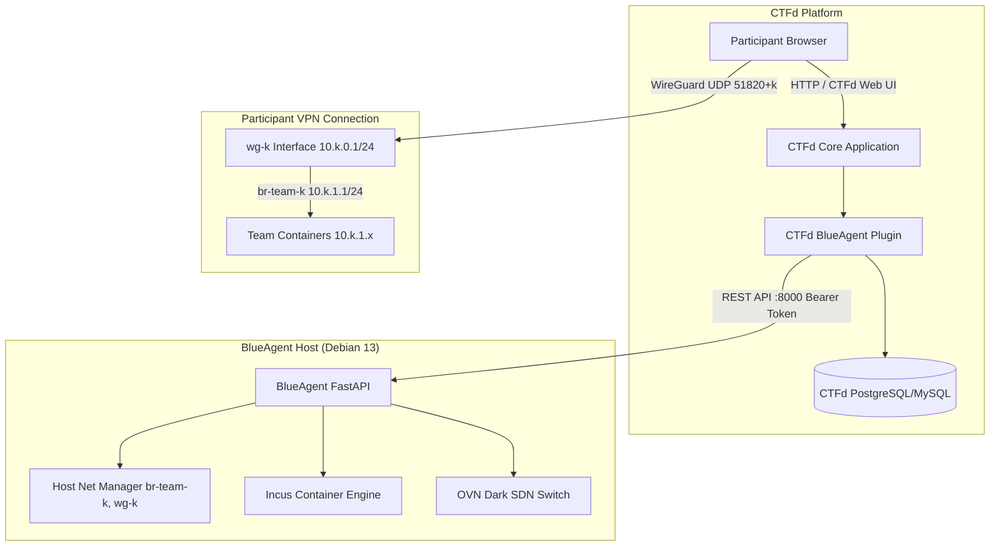

# CTFd Plugin Integration Guide for BlueAgent v2

## 1. Architecture Overview & Division of Responsibilities

CTFd acts as game engine (authentication, scoreboard, challenges, flags, submissions). BlueAgent v2 acts as bare-metal container orchestrator (Incus containers, per-team WireGuard tunnels, Linux bridge networks, dark OVN SDN verification sandboxes).



### Division of Responsibility

| Component | Responsibility |
| :--- | :--- |
| **CTFd Core** | User registration, team management, scoreboard, challenge descriptions, flag validation. |
| **CTFd Plugin** | Bridges CTFd events to BlueAgent REST endpoints, manages team mapping (`ctfd_team_id` <-> `team_k`), provides UI download button for WireGuard configs, coordinates automated service verification. |
| **BlueAgent** | Allocates `10.k.0.0/24` WireGuard VPNs, bridges `br-team-k` (`10.k.1.0/24`), spins Incus containers with static IPs, performs dark OVN sandbox verification via ZFS CoW snapshots. |

---

## 2. Core Plugin Mechanics

### A. Team Subnet Mapping (`team_k`)
BlueAgent uses deterministic integer index `team_k` ($0 \le team\_k \le 254$):
- **WireGuard VPN**: `10.k.0.0/24` (Gateway `10.k.0.1`, Clients `10.k.0.2`–`.254`)
- **Challenge Containers**: `10.k.1.0/24` (Host bridge `10.k.1.1`, Containers `10.k.1.2`–`.254`)

Plugin stores mapping in `blueagent_team_mappings` table.

### B. Lazy WireGuard Provisioning
1. Player clicks "Download VPN" in CTFd.
2. Plugin calls `POST /teams/{team_k}/members`.
3. BlueAgent provisions `wg-k` and `br-team-k` if missing, allocates client IP on `10.k.0.x`, generates Curve25519 keys, registers peer in Linux kernel.
4. Returns `.conf` text. Subsequent requests are idempotent.

### C. On-Demand Container Deployment
1. Admin unlocks challenge or team requests instance.
2. Plugin sends `ChallengeConfig` JSON to `POST /teams/{team_k}/machines`.
3. BlueAgent deploys Incus containers on `br-team-k` with static `10.k.1.<ip_suffix>`.

### D. Automated Dark Verification (SLA / Scoring Checks)
1. Flag submission or periodic SLA checker calls `POST /teams/{team_k}/verificator`.
2. BlueAgent acquires per-team lock (rejects concurrent verify with HTTP 409).
3. ZFS CoW clone created (~100ms), bound to ephemeral dark OVN logical switch.
4. Readiness probes and verification commands run against clones.
5. Strict LIFO cleanup tears down clones and OVN switch. Production containers remain untouched.

---

## 3. CTFd Plugin Directory Structure

```
CTFd/plugins/blueagent/
├── __init__.py               # Plugin entrypoint (load)
├── config.py                 # BlueAgent API client settings
├── client.py                 # HTTP client for BlueAgent REST API
├── models.py                 # SQLAlchemy models (mapping & challenge spec)
├── challenge.py              # Custom BlueAgent Challenge Type (BaseChallenge)
├── routes.py                 # Flask Blueprints (API & user downloads)
├── templates/
│   ├── blueagent_config.html # Admin settings page
│   └── vpn_widget.html       # Player-facing VPN download modal
└── assets/
    └── blueagent.js          # Client-side UI triggers
```

---

## 4. Implementation Code

### 4.1 Client (`client.py`)

```python
import requests
from flask import current_app
from typing import Dict, Any, Optional

class BlueAgentClient:
    def __init__(self, base_url: str = None, token: str = None):
        self.base_url = (base_url or current_app.config.get("BLUEAGENT_URL", "http://127.0.0.1:8000")).rstrip("/")
        self.token = token or current_app.config.get("BLUEAGENT_TOKEN", "")

    @property
    def headers(self) -> Dict[str, str]:
        return {
            "Authorization": f"Bearer {self.token}",
            "Content-Type": "application/json"
        }

    def provision_team(self, team_k: int, name: str) -> requests.Response:
        return requests.post(f"{self.base_url}/teams", json={"team_k": team_k, "name": name}, headers=self.headers, timeout=10)

    def add_team_member(self, team_k: int, ctfd_user_id: int, user_name: str, team_name: str) -> requests.Response:
        return requests.post(
            f"{self.base_url}/teams/{team_k}/members",
            json={"name": user_name, "ctfd_user_id": ctfd_user_id, "team_name": team_name},
            headers=self.headers,
            timeout=15
        )

    def get_peer_telemetry(self, team_k: int) -> requests.Response:
        return requests.get(f"{self.base_url}/teams/{team_k}/peers", headers=self.headers, timeout=5)

    def teardown_team(self, team_k: int) -> requests.Response:
        return requests.delete(f"{self.base_url}/teams/{team_k}", headers=self.headers, timeout=20)

    def deploy_challenge(self, challenge_spec: Dict[str, Any]) -> requests.Response:
        team_k = challenge_spec.get("team_k")
        return requests.post(f"{self.base_url}/teams/{team_k}/machines", json=challenge_spec, headers=self.headers, timeout=60)

    def teardown_challenge(self, team_k: int, challenge_spec: Optional[Dict[str, Any]] = None) -> requests.Response:
        return requests.delete(f"{self.base_url}/teams/{team_k}/machines", json=challenge_spec, headers=self.headers, timeout=30)

    def verify_challenge(self, team_k: int, challenge_spec: Dict[str, Any]) -> requests.Response:
        return requests.post(f"{self.base_url}/teams/{team_k}/verificator", json=challenge_spec, headers=self.headers, timeout=120)
```

### 4.2 Models (`models.py`)

```python
from CTFd.models import db, Challenges
import json

class BlueAgentTeamMapping(db.Model):
    __tablename__ = "blueagent_team_mappings"
    id = db.Column(db.Integer, primary_key=True)
    ctfd_team_id = db.Column(db.Integer, unique=True, nullable=False)
    team_k = db.Column(db.Integer, unique=True, nullable=False)

    @classmethod
    def get_or_create(cls, ctfd_team_id: int) -> int:
        record = cls.query.filter_by(ctfd_team_id=ctfd_team_id).first()
        if record:
            return record.team_k
        used_slots = {r.team_k for r in cls.query.all()}
        for candidate in range(1, 255):
            if candidate not in used_slots:
                new_map = cls(ctfd_team_id=ctfd_team_id, team_k=candidate)
                db.session.add(new_map)
                db.session.commit()
                return candidate
        raise RuntimeError("Capacity exceeded (max 254 teams)")

class BlueAgentChallengeModel(Challenges):
    __mapper_args__ = {"polymorphic_identity": "blueagent"}
    id = db.Column(db.Integer, db.ForeignKey("challenges.id", ondelete="CASCADE"), primary_key=True)
    challenge_spec = db.Column(db.Text, default="{}")

    def get_spec(self):
        return json.loads(self.challenge_spec or "{}")

    def set_spec(self, data):
        self.challenge_spec = json.dumps(data)
```

### 4.3 Custom Challenge Class (`challenge.py`)

```python
from CTFd.plugins.challenges import BaseChallenge
from CTFd.models import db, Challenges, Flags
from CTFd.utils.user import get_current_team
from .models import BlueAgentChallengeModel, BlueAgentTeamMapping
from .client import BlueAgentClient

class BlueAgentChallengeType(BaseChallenge):
    id = "blueagent"
    name = "blueagent"
    challenge_model = BlueAgentChallengeModel

    @classmethod
    def attempt(cls, challenge, request):
        data = request.form or request.get_json()
        submission = data.get("submission", "").strip()

        team = get_current_team()
        if not team:
            return False, "Player must be on team"

        team_k = BlueAgentTeamMapping.get_or_create(team.id)
        client = BlueAgentClient()

        spec = challenge.get_spec()
        spec["team_k"] = team_k
        spec["challenge_id"] = f"chal-{challenge.id}"

        verify_resp = client.verify_challenge(team_k=team_k, challenge_spec=spec)
        if verify_resp.status_code == 409:
            return False, "Verification in progress. Wait."
        if verify_resp.status_code != 200 or not verify_resp.json().get("passed", False):
            return False, "Service verification failed."

        flags = Flags.query.filter_by(challenge_id=challenge.id).all()
        for flag in flags:
            if flag.content == submission:
                return True, "Correct Flag! Challenge verified and solved."

        return False, "Incorrect Flag."
```

### 4.4 Routes (`routes.py`)

```python
from flask import Blueprint, jsonify, Response, abort
from CTFd.utils.user import get_current_user, get_current_team
from CTFd.utils.decorators import authed_only, admins_only
from .models import BlueAgentTeamMapping
from .client import BlueAgentClient

blueagent_bp = Blueprint("blueagent", __name__, template_folder="templates")

@blueagent_bp.route("/api/v1/plugins/blueagent/vpn/download", methods=["GET"])
@authed_only
def download_vpn():
    user = get_current_user()
    team = get_current_team()
    if not team:
        return jsonify({"success": False, "error": "No team"}), 400

    team_k = BlueAgentTeamMapping.get_or_create(team.id)
    client = BlueAgentClient()

    resp = client.add_team_member(team_k=team_k, ctfd_user_id=user.id, user_name=user.name, team_name=team.name)
    if resp.status_code not in (200, 201):
        return jsonify({"success": False, "error": "VPN provision failed"}), 500

    config_text = resp.json().get("config_text")
    return Response(
        config_text,
        mimetype="text/plain",
        headers={"Content-Disposition": f"attachment;filename=team-{team_k}-{user.name}.conf"}
    )
```

### 4.5 Entrypoint (`__init__.py`)

```python
from CTFd.plugins import register_plugin_assets_directory
from CTFd.plugins.challenges import CHALLENGE_CLASSES
from .challenge import BlueAgentChallengeType
from .routes import blueagent_bp

def load(app):
    app.db.create_all()
    CHALLENGE_CLASSES["blueagent"] = BlueAgentChallengeType
    app.register_blueprint(blueagent_bp)
    register_plugin_assets_directory(app, base_path="/plugins/blueagent/assets/")
```
